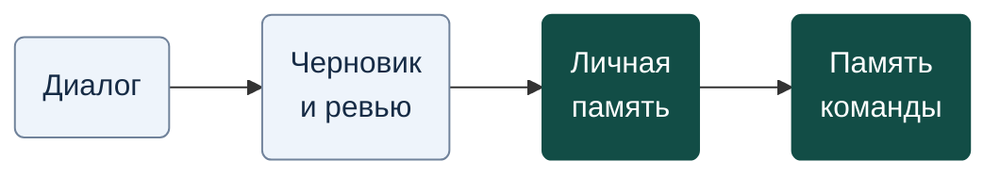

# Command Agent Memory

Command Agent Memory читает историю работы с агентом и готовит обновление памяти проекта. Из диалога можно сохранить, например, соглашение о коде в `CLAUDE.md` или определение метрики в командном справочнике. Изменения проходят ревью в рабочей копии. В командную память попадают только отобранные знания.

[Установка](#установка) · [Архитектура](docs/architecture/project-structure.md) · [Выпуск 0.3.0rc3](https://github.com/Viacheslav-hub-blip/comand_agent_memory/releases/tag/v0.3.0rc3) · [Лицензия MIT](LICENSE)



## Правило из диалога в JSONL

> Для функций проекта нужны русские docstrings с описанием входов и результатов.

Так выглядит первая реплика в учебном журнале. В нём одна сессия и два сообщения. Файл `memory/CLAUDE.md` содержит общие инструкции проекта. В конфигурации он указан как место для личных правил, а каталог `notes` отведён под знания. [Журнал диалога](docs/examples/jsonl_to_file_memory/conversation_events.jsonl) · [Исходный CLAUDE.md](docs/examples/jsonl_to_file_memory/memory/CLAUDE.md) · [Конфигурация](docs/examples/jsonl_to_file_memory/memory_pipeline.json).

Чтобы проверить подключение, выполните команду из корня репозитория с Python 3.11 или новее. Ключ API для этой проверки не нужен.

```powershell
python -X utf8 -m command_agent_memory --config docs/examples/jsonl_to_file_memory/memory_pipeline.json --validate-only --json
```

CLI прочитает журнал и выведет `"state": "validated"` и `"sessions": 1`. Флаг `--validate-only` завершает работу до вызова модели и записи в память.

## Демо «Маяк»

> По таблице inputs/payments.csv рассчитай L7 для проекта «Маяк» и запиши расчёт и итог в result.md.

В этом проекте L7 считают по проведённым платежам. Из суммы оплат (150) вычитают сумму возвратов (50). Платёж на 70 со статусом `pending` пропускают. Пользователь объяснил формулу в прошлом диалоге, а для проверки дал агенту новую таблицу. [Исходный диалог](docs/examples/portable_replay/history.jsonl) · [Платежи](docs/examples/portable_replay/inputs/payments.csv) · [Эталон отчёта](docs/examples/portable_replay/reference/answer.md).

В режиме replay одну задачу решают две новые сессии одного агента. У первой прежняя память, у второй в `AGENTS.md` уже есть формула. Вот что получилось в прогоне 21 ноября 2026 года.

| | С прежней памятью | С обновлённой памятью |
| --- | --- | --- |
| Откуда взялась формула | Пользователь ответил на уточнение | Агент прочитал `AGENTS.md` |
| Реплики пользователя | 2 | 1 |
| Вызовы модели рабочего агента | 7 | 5 |
| Время работы агента | 14,40 с | 14,66 с |
| Итог в `result.md` | 100 | 100 |

Проверить входные данные для replay можно локально. Для повторения самого опыта потребуется модель. [Команды запуска и полные измерения](docs/examples/portable_replay/README.md).

```powershell
python -X utf8 -m command_agent_memory --config docs/examples/portable_replay/memory_pipeline.example.json --validate-only --evaluate-by-replay --json
```

## Командная память в проекте «Ладога»

Один аналитик объяснил своему агенту, как считать свободный лимит: из общего лимита вычитают занятый лимит и технический резерв. После ревью определение попало в командный справочник. Второй аналитик попросил выполнить расчёт на новых числах, опустив формулу.

Агент открыл статью в `team_knowledge/`, посчитал **137 − 29 − 11 = 97 тыс. руб.** и сослался на источник. В контрольном запуске с теми же личными инструкциями и без командного справочника агент попросил уточнить определение. [Конфигурация и результаты опыта](docs/examples/team_memory_transfer.md).

## Установка

Для обоих способов нужен Python 3.11 или новее.

- **В агентном клиенте.** Распакуйте все десять папок из архива в каталог скиллов клиента. В Codex это `.agents/skills/` проекта. Попросите агента настроить память через `agent-memory-setup`, затем обработать последний диалог через `agent-memory-cycle`. [Скачать скиллы](https://github.com/Viacheslav-hub-blip/comand_agent_memory/releases/download/v0.3.0rc3/agent-memory-skills-with-setup.zip).
- **В терминале.** Из корня репозитория выполните `python -m pip install -e .`. В `memory_pipeline.json` укажите источник истории, модель и пути к документам памяти. CLI поддерживает Codex и OpenRouter. [Настройка CLI](docs/usage.md#установка-и-запуск).

Чтобы запускать Python-конвейер из клиента и поручать отдельные этапы его субагентам, установите [комплект update-agent-memory](https://github.com/Viacheslav-hub-blip/comand_agent_memory/releases/download/v0.3.0rc3/update-agent-memory-with-setup.zip). [Проверенные клиенты и режимы](docs/usage.md#проверенные-клиенты-и-режимы).

## Документация

- [Как устроены ревью, replay и публикация памяти](docs/architecture/data-flow.md)
- [Подключение источников истории и хранилищ](docs/configuring_agents_and_databases.md) · [Контракты адаптеров](docs/adding_integrations.md)
- [Доставка командной памяти через Git](docs/git_team_memory.md)
- [Тесты и сборка](docs/usage.md#проверки-и-сборка) · [Спецификация жизненного цикла](specifications/memory_lifecycle.md)
