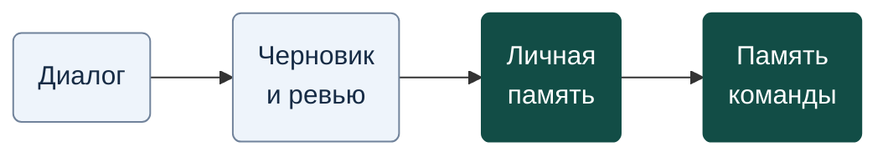

# Command Agent Memory

Пользователь один раз объясняет агенту, как считать метрику. В следующем чате агент уже знает формулу. Command Agent Memory извлекает такие знания из диалогов, проверяет их и сохраняет для будущих задач пользователя и его команды.

[Демо «Маяк»](#демо-маяк) · [Установка](#установка) · [Архитектура](docs/architecture/project-structure.md) · [Выпуск 0.3.0rc3](https://github.com/Viacheslav-hub-blip/comand_agent_memory/releases/tag/v0.3.0rc3) · [Лицензия MIT](LICENSE)



Ревьюер сверяет черновик с диалогом. При включённом **replay** два свежих экземпляра одного агента решают одну задачу с прежней и предложенной памятью. Оценщик сравнивает ответы и созданные файлы. При отклонении изменений действующей остаётся прежняя версия. [Полная схема с условиями публикации](docs/architecture/data-flow.md).

## Демо «Маяк»

> По таблице inputs/payments.csv рассчитай L7 для проекта «Маяк» и запиши расчёт и итог в result.md.

В предыдущем диалоге пользователь уже определил L7 для своего проекта. На новой выборке было 150 единиц оплаченных платежей и 50 единиц возвратов. Платежи в ожидании в расчёт не входили. Ниже — результат одного контрольного прогона 21 ноября 2026 года.

| Что произошло | С прежней памятью | С предложенной памятью |
| --- | --- | --- |
| Откуда агент узнал формулу | Уточнил у пользователя | Прочитал в `AGENTS.md` |
| Реплики пользователя | 2 | **1** |
| Вызовы модели рабочего агента | 7 | **5** |
| Итог в `result.md` | 100 | **100** |

В этом примере память сэкономила одно уточнение. Время работы агента было почти одинаковым — 14,40 и 14,66 секунды. [Исходный диалог](docs/examples/portable_replay/history.jsonl) · [Таблица платежей](docs/examples/portable_replay/inputs/payments.csv) · [Эталон](docs/examples/portable_replay/reference/answer.md) · [Все измерения и повторение опыта](docs/examples/portable_replay/README.md).

### Попробовать без ключа API

Из корня скачанного репозитория выполните команду с Python 3.11 или новее. Она проверит, что CLI читает учебную историю и находит материалы для обоих запусков.

```powershell
python -X utf8 -m command_agent_memory --config docs/examples/portable_replay/memory_pipeline.example.json --validate-only --evaluate-by-replay --json
```

В итоговом JSON вы увидите `"state": "validated"` и `"sessions": 1`. Это проверка входов. Для работы с моделью скопируйте пример в отдельную папку и запустите его по [инструкции к replay](docs/examples/portable_replay/README.md).

## Установка

| Как будете запускать | С чего начать |
| --- | --- |
| **Из агентного клиента** | Распакуйте все десять папок архива в каталог скиллов клиента. Для Codex это `.agents/skills/` проекта. Попросите агента настроить проект через `agent-memory-setup`, затем обновить память по последнему диалогу через `agent-memory-cycle`. [Скачать скиллы](https://github.com/Viacheslav-hub-blip/comand_agent_memory/releases/download/v0.3.0rc3/agent-memory-skills-with-setup.zip). |
| **Из Python или терминала** | Из корня репозитория выполните `python -m pip install -e .`. Укажите источник истории и пути памяти в `memory_pipeline.json`. CLI поддерживает Codex и OpenRouter. [Установка и конфигурация](docs/usage.md#установка-и-запуск). |

Для обоих вариантов нужен Python 3.11+. Если клиент должен передавать модельные этапы своим субагентам через Python-конвейер, используйте комплект [update-agent-memory с настройкой](https://github.com/Viacheslav-hub-blip/comand_agent_memory/releases/download/v0.3.0rc3/update-agent-memory-with-setup.zip). [Проверенные клиенты и режимы](docs/usage.md#проверенные-клиенты-и-режимы).

## Материалы доклада

| Что хотите посмотреть | Куда перейти |
| --- | --- |
| Как диалог превращается в память | [Текст доклада](docs/aij_talk.md) · [Скачать интерактивную схему для показа без сети (HTML)](https://github.com/Viacheslav-hub-blip/comand_agent_memory/releases/download/v0.3.0rc3/agent-memory-architecture.html) |
| Что получает другой участник команды | [Сквозной пример](docs/examples/full_memory_cycle.md) · [Доставка через Git](docs/git_team_memory.md) |
| Как подключить своего агента или хранилище | [Источники и настройки](docs/configuring_agents_and_databases.md) · [Контракты адаптеров](docs/adding_integrations.md) |
| Как проверить и собрать проект | [Команды тестирования и сборки](docs/usage.md#проверки-и-сборка) · [Спецификация жизненного цикла](specifications/memory_lifecycle.md) |

[QR-код на репозиторий для последнего слайда](docs/project-qr.png)
