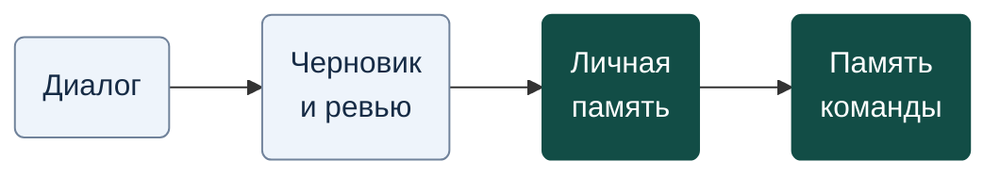

# Command Agent Memory

Command Agent Memory читает историю работы с агентом и готовит обновление памяти проекта. Изменения проходят ревью в рабочей копии. В командную память попадают только отобранные знания.

[Установка](#установка) · [Архитектура](docs/architecture/project-structure.md) · [Выпуск 0.3.0rc3](https://github.com/Viacheslav-hub-blip/comand_agent_memory/releases/tag/v0.3.0rc3) · [Лицензия MIT](LICENSE)

## Установка

Для обоих способов нужен Python 3.11 или новее.

- **В агентном клиенте.** Распакуйте все десять папок из архива в каталог скиллов клиента. В Codex это `.agents/skills/` проекта. Попросите агента настроить память через `agent-memory-setup`, затем обработать последний диалог через `agent-memory-cycle`. [Скачать скиллы](https://github.com/Viacheslav-hub-blip/comand_agent_memory/releases/download/v0.3.0rc3/agent-memory-skills-with-setup.zip).
- **В терминале.** Из корня репозитория выполните `python -m pip install -e .`. В `memory_pipeline.json` укажите источник истории, модель и пути к документам памяти. CLI поддерживает Codex и OpenRouter. [Настройка CLI](docs/usage.md#установка-и-запуск).

Чтобы запускать Python-конвейер из клиента и поручать отдельные этапы его субагентам, установите [комплект update-agent-memory](https://github.com/Viacheslav-hub-blip/comand_agent_memory/releases/download/v0.3.0rc3/update-agent-memory-with-setup.zip). [Проверенные клиенты и режимы](docs/usage.md#проверенные-клиенты-и-режимы).

## Документация

- [Как устроены ревью, replay и публикация памяти](docs/architecture/data-flow.md)
- [Подключение источников истории и хранилищ](docs/configuring_agents_and_databases.md) · [Контракты адаптеров](docs/adding_integrations.md)
- [Доставка командной памяти через Git](docs/git_team_memory.md)
- [Тесты и сборка](docs/usage.md#проверки-и-сборка) · [Спецификация жизненного цикла](specifications/memory_lifecycle.md)
