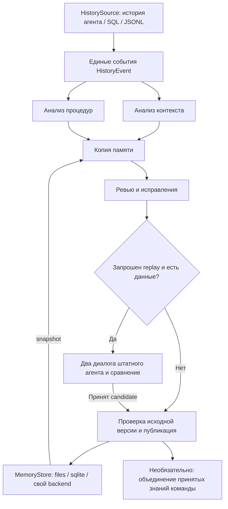

# Command Agent Memory

Отдельное приложение для обновления личной и командной памяти AI-агентов.
Оно подключается к внешним логам и выбранным документам через конфигурацию;
установка в проект рабочего агента не требуется. Приложение читает историю работы,
выделяет контекст и процедуры, готовит изменения памяти в копии, проверяет их
ревьюером и публикует принятую версию. При наличии сценария можно проверить
память повторным решением задачи.

История, модели этапов и хранилище памяти подключаются независимо.
Другой агент или база добавляется адаптером; менять конвейер не требуется.

## Установка и запуск

Требуется Python 3.11 или новее. Из каталога проекта:

```powershell
python -m venv .venv
.venv\Scripts\Activate.ps1
python -m pip install -e .
python -m command_agent_memory --config docs/examples/jsonl_to_file_memory/memory_pipeline.json --validate-only
```

Базовый пакет работает без сторонних Python-библиотек. Для исполнения через
Codex нужен отдельно установленный и авторизованный Codex CLI.
Для OpenRouter и диалоговой проверки:

```powershell
python -m pip install -e ".[openrouter,replay]"
$env:OPENROUTER_API_KEY = "ваш ключ"
```

Для сжатых историй `.jsonl.zst` установите дополнение `.[zstandard]`.
Драйвер внешней SQL-базы устанавливается отдельно.

Для replay явно задайте штатную фабрику рабочего агента в поле `agent` сценария.
Она сохраняет его модель, инструменты и права. Встроенная общая сборка находится
в `command_agent_memory.working_agent`; её использует также обычное приложение.
Сравниваются два свежих запуска с прежней и предложенной памятью.

Пример поля `agent` в replay-сценарии для встроенного рабочего агента:

```json
"agent": {
  "factory": "command_agent_memory.working_agent:create_session",
  "options": {
    "model": "YOUR_WORKER_MODEL_ID",
    "model_parameters": {"temperature": 0}
  }
}
```

Для внешнего агента укажите его собственную фабрику, которая создаёт независимую
сессию с исходными инструментами и настройками. Формат истории не восстанавливает
инструменты автоматически. Несовпадение профилей двух сессий блокирует сравнение.
Docker не требуется. Локальный shell сохраняет права пользователя; рабочая копия
файлов не ограничивает доступ к ОС. Подключение к внешним ресурсам и подготовку
их состояния для каждого прогона обеспечивает фабрика.

У проекта одна команда:

```powershell
command-agent-memory --config memory_pipeline.json --validate-only
command-agent-memory --config memory_pipeline.json
command-agent-memory --config memory_pipeline.json --evaluate-by-replay
```

Те же параметры принимает `python -m command_agent_memory`.
`--validate-only` проверяет входы без моделей и записи памяти.
Рабочий запуск обращается к выбранным моделям и публикует принятый результат.
Пользовательские расширения выполняются как доверенный Python-код, включая импорт
при validate-only; их автор должен соблюдать договор о чтении без записи.

## Конфигурация

```json
{
  "defaults": {"provider": "codex", "model": "YOUR_MODEL_ID"},
  "users": [
    {
      "user_id": "alice",
      "workspace": "./runs/alice",
      "source": {"type": "jsonl", "path": "./conversation_events.jsonl"},
      "memory": {
        "type": "files",
        "root": "./agent-project",
        "personal": ["AGENTS.md"],
        "knowledge": ["notes"]
      }
    }
  ]
}
```

Замените `YOUR_MODEL_ID` на доступную вам модель. Все относительные пути считаются
от каталога конфигурации. `conversation_events.jsonl` содержит один объект на строку:

```jsonl
{"id":"1","session_id":"chat-1","role":"user","content":"Пиши документацию на русском."}
{"id":"2","session_id":"chat-1","role":"assistant","content":"Принято."}
```

Память можно хранить в SQLite, заменив блок `memory`:

```json
"memory": {
  "type": "sqlite",
  "path": "./memory/alice.db",
  "personal": ["AGENTS.md"],
  "knowledge": ["notes"]
}
```

В SQLite используется таблица `memory_documents(path, content)`.
Конвейер работает с локальной копией документов и сохраняет результат в БД.
Чтение этой БД самим рабочим агентом подключается средствами его SDK.
Для агентов, читающих файлы инструкций, используйте файловую память.

Модели отдельных этапов переопределяются через `stages`; `wishes_file` добавляет
общие пожелания к каждому запросу. Ключи передавайте через окружение.
Необязательные локальные настройки находятся в `local_settings/agent_settings.py`;
пример — `local_settings/agent_settings.example.py`. Этот файл не входит в пакет и Git.

Для собственного подключения скопируйте `memory_pipeline.example.json` в
`memory_pipeline.json` и замените модель, `USER_ID` и внешние пути. Поле
`users[].workspace` задаёт каталог обработки приложения, например `./runs/USER_ID`;
действующая файловая память агента задаётся через `memory.root`. Локальная
конфигурация и `runs/` исключены из Git. Шаблон не запускается до подстановки
ваших путей к истории и памяти.

## Схема работы



При нехватке replay-данных сохраняется `skipped`: память принимается по ревью.
При выполненном replay публикация требует выбора `candidate`.
Ревью по умолчанию ограничено 300 секундами и 24 вызовами OpenRouter;
исчерпание бюджета сохраняет прежнюю память. Параметры задаются в `stages.review`
через `timeout_seconds` и `max_model_calls` (для Codex — только время).
У консолидаторов OpenRouter файловые инструменты разрешают запись только в область
текущего этапа; shell при этом отключён. Встроенные исполнители передают описание фактической ОС
и рабочего каталога. Подробнее — в руководстве по настройке.
`"team":{"root":"./shared-memory"}` включает командное объединение знаний;
личные правила в него не передаются. Командная память публикуется в файлы.
Для локальной доставки добавьте `"workspaces":["./agent-b"]` в `team`.
Каталоги получателей должны существовать; в каждом обновляется `team_knowledge/`.
Относительные пути считаются от конфигурации. Доставка выполняется после принятия
командной версии, включая повторный запуск без новой консолидации. Запускайте её
между задачами рабочего агента: несколько файлов не заменяются атомарно для читателя.
DeepAgents-агент из этого пакета подключает командный индекс и skills при создании;
для других агентов способ подключения задаётся отдельно.

Файловая публикация сохраняет backup и устойчивый журнал, восстанавливается после
остановки процесса до следующего чтения через хранилище и сохраняет внешние правки
при откате. `read_session()` фиксирует память на время задачи. Независимого читателя
нужно останавливать между задачами: несколько файлов не меняются одной операцией ОС.
SQLite-публикация выполняется одной транзакцией с проверкой исходного снимка.
Неизменные принятые результаты используются повторно.
Версии встроенных `SKILL.md` и `references/` входят в отпечаток запуска;
изменение инструкций отменяет повторное использование результата.

Командный реестр `.registry/state.json` сохраняет источники, версии и основания
решений. Действующая память и доставка включают только `accepted`; кандидаты
`pending` и несовместимые утверждения `conflicts` остаются в реестре.
Консолидатор возвращает решения по знаниям, приложение проверяет их и публикует
документы. Числовой порог подтверждений не вводится.
Формат, переходы и перенос прежней памяти: [командный реестр](docs/team_memory_registry.md).

## Что поддерживается

| Область | Встроено | Расширение |
| --- | --- | --- |
| История | Claude Code, Codex rollout, GigaAgent/LangGraph, Phoenix, JSONL, SQLite | `HistorySource` |
| SQL-история | DB-API драйвер, свой SELECT и параметры | Драйвер БД; для NoSQL — собственный источник |
| Модели | Codex CLI, OpenRouter | `ModelAdapter` |
| Память | Файлы/каталоги, SQLite | `MemoryStore` |

Для произвольной системы нужен адаптер или поддерживаемый экспорт.
Автоматического распознавания любого агента или базы нет.

## Структура

```text
command_agent_memory/
  __main__.py                       # параметры командной строки
  application_config.py             # настройки экземпляра и пути
  working_agent.py                  # общая сборка рабочего DeepAgents-агента
  worker_agents.py                  # подключение фабрики и сравнение профилей
  memory_pipeline.py                # последовательность обработки памяти
  skill_resources.py                # поиск и чтение встроенных инструкций
  run_reports.py                    # каталоги запусков и отчёты этапов
  history_sources/                  # получение внешней истории
    conversation_history.py         # общий формат и встроенные источники
    sql_history_source.py           # чтение SQL через внешний драйвер
  history_analysis/                 # извлечение сведений из истории
    session_analysis.py             # анализ контекста и процедур
    analysis_reports.py             # чтение и версии результатов анализа
  model_execution/                  # выполнение модельных заданий
    provider_registry.py            # контракт и выбор исполнителя
    stage_runner.py                 # модель, пожелания и запуск этапа
    codex_cli.py                    # запуск через Codex CLI
    openrouter_api.py               # вызовы OpenRouter
    local_shell.py                  # файловые инструменты и команды
  memory_update/                    # подготовка и принятие изменений
    personal_memory_update.py        # полный цикл памяти человека
    team_memory_update.py            # объединение командных знаний
    memory_proposal.py               # предложение в рабочей копии
    memory_review.py                 # проверка и исправление предложения
  memory_storage/                   # документы памяти и их публикация
    memory_layout.py                # состав и назначение документов
    storage_registry.py             # контракт и выбор хранилища
    file_storage.py                 # файловое хранение и публикация
    file_transaction.py             # журнал, откат и восстановление публикации
    sqlite_storage.py               # транзакционная публикация SQLite
    memory_snapshots.py             # чтение и запись рабочих снимков
    memory_locking.py               # блокировки одновременного обновления
    team_registry.py                # источники, версии, состояния командных знаний
  team_memory_delivery/              # доставка опубликованной памяти
    local_copy.py                    # доставка в настроенные рабочие каталоги
  memory_replay/                     # проверка повторным решением задачи
    replay_scenario.py               # сценарий, реплики и входные данные
    replay_agent.py                  # журнал сообщений рабочего агента
    dialogue_runner.py               # диалог с тестировщиком
    replay_evaluation.py             # прогон и сравнение результатов
  skills/                            # встроенные инструкции этапов
memory_pipeline.example.json         # шаблон внешних подключений
runs/                                # локальные результаты, если настроены
docs/                                # руководства и описание структуры
tests/                               # автоматические проверки
```

Назначение каждого файла и таблица переноса импортов:
[Устройство приложения](docs/project_structure.md).

`memory_update` использует `memory_storage` для снимков и публикации.
Модули хранения не зависят от модельного цикла обновления. Локальная доставка
командной памяти выделена отдельно; Git-транспорт пока не реализован.

Каждый скил содержит `SKILL.md` с полями `name` и `description`; `name` совпадает
с именем каталога и использует строчные буквы и дефисы. Дополнительные материалы
располагаются в `references/` соответствующего скила. Загрузчик
`get_skill_path(name, resource="SKILL.md")` разрешает пути внутри выбранного пакета.
Встроенные скилы включаются в wheel и доступны после установки приложения.

Структура соответствует [Agent Skills](https://agentskills.io/specification)
и [формату скилов Hermes](https://hermes-agent.nousresearch.com/docs/user-guide/features/skills).
В Hermes основной пользовательский каталог — `~/.hermes/skills/`, проектные каталоги —
`.hermes/skills/` и `.agents/skills/`. Наши встроенные пакеты можно подключить через
`skills.external_dirs`, указав абсолютный путь к `command_agent_memory/skills`.
Это отдельная настройка Hermes; конвейер загружает скилы своим загрузчиком.

- [Настройка источников и этапов](docs/configuring_agents_and_databases.md).
- [Контракты и добавление адаптеров](docs/adding_integrations.md).
- [Диалоговая проверка](docs/evaluating_memory_with_replay.md).
- [Права replay и восстановление файловой публикации](docs/publication_and_replay_safety.md).
- [Сквозной локальный опыт: личная память → replay → команда → другой агент](docs/examples/full_memory_cycle.md).
- [Запуск в PyCharm](docs/running_in_pycharm.md).

Исторический код и исследовательские документы сохранены одним архивом в
`project_archives/research-code-before-final-cleanup.zip` и не входят в рабочий пакет.
`data/`, `tmp/` и другие локальные результаты не являются исходным кодом пакета.

## Проверки и сборка

```powershell
python -X utf8 -m unittest discover -s tests
python -m pip wheel . --no-deps --wheel-dir dist
```

Модельные этапы в тестах используют имитации. Доступ к вашим моделям,
внешним серверам и конкретным SQL-драйверам проверяется в вашем окружении.
Перед применением к новому рабочему агенту проверьте полный путь: получение его
истории → обновление памяти → применение памяти в новой задаче. Реальный опыт
с DeepSeek проводился до последней замены архитектуры replay; текущая версия
требует повторной проверки с настоящей моделью и фабрикой выбранного агента.


Каталоги с короткими служебными названиями не содержат реализацию конвейера:

| Каталог | Что находится внутри |
| --- | --- |
| knowledge/ | Сохранённые знания проекта: wiki, случаи и skills |
| data/ | Результаты локальных запусков |
| conversation_history/ | Локальные выгрузки диалогов |
| user_workspace/ | Рабочие файлы локального агента |
| large_tool_results/ | Сохранённые объёмные ответы инструментов |
| tmp/ | Временные файлы и проверки |
| build/, *.egg-info/ | Автоматические результаты сборки Python-пакета |
| .venv/, __pycache__/, .pytest_cache/ | Окружение Python и кэш |
