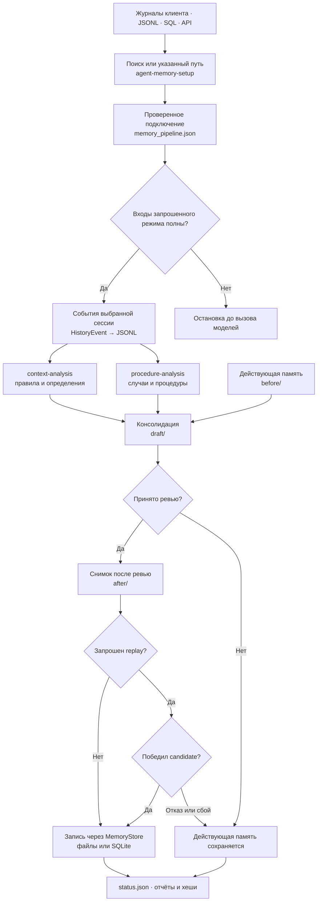
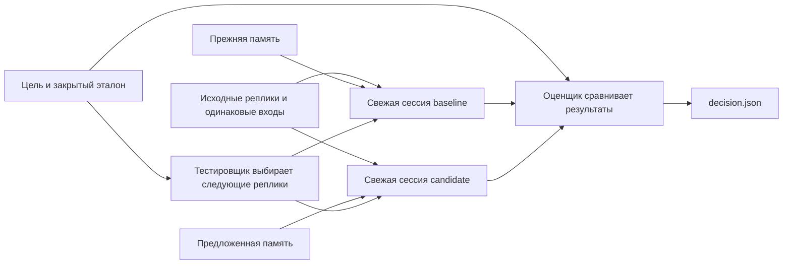
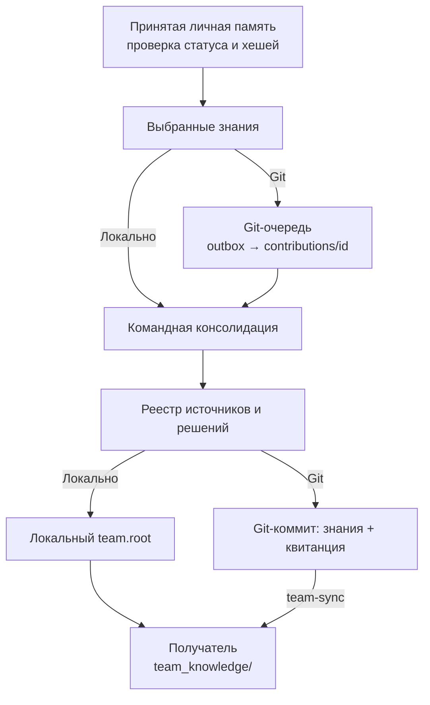

# Движение и обработка данных

Схема показывает путь истории до личной и командной памяти и контрольные точки
публикации. Функций и классов в документе нет.

## Личная память

Для явно запрошенного replay входы проверяются до модельной обработки.
Ревью и сравнение используют тот же снимок `after/`, который затем записывается.
Перед записью проверяется, что исходная память соответствует `before/`.

| Данные | Где искать |
| --- | --- |
| Исходная история и отчёты сессии | В CLI и мосте — `analysis-runs/` и `raw/chat-reports-*/session-*/`. В автономном скилле — `skill-runs/<id>/personal/history/` и ссылки в `stages.json`. |
| Снимки и итог личного запуска | `consolidation-runs/<id>/personal/` или `skill-runs/<id>/personal/`. Внутри находятся `before/`, `draft/`, `after/` и `status.json`. |
| Действующая память проекта | Пути из `memory.personal` и `memory.knowledge`, для файлового режима обычно `AGENTS.md` или `CLAUDE.md` и `.agent-memory/knowledge/`. |

## Проверка replay

Перед запуском сравниваются модель, параметры, инструкции, инструменты и среда
двух независимых сессий. Оценщик получает ответы, созданные файлы и доступные
метрики. Публикация требует решения `candidate`.

## Командная память

В `team_knowledge/` попадают действующий индекс и принятые документы.
Записи `pending` и `conflicts` сохраняются в реестре. В Git-режиме получатель
фиксирует SHA доставленного снимка и контрольные суммы файлов.

[Структура проекта](project-structure.md) · [Руководство по replay](../evaluating_memory_with_replay.md) · [Настройка Git-доставки](../git_team_memory.md)
