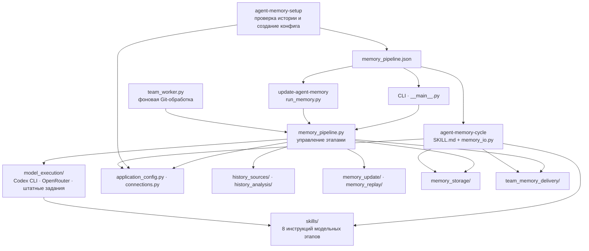

# Структура Command Agent Memory

Схема показывает точки входа, состав скиллов и ответственность модулей.
Функций и классов в документе нет.

| Путь | Назначение |
| --- | --- |
| [`.agents/skills/agent-memory-setup/`](../../.agents/skills/agent-memory-setup/) | Поиск и проверка источника. Сохранение `memory_pipeline.json` после чтения истории. |
| [`.agents/skills/agent-memory-cycle/`](../../.agents/skills/agent-memory-cycle/) | Ведущий агент назначает модельные этапы штатным субагентам. Скрипты выполняют операции с данными и проверяют материалы этапов. |
| [`.agents/skills/update-agent-memory/`](../../.agents/skills/update-agent-memory/) | Запускает Python-конвейер и передаёт задания штатным субагентам через `task.json` и `reply.json`. |
| [`command_agent_memory/history_sources/`](../../command_agent_memory/history_sources/) | Читает историю Codex, Claude Code, GigaAgent, Phoenix, JSONL и SQL. `project_sessions.py` заново находит текущую сессию проекта при каждом запуске с `latest_in_project`. |
| [`command_agent_memory/history_analysis/`](../../command_agent_memory/history_analysis/) | Для каждой сессии готовит отчёты о контексте и процедурах и переиспользует их при совпадении входов. |
| [`command_agent_memory/model_execution/`](../../command_agent_memory/model_execution/) | Выбирает исполнителя, передаёт задание и ведёт журнал вызовов. |
| [`command_agent_memory/memory_update/`](../../command_agent_memory/memory_update/) | Создаёт черновик личной памяти, запускает ревью и собирает командное предложение. |
| [`command_agent_memory/memory_replay/`](../../command_agent_memory/memory_replay/) | Сценарий, две свежие сессии, сбор трасс и принятие результата сравнения. |
| [`command_agent_memory/memory_storage/`](../../command_agent_memory/memory_storage/) | Снимки и публикация файлов или SQLite. Сюда же входит реестр командных знаний. |
| [`command_agent_memory/team_memory_delivery/`](../../command_agent_memory/team_memory_delivery/) | Вклад, очередь, Git-коммит, квитанция и синхронизация снимка. |
| [`scripts/build_memory_skill.py`](../../scripts/build_memory_skill.py) | Собирает два ZIP со скиллом настройки. |
| [`docs/examples/`](../examples/) · [`tests/`](../../tests/) | Синтетические входы, сценарии replay и тесты. |

[Подробная карта файлов](../project_structure.md) · [Движение и обработка данных](data-flow.md)
