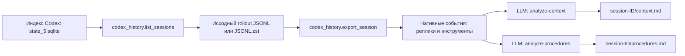

# Чтение диалогов Codex

Адаптер `codex_history.py` читает локальный индекс `state_5.sqlite` только для
чтения. Проект выбирается по имени каталога `cwd`, количество диалогов задаётся
отдельно для каждого проекта. Учитываются также архивные диалоги.

Поддерживаются исходные `.jsonl` и `.jsonl.zst`. Для Zstandard требуется пакет
`zstandard`. В текущем окружении он уже есть в Python проекта `deepagent`.
SQLite и формат логов являются внутренними форматами установленной версии Codex;
адаптер может потребовать обновления при изменении этих форматов.

```powershell
C:/Users/Slav4ik/PycharmProjects/deepagent/.venv/Scripts/python.exe analyze_chats_codex.py --user-id slav4ik --workspace data/codex-real-dialogues/slav4ik --source codex --project jev_test --project offzone --limit-per-project 2
```

`--validate-only` показывает список, не запуская анализаторы.
`--codex-home` позволяет указать другой каталог Codex.

Адаптер сохраняет выбранные события в журнал запуска, не создавая промежуточную
базу чатов. Поля событий `session_meta`, `compacted` и `response_item`
сохраняются без преобразований, кроме исключения `reasoning`. Телеметрия и
дублирующие `event_msg` исключаются. Тексты сообщений, вызовы инструментов,
аргументы и результаты инструментов не сокращаются.

Каждый диалог получает два независимых процесса анализа с существующими skills:



Отчёты находятся в `data/codex-real-dialogues/slav4ik/raw/chat-reports-codex/`.
В `manifest.json` диалога записывается выбранный исходный путь и проект.
Консолидация этой командой не запускается. Прежний режим SQLite остаётся
режимом по умолчанию.

## Личная консолидация и HTML

После завершения всех анализов:

```powershell
python consolidate_reports_codex.py --user-id slav4ik --workspace data/codex-real-dialogues/slav4ik --stage personal
```

Личный этап запускает два консолидатора и ревьюера. Результат сохраняется в
`AGENTS.md`, `USER_PREFERENCES.md`, `user_llm_wiki/`, `knowledge/` указанной области.
В каталоге запуска есть снимки `before`, `before-review`, `after` и решение ревьюера.

Страница фактического прогона 24 октября:

```powershell
python build_memory_viewer.py --workspace data/codex-real-dialogues/slav4ik --consolidation-run data/consolidation-runs/20261024T102835638077-de5ee965b8fa/personal --output diagrams/slav4ik-memory.html
```

На странице доступны исходные истории, восемь отчётов, инструкции этапов,
промпты консолидаторов и ревьюера, состояния памяти и итог ревью.
Сообщения пользователя выделены фоном, рамкой и подписью. Фильтр позволяет
показать только их, а ссылки — перейти к предыдущему или следующему сообщению.
Технические записи раскрываются отдельно, текст внутри не сокращается.
Роли соответствуют логам Codex: среди `user` могут быть автоматически добавленные
блоки контекста. Повторное решение исходных задач этим запуском не проверяется.
