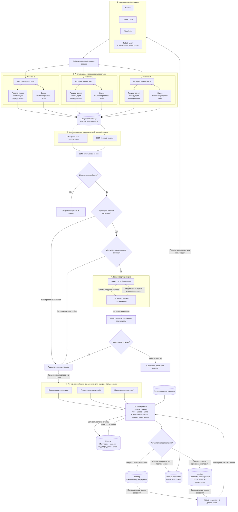

# От диалогов агентов к памяти команды

Конференционная схема утверждена пользователем 26 октября 2026 года как целевая
архитектура проекта и закреплена в
[спецификации](../openspec/specs/single-user-memory/spec.md).
Документация текущей реализации сохранена отдельно.

- [Оформленная вертикальная схема](conference-memory-flow.html).
- [Редактируемый Mermaid-исходник](conference-memory-flow.mmd).

## Что показано

1. Codex, Claude Code, GigaCode и любой другой агент с доступными логами или базой.
2. Отбор ещё не обработанных сессий одного пользователя.
3. Три повторяющиеся карточки сессий как обозначение множества 1…N. Каждая
   история поступает в два независимых анализа, которые дают context.md и
   procedures.md. Отчёты всех сессий сохраняются в одно хранилище пользователя.
4. Два направления консолидации на одном уровне: правила/предпочтения и личные
   знания. Используются текущая личная память и рабочая копия. Такая компоновка
   показывает две ответственности, не утверждает параллельное исполнение кода.
5. Review всей копии: пересечения, дубли и противоречия. Отклонённые изменения
   не публикуются.
6. Проверка памяти: выключена — принятие по review; включена, но данных
   недостаточно — принятие по review; данных достаточно — диалоговый прогон.
   force-replay и выбор одношагового режима намеренно исключены по запросу.
7. Решающий агент и пользователь-тестировщик на одном уровне. Ответ и файлы идут
   тестировщику; выбранная исходная пользовательская реплика возвращается агенту
   дословно. Контекст агента сохраняется. Успешное завершение — подтверждение цели.
8. После завершения диалога отдельная LLM сравнивает новый результат с прежним.
   При улучшении память принимается; при ухудшении или неясном выводе сохраняется
   прежняя. Ошибки и незавершённые проверки не считаются успехом.
9. Независимое повторение личного цикла для пользователей A…N. Штриховая связь
   обозначает масштабирование процесса, а не копирование памяти одного человека
   другим. В оформленной схеме средняя карточка связана с подробным личным циклом;
   соседние обозначают аналогичные независимые циклы.
10. В командный контур поступают принятые wiki, Cases и Skills и статус проверки.
    Личные AGENTS.md и USER_PREFERENCES.md остаются у владельца. Запись «все
    проверенные файлы» относится к принятому набору командных знаний: в него не
    включается автоматически вся личная информация.
11. Сопоставление с текущими общими знаниями и двусторонняя работа с реестром:
    чтение оснований и запись источников, версий, подтверждений, споров и решений.
    Отдельный командный review заменён этим механизмом по запросу пользователя.
12. Три результата: pending, публикация в командной памяти или conflicts.
    При конфликте спорное снимается с применения, оба варианта сохраняются.
    Pending и conflicts не передаются агентам как действующая память.
13. Новые сведения запускают повторное рассмотрение. Повтор одного чата и replay
    не дают нового независимого подтверждения. Числовой порог публикации в этой
    схеме не вводится. Различие условий само по себе не считается противоречием.
14. Командные знания возвращаются исходным агентам и используются в новых
    задачах. Новые логи снова могут стать входом анализа: общий цикл замкнут.

## Как читать оформление

Основной поток идёт сверху вниз. Карточки сессий и пользователей показывают
масштабирование. Внутренние стрелки между агентом и тестировщиком образуют
диалоговый цикл. Слева снизу показано повторное рассмотрение кандидатов, а
вдоль правого края — возвращение командных знаний агентам. Пересечение
обратной связи с линией конфликта обозначено мостиком, а не общей точкой.

Палитра продолжает светлый стиль предыдущих схем. Используется системный
шрифт Segoe UI с Arial как запасным; внешние шрифты, скрипты и изображения не
требуются. История чата изображена карточкой с пиктограммами сообщений.

## Отличия от действующего кода

- Полный набор внешних адаптеров, отбор всех новых сессий и доставка общей памяти
  всем агентам показаны как целевой интерфейс.
- Действующий командный stage knowledge получает исходные отчёты напрямую.
  Здесь по новому сценарию входом служат принятые личные знания пользователей.
- Pending, conflicts и полноценный реестр ещё предстоит реализовать.
- Нехватка данных ведёт к принятию по review согласно конференционному сценарию.
  Существующая оценка replay дополнительно рассматривает воспроизводимость и
  стоимость; эти подробности намеренно не показаны.
- Входной запрос решающего агента отделён от закрытого эталона тестировщика.
  Принятие без прогона не маркируется успешным выполнением проверки.
- Система изображена как замкнутый процесс, без утверждения о наличии фонового
  автоматического запуска всех его частей.

Исполняемый код проекта и навыки не менялись.

## Mermaid

## Упрощение подписей

По запросу пользователя убраны мелкие пояснения из блока отбора сессий, общего
хранилища и слоёв 3–4. В карточках сессий укрупнены сами виды знаний, удалены
заголовки анализаторов и промежуточные плашки имён файлов. Результаты анализов
идут непосредственно в общее хранилище. Решающий блок переименован в «Агент с
новой памятью». Подписи переходов, направление связей и слои 5–6 сохранены.
