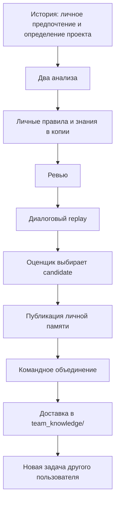

# Сквозная проверка личной и командной памяти

Документ описывает исторический локальный сценарий от 2 ноября 2026 года.
Функций и классов нет. Полные локальные артефакты — в
`data/full-cycle-20261102/`, итог — в `REPORT.md` этого каталога.



Перед конвейером записано настоящее выполнение агента с прежней памятью:
он запросил определение L7, получил вторую исходную реплику и сохранил результат
97 тыс. руб. Авторский критерий правильности хранится отдельно от прежнего ответа.

С новой памятью тот же запрос выполнен за один ход. Тестировщик подтвердил ответ
и файл, оценщик выбрал candidate. После командного объединения агент B применил
определение на новых числах и получил 147 тыс. руб. Личные файлы B сохранились.

Основная команда эксперимента:

```powershell
python -m command_agent_memory --config data/full-cycle-20261102/memory_pipeline.json --evaluate-by-replay
```

Команда выше фиксирует способ запуска исторического эксперимента. Его конфигурация
и исходный baseline хранятся в локальном каталоге `data/`. Текущий CLI создаёт два
свежих запуска через штатную фабрику. Для воспроизведения из рабочей копии используйте
[самостоятельный пример парного replay](portable_replay/README.md).

Эксперимент подтверждает передачу знания в конкретной задаче. Затраты на построение
и проверку памяти учитываются отдельно. Текущий порядок описан в
[руководстве по командному реестру](../team_memory_registry.md) и
[спецификации Git-доставки](../../specifications/distributed_team_memory.md).
