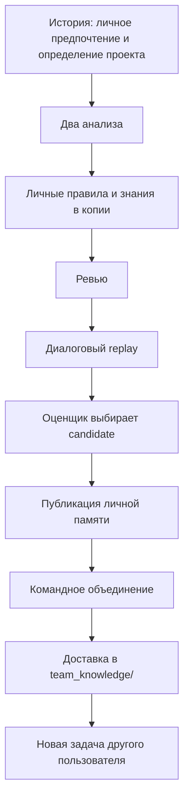

# Сквозная проверка личной и командной памяти

Документ описывает проверенный 2 ноября 2026 года локальный сценарий.
Функций и классов нет. Полные локальные артефакты — в
`data/full-cycle-20261102/`, итог — в `REPORT.md` этого каталога.



Перед конвейером записано настоящее выполнение агента с прежней памятью:
он запросил определение L7, получил вторую исходную реплику и сохранил результат
97 тыс. руб. Авторский критерий правильности хранится отдельно от прежнего ответа.

С новой памятью тот же запрос выполнен за один ход. Тестировщик подтвердил ответ
и файл, оценщик выбрал candidate. После командного объединения агент B применил
определение на новых числах и получил 147 тыс. руб. Личные файлы B сохранились.

Основная команда эксперимента:

```powershell
python -m command_agent_memory --config data/full-cycle-20261102/memory_pipeline.json --evaluate-by-replay
```

Конфигурация и исходный baseline относятся к локальному эксперименту и не являются
поставляемым готовым подключением. Повтор с --evaluate-by-replay запускает новую
проверку; это не команда просмотра уже сохранённого результата.

Проверка демонстрирует связность локального конвейера. Она не подтверждает
устойчивый выигрыш на других задачах: время и токены построения памяти необходимо
учитывать отдельно. Следующий этап — несколько независимых новых задач и полный
учёт затрат. Git-обмен и реестр подтверждений остаются отдельными отложенными задачами.
