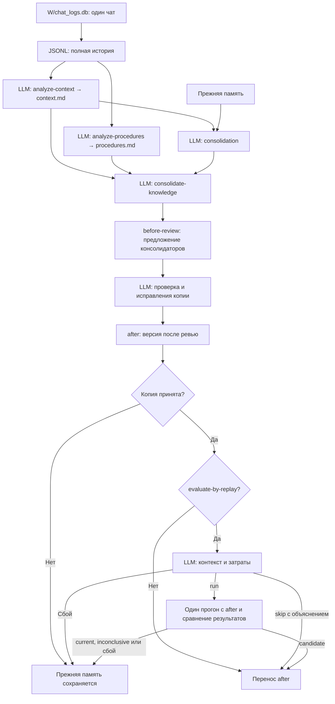

# Анализ и консолидация диалогов

Историческое описание. Актуальная структура и основной путь запуска:
[структура проекта](project-structure.md), [README](../README.md).

Реализация на 24 октября 2026 года. Один чат анализируется двумя независимыми
сеансами Codex. Отчёты передаются целиком; разбор Markdown в Python удалён.
Два консолидатора готовят одну копию личной памяти. Ревьюер проверяет всю копию
и может исправлять её. Итоговый снимок создаётся после ревью.

## Анализ одного чата

`analyze_chats_codex.py` выгружает каждый чат пользователя из SQLite в JSONL.
История сохраняет сообщения, вызовы инструментов и результаты, включая текст
прочитанных файлов. Отдельного обхода всех рабочих файлов нет.

- `agents/analyze-context/skills/analyze-context/SKILL.md`: правила, предпочтения,
  контекст и определения.
- `agents/analyze-procedures/skills/analyze-procedures/SKILL.md`: cases и skills;
  reference с правилами составления skills передаётся этому анализатору.

Каждый запуск начинает новый контекст. На один чат создаются:

```text
W/raw/chat-reports-codex/session-ID/context.md
W/raw/chat-reports-codex/session-ID/procedures.md
W/raw/chat-reports-codex/session-ID/manifest.json
```

W — рабочая область пользователя. manifest содержит только сведения запуска.
Структуру, заголовки и содержание Markdown Python не проверяет.
Журналы обоих сеансов находятся в `raw/chat-reports-codex/codex-logs/ID-запуска/`.

## Консолидация и ревью

`memory_pipeline.read_reports` читает файлы целиком. Первый текст получает
консолидатор правил и контекста, оба текста — консолидатор знаний. Он сам
отбирает определения, cases и skills. Старый `session-ID.md` можно передать
целиком; при наличии новой пары того же чата используется пара.

Личная память: AGENTS.md, USER_PREFERENCES.md, user_llm_wiki/ и knowledge/.
Ревьюер может исправить эти файлы в копии, объединить дубли, перенести
предметные определения из прежней личной wiki и изменить классификацию
case/skill по имеющимся материалам. Он не редактирует оригинал и отчёты.
Один сеанс ревью заканчивается решением и итоговой версией after.

При включённом `--evaluate-by-replay` LLM сначала оценивает контекст и стоимость.
Если выбрано run, один прогон использует эту итоговую
версию. Без флага принятую память переносит решение ревью. Неразрешённый
вопрос, сбой или отказ оценщика оставляют прежнюю память.

## Схема личного цикла



## Запуск

```powershell
$annaWorkspace = "data/synthetic-team-runs/20261020T040159Z-a0d71f0d/users/101/user_workspace"
python analyze_chats_codex.py --user-id 101 --workspace $annaWorkspace
python consolidate_reports_codex.py --user-id 101 --workspace $annaWorkspace --stage personal
```

`--workspace` и `--user-id` обязательны. `--validate-only` проверяет доступность
входных файлов без моделей и записи результатов. `--reports-dir` выбирает
каталог отчётов. Анализ сохраняет два отчёта на каждый чат пользователя.

`--model` выбирает модель анализа или консолидаторов; `--review-model` — модель
ревью и оценщика прогона. Настройка модели отдельно для каждого этапа пока
описана в [spec](../openspec/specs/single-user-memory/spec.md).

Этап `knowledge` сохранён: он получает полные отчёты контекста и решений и
обновляет указанный `--knowledge-dir`, по умолчанию корневой knowledge/.
`both` выполняет personal, затем knowledge. Личные файлы не являются входом
командного этапа. Pending, conflicts и учёт подтверждений остаются планом.

Файлы запусков и порядок сохранения версий: [ревью и перенос](reviewed-consolidation.md).
Сценарий одного прогона: [проверка выполнением задачи](replay-evaluation.md).
