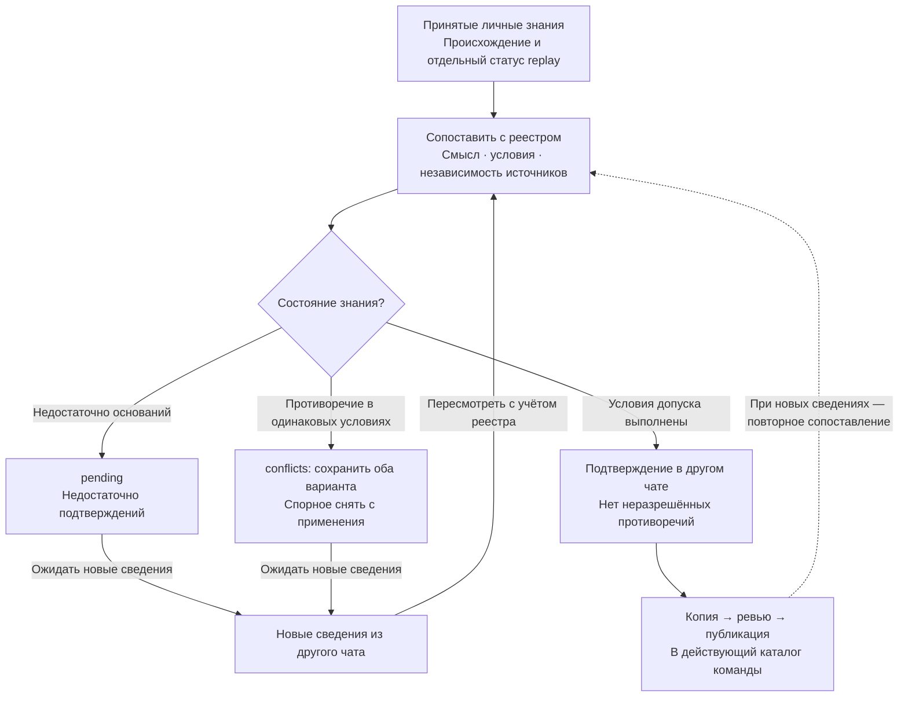

# Вертикальная схема проекта: этапы, связи и циклы

Состояние на 26 октября 2026 года. Основные этапы расположены сверху вниз.
Внутри этапов показаны решения и локальные циклы. Входы консолидаторов подписаны
внутри узлов, чтобы не проводить отдельную длинную стрелку от каждого отчёта.

Сплошные стрелки показывают передачу данных и подписанные переходы управления.
Пунктир показывает передачу отчётов в командный этап. Дальний возврат после
нового чата обозначен парой меток ↻1 в начале и конце схемы. Пунктир сам по себе не означает будущую реализацию:
будущий механизм показан отдельной схемой с явной пометкой ПЛАН.

Основная схема: [project-data-flow.mmd](project-data-flow.mmd).

```mermaid
%%{init: {"flowchart": {"wrappingWidth": 320, "nodeSpacing": 28, "rankSpacing": 32}}}%%
%% Вертикальная схема: порядок этапов, основные данные, развилки и циклы.
%% Дальний возврат к началу показан парой меток ↻1; локальный цикл — стрелками.
flowchart TB
    subgraph ANALYSIS["1. Анализ исходного чата"]
        direction TB
        HISTORY["↻1 История SQLite / Codex<br/>Пользователь · агент · инструменты"]
        CONTEXT["LLM: контекст<br/>Предпочтения · инструкции · определения"]
        PROCEDURES["LLM: решения<br/>Cases и полные процессы Skills"]
        REPORTS["Код: сохранить два отчёта<br/>context.md + procedures.md<br/>Передавать их целиком"]
        HISTORY --> CONTEXT
        HISTORY --> PROCEDURES
        CONTEXT --> REPORTS
        PROCEDURES --> REPORTS
    end

    subgraph PERSONAL["2. Подготовка личной памяти"]
        direction TB
        COPY["Код: скопировать текущую память<br/>Оригинал пока не изменяется"]
        PCON["LLM: объединить правила и предпочтения<br/>Вход: context.md<br/>AGENTS.md · USER_PREFERENCES.md · user_llm_wiki/"]
        KCON["LLM: объединить личные знания<br/>Вход: оба отчёта<br/>knowledge/wiki · cases · skills · INDEX.md"]
        REVIEW["LLM: проверить и исправить всю копию<br/>Вход: отчёты, прежняя память и предложение"]
        ACCEPT{"Ревью принято<br/>без оставшихся замечаний?"}
        REJECT["Остановить личный этап<br/>Сохранить прежнюю память и материалы"]
        COPY --> PCON --> KCON --> REVIEW --> ACCEPT
        ACCEPT -->|"Нет"| REJECT
    end

    subgraph VERIFY["3. Проверка и публикация личной памяти"]
        direction TB
        ENABLED{"Проверка прогоном включена?"}
        ASSESS{"LLM: run или skip?<br/>При force-replay — сразу run"}
        AGENT["Агент: решать задачу с копией памяти<br/>Только запрос и исходные файлы"]
        MODE{"Диалоговый режим?"}
        TESTER["LLM: пользователь-тестировщик<br/>Видит ответ, файлы, цель и эталон"]
        NEXT{"Решение тестировщика?"}
        MESSAGE["Код: взять выбранную исходную реплику<br/>Дословно; сохранить контекст агента"]
        COMPARE["LLM: сравнить с прежним результатом<br/>Качество · завершённость · шаги · токены · время"]
        BETTER{"Выбрана предложенная память?"}
        PUBLISH["Код: проверить неизменность версий<br/>Опубликовать итоговый снимок с резервированием"]
        KEEP["Сохранить прежнюю память<br/>Предложение и журналы остаются"]
        ENABLED -->|"Нет: принятие по ревью"| PUBLISH
        ENABLED -->|"Да"| ASSESS
        ASSESS -->|"skip: сохранить причину"| PUBLISH
        ASSESS -->|"run: нужен полный сценарий"| AGENT
        AGENT --> MODE
        MODE -->|"Нет: один запрос"| COMPARE
        MODE -->|"Да: после каждого ответа"| TESTER
        TESTER --> NEXT
        NEXT -->|"send: следующий ход"| MESSAGE
        MESSAGE --> AGENT
        NEXT -->|"complete: цель подтверждена"| COMPARE
        NEXT -->|"stop / лимит / сбой"| KEEP
        COMPARE --> BETTER
        BETTER -->|"candidate"| PUBLISH
        BETTER -->|"current / inconclusive"| KEEP
    end

    subgraph TEAM["4. Командная консолидация — текущая реализация"]
        direction TB
        TCOPY["Код: скопировать текущие знания команды<br/>Вход: оба исходных аналитических отчёта"]
        TCON["LLM: объединить wiki, Cases и Skills"]
        TREVIEW["LLM: проверить и исправить копию"]
        TOK{"Ревью принято?"}
        TPUBLISH["Код: опубликовать командные знания<br/>Дополнительного прогона здесь нет"]
        TKEEP["Сохранить прежние знания команды"]
        TCOPY --> TCON --> TREVIEW --> TOK
        TOK -->|"Да"| TPUBLISH
        TOK -->|"Нет"| TKEEP
    end

    subgraph USE["5. Применение памяти в следующей задаче"]
        direction TB
        INIT["Создать новый сеанс агента<br/>Личные файлы и индексы → memory<br/>Каталоги навыков → skills"]
        TASK["Агент читает подходящие wiki, Cases и Skills<br/>И решает новую задачу"]
        LOG["Код: записать новый чат<br/>Сообщения, инструменты и результаты"]
        REPEAT(("↻1"))
        INIT --> TASK --> LOG --> REPEAT
    end

    REPORTS -->|"Отчёты контекста и решений"| COPY
    ACCEPT -->|"Да: итоговая копия"| ENABLED
    PUBLISH -->|"Если stage=both"| TCOPY
    REPORTS -.->|"Оба отчёта напрямую в командный этап"| TCOPY
    PUBLISH -->|"Личная память"| INIT
    TPUBLISH -->|"Командный снимок при явном подключении"| INIT
```

## Значение связей

- Два анализа получают одну полную сохранённую историю в разных контекстах.
  Развилка обозначает независимость входов; текущий CLI вызывает их последовательно.
- Личные консолидаторы изменяют одну копию последовательно. Контекстный получает
  context.md; консолидатор знаний — оба отчёта. Исходная память входит в копию.
- Ревьюер исправляет копию внутри одного сеанса. Автоматического цикла
  «отказ → повторная консолидация → новое ревью» в текущем коде нет.
- В блок проверки поступает только принятая ревью копия. Без прогонов и при
  разрешённом skip публикация основана на ревью. force-replay запрещает skip.
  Для фактического прогона нужен полный сценарий.
- В диалоговом режиме первая исходная реплика подаётся дословно. После ответа
  тестировщик выбирает complete, stop или номер следующей исходной реплики.
  Код проверяет номер и лимиты и берёт текст из сценария дословно. Контекст
  решающего агента сохраняется. Тестировщик может пропустить уже учтённое уточнение.
- Эталон доступен тестировщику и итоговому оценщику. Решающий агент получает
  запрос, исходные файлы и проверяемую память. Созданные файлы и ответ поступают
  тестировщику; завершённый результат и измерения — итоговому оценщику.
- Перед итоговым сравнением код требует state=completed, сохранённый ответ и
  неизменность памяти. В диалоге проверяются и хеши исходных данных. Ошибка
  прогона, протокола, файлов или незавершённый диалог запрещают публикацию.
  На схеме эти общие проверки включены в подписи, без отдельных узлов на каждый сбой.
- Стрелка PUBLISH → TCOPY обозначает порядок stage=both, а не передачу
  личной памяти командному консолидатору. Его аналитический вход показан
  отдельно: REPORTS → TCOPY. При stage=personal командный этап пропускается.
  Отдельный stage=knowledge читает готовые отчёты независимо от личной публикации.
- Стрелки PUBLISH → INIT и TPUBLISH → INIT показывают подключение опубликованных
  версий. При отказе следующий сеанс может использовать прежнюю память; новая
  версия не поступает в INIT. Следующий сеанс не является обязательным
  продолжением CLI после ошибки.
  Командный каталог подключается явно через team_knowledge/; автоматической
  доставки всех обновлений пока нет. Дополнительного replay на командном этапе нет.
- Метки ↻1 означают возврат нового сохранённого чата к этапу 1 при следующем
  запуске анализа. Фонового автозапуска метки не обещают; длинная обратная
  линия заменена метками для сохранения вертикального порядка.
- run_openrouter_pipeline.py выполняет personal с обязательным одношаговым replay;
  командный этап и парный диалоговый опыт эта команда не запускает.

## Будущая командная память — ПЛАН

Это будущая замена механизма допуска в блоке 4, а не этап после использования памяти.
Исходник: [team-memory-lifecycle.mmd](team-memory-lifecycle.mmd).

Реестр, pending и conflicts пока не реализованы. Подтверждение из другого чата
может принадлежать тому же или другому пользователю. Повторная обработка одного
чата и replay не увеличивают число подтверждений. Различные условия применения
сами по себе не являются противоречием. Новые сведения запускают рассмотрение,
а не автоматически побеждают другую версию по числу упоминаний. Pending и
conflicts не подключаются как действующая память агента.

## Отдельная оценка и отчётность

Парный эксперимент запускает два новых диалога по одному сценарию: без памяти
и с выбранным снимком. Каждый получает отдельные экземпляры решающего агента
и тестировщика. Результат сравнения не публикует память автоматически. Это
отдельный процесс, а не повтор внутри цикла принятия одной предложенной версии.

На этапах сохраняются материалы, снимки before/before-review/after, решения,
отчёты, JSONL и доступные метрики. В диалоге журналы и затраты двух ролей разделены.
Есть явное продолжение анализа и ревью; диалоговый InMemorySaver пока хранит
контекст только в работающем процессе.

## Проверенные источники

- [Спецификация](../openspec/specs/single-user-memory/spec.md).
- [Фиксация состояния на 26 октября](project-state-2026-10-26.md).
- [Копия, ревью и публикация](../reviewed_consolidation.py).
- [Порядок личного и командного этапов](../consolidate_reports_codex.py).
- [Проверочный прогон](../replay_evaluation.py).
- [Диалоговая проверка](dialogue-replay.md).
- [Подключение памяти](../agent_runtime.py).
- [Целевой командный механизм](proposed-personal-team-memory.md).

Изменена только документация. Новый полный цикл после последних правок Cases и
настроек DeepAgents ещё предстоит выполнить; схема не доказывает улучшение качества.