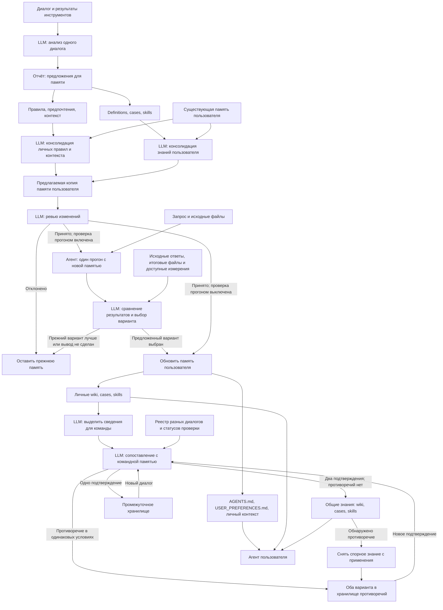

# Личная и командная память с проверкой предложений

Предложение от 23 октября 2026 года. Это описание следующей версии, а не уже
реализованное поведение программы на момент составления.
Обновление: подготовка общей копии личных правил, контекста и знаний уже
реализована в шаге 3. Один проверочный прогон реализован в шаге 4
опциональным флагом. Состояния командных сведений остаются планом.

Уточнение личного цикла от 24 октября: [два анализа и ревью с исправлениями](../openspec/specs/single-user-memory/spec.md).
Эта спецификация заменяет прежнее описание разделения отчёта и ревью личной памяти.

## Основной цикл

1. Анализ одного диалога предлагает сведения для запоминания.
2. Консолидация сопоставляет их с памятью пользователя и готовит изменения в копии.
3. Существующий LLM-ревьюер проверяет предложенную копию.
4. При включённом `--evaluate-by-replay` агент один раз решает задачу с этой копией.
5. LLM сравнивает новый результат с сохранённым результатом исходного диалога
   и выбирает: оставить прежнюю память или принять предложенную.
6. После принятия обновляется личная память. Определения, cases и skills также
   передаются на командную консолидацию.

Для первой версии два варианта — существующая память и одна предложенная копия.
Новый прогон только один, без повторов. Это сравнение с историческим результатом,
а не два заново выполненных запуска в одинаковых условиях.

В новой задаче агент получает запрос и исходные файлы. Прежние ответы и итоговые
файлы доступны оценщику. Нужна копия окружения до решения задачи, иначе агент
может получить готовый результат среди входных файлов.

## Схема



Ветви повторного рассмотрения запускаются новым диалогом. Повторных прогонов
той же задачи и автоматического цикла исправлений на этой схеме нет.

## Личная память

- AGENTS.md: правила выполнения работы.
- USER_PREFERENCES.md: предпочтения пользователя.
- user_llm_wiki/: сведения о пользователе, проектах и окружении.
- knowledge/wiki/: определения предметной области.
- knowledge/cases/: случаи решения задач.
- knowledge/skills/: процедуры решения задач.
- knowledge/INDEX.md: навигация по знаниям пользователя.

Разделы definitions, cases и skill сохраняются у пользователя и поступают на
командную консолидацию. Для обоих каталогов можно использовать один skill
consolidate-knowledge, передавая разные входы и пути. Этот skill описывает только
объединение знаний в указанном каталоге.

В командное предложение не включаются личные данные и пути окружения автора.
У пользователя могут оставаться конкретные параметры; для команды сохраняются
сведения с условиями их применения. Тексты двух версий не обязаны совпадать.

## Состояния командного знания

| Ситуация | Действие |
| --- | --- |
| Новое сведение встретилось в одном диалоге | Добавить в промежуточное хранилище |
| То же сведение подтвердилось в другом диалоге этого или другого пользователя | Перенести в общие знания, если нет противоречия |
| Повторно обработан тот же диалог | Не увеличивать число подтверждений |
| Новое сведение дополняет существующее | Проверять новое дополнение отдельно; прежнюю подтверждённую часть сохранить |
| Различаются проект, версия или условия | Сохранить различия с условиями, не считать их автоматически противоречием |
| Сведения противоречат друг другу в одинаковых условиях | Снять спорное утверждение с применения; оба варианта сохранить в хранилище противоречий |
| Пришло новое подтверждение спорного сведения | Повторно оценить оба варианта; вернуть разрешённое знание в общий каталог |

Подтверждение относится к конкретному утверждению или дополнению, а не автоматически
ко всему документу. Если из-за снятого утверждения процедура становится неприменимой,
она также исключается из действующих материалов до разрешения противоречия.

LLM определяет смысловое совпадение, условия и противоречия. Реестр хранит
идентификаторы диалогов, чтобы повторная обработка не создавала подтверждений.
Эти идентификаторы не добавляются в тексты wiki, cases и skills.

Проверочный прогон не является новым подтверждением. Пересказ агентом уже
сохранённой памяти также не является независимым подтверждением: нужны новые
результаты работы или подтверждение пользователя.

Два подтверждения — правило допуска в общий каталог, а не доказательство истинности.
При споре следующее подтверждение запускает рассмотрение; оно не обязано
автоматически побеждать другой вариант по количеству упоминаний.

## Проверка прогоном

Оценщик видит требования, исходный и новый результаты, созданные файлы, количество
обращений к модели и инструментам, токены и время, если они доступны.
Приоритет — выполнение задачи; уменьшение затрат не оправдывает ошибочный ответ.
Причина выбора сохраняется вместе с результатами запуска.

Для первой версии оценивается вся предложенная копия личной памяти. Отдельный
перебор вариантов анализа и вариантов консолидации не выполняется.

Принятый прогон означает, что память применена на одной задаче. Он не доказывает
каждое определение и не подтверждает применимость для всей команды.

Флаг остаётся опциональным. При выключенном флаге результат нельзя обозначать
как проверенный прогоном. Статус этой проверки хранится отдельно от количества
подтверждений в разных диалогах.

## Предлагаемое расположение командных данных

```text
knowledge/                 действующие общие wiki, cases, skills и INDEX.md
team-memory/pending/       сведения с одним подтверждением
team-memory/conflicts/     варианты неразрешённых противоречий
team-memory/registry.json   идентификаторы диалогов и состояния сведений
```

Это каталоги одного проекта, отдельный сервис не требуется. Агент, решающий
задачи, использует личную память и действующий общий каталог. Pending и conflicts
не подключаются как действующие инструкции. Противоречие в общем каталоге не
означает автоматического удаления подходящего пользователю локального варианта.

## Отличия от текущего кода

Уже есть анализ, два вида консолидации, копии до и после изменений, LLM-ревью,
блокировка записи и перенос принятой копии.

В шаге 3 добавлены передача definitions/cases/skill в личную консолидацию
знаний и поддержка knowledge/ при подготовке, ревью и переносе общей личной копии.

Осталось добавить:

1. Pending, conflicts и реестр подтверждений для командной памяти.
2. Подключение действующих командных знаний к решающему агенту.

Один прогон, оценщик, флаг evaluate-by-replay и подключение личных индексов
и skills реализованы в шаге 4.

Обновление командных знаний по-прежнему готовится в копии и проходит ревью до
переноса. Дополнительного прогона на командном этапе в первой версии нет.
