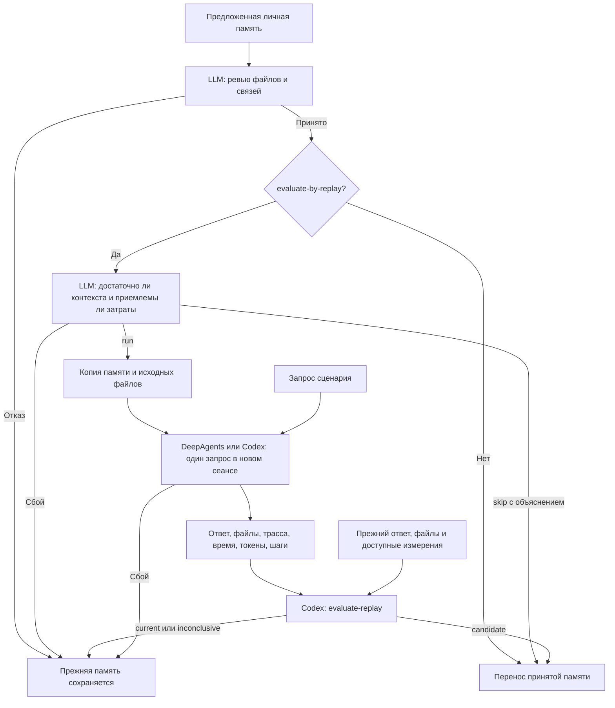

# Один прогон до обновления памяти

--evaluate-by-replay включает оценку возможности и стоимости проверки личного
предложения после принятого ревью, перед переносом. LLM выбирает run или skip.
При run выполняется одно решение задачи. При skip память принимается по ревью,
а пропуск и его причина записываются. Без флага также сохраняется принятие по ревью.
Сбой оценки не считается решением skip и останавливает перенос.



## Запуск

```powershell
$annaWorkspace = "data/synthetic-team-runs/20261020T040159Z-a0d71f0d/users/101/user_workspace"
python consolidate_reports_codex.py --user-id 101 --workspace $annaWorkspace --stage personal --evaluate-by-replay --replay-scenario docs/examples/replay-anna/scenario.json --agent-python C:/Users/Slav4ik/PycharmProjects/deepagent/.venv/Scripts/python.exe
```

--agent-python — Python с DeepAgents и LangChain; по умолчанию используется Python
запускающего скрипта. Решающий агент берёт модель и авторизацию из settings.py,
как консольный агент. Оценщик использует --review-model либо --model через Codex.
Для решения задачи той же моделью Codex укажи `--replay-backend codex`.
Этот вариант не обращается к OpenRouter и не использует модель из settings.py.
Модель решения совпадает с моделью оценщика: --review-model либо --model.
Пример использует существующее окружение соседнего deepagent; библиотек не устанавливает.

--validate-only проверяет технические параметры без модели, но не подтверждает
достаточность контекста и приемлемость затрат.
Для --stage knowledge прогон не применяется. При --stage both он выполняется
только в personal; отказ останавливает запуск до командной консолидации.

--replay-scenario теперь необязателен. Без него LLM получает каталог отчётов
и объясняет, чего не хватает для повторения. Неполный сценарий также допустим
для оценки: отсутствие входов или прежнего ответа не приводит к запуску задачи.
Доступный Python и окружение входят в сведения оценки.

## Сценарий

```json
{
  "request": "Запрос пользователя",
  "inputs": "inputs",
  "reference": "reference",
  "reference_metrics": null,
  "history": null,
  "resource_notes": ""
}
```

Пути разрешаются относительно JSON внутри проекта. inputs — каталог исходных
файлов до решения задачи. Он копируется с собственным именем: inputs/file.csv
окажется в рабочей области как inputs/file.csv. Если каталог называется
synthetic_team, запрос использует /synthetic_team/.

reference содержит answer.md и при наличии файлы прежнего выполнения, например
files/synthetic_team/outputs/C01/. reference_metrics необязателен: при отсутствии
времени или токенов они не выдумываются. Исходные данные и reference не должны
пересекаться. Прежний результат не копируется в рабочую область решающего агента.

history — путь к сохранённой исходной истории внутри проекта, resource_notes —
пояснения об операциях и затратах. reference_metrics может содержать время,
токены, вызовы инструментов, объём результата и потребление памяти, если они известны.
Затраты анализа и консолидации не являются затратами исходной задачи.
LLM оценивает данные без повторения SQL, выгрузок и вычислений. Числовых порогов
в коде нет. Недостаток данных, невоспроизводимость условий, высокие или неясные
затраты могут стать причиной skip. Размер файла не подменяет измерение памяти.

Пример Анны объединяет четыре её пользовательские реплики C01 в один запрос.
Прежний ответ и файлы взяты из сохранённого диалога и outputs/C01. Измерения
прежнего диалога относятся ко всем четырём репликам; модель тогда была другой.
Это историческое сравнение одного нового выполнения, а не повтор исходных условий.

## Что выполняется

Сначала assess_replay получает сценарий, историю, измерения и материалы анализа.
Решение сохраняется в replay-assessment/decision.json. Оно содержит decision,
summary, context и resources. При skip перечисленные ниже действия не выполняются.

1. При run evaluate_by_replay создаёт отдельную рабочую область с принятой ревью копией.
2. Добавляет исходные файлы и прежний корневой skills/, если он существует.
3. Один раз запускает выбранного исполнителя. По умолчанию это replay_worker.py
   с DeepAgents; при --replay-backend codex вызывается replay_codex.run_codex_replay.
4. DeepAgents использует create_agent и run_turn из agent_runtime.py. Codex читает
   личные инструкции, индексы памяти и применимые skills из подготовленной копии.
   Оба варианта сохраняют итоговый ответ, трассу и измерения. Повторной сессии при сбое нет.
5. Код убеждается, что рабочая память не была изменена самим решающим агентом.
6. Файлы задачи сохраняются в result/files. Оценщику передаются оба результата.
7. LLM выбирает candidate, current или inconclusive и объясняет выбор.
8. После выполненного прогона только candidate разрешает перенос. Ошибка процесса, неверный протокол,
   current или inconclusive сохраняют действующую память.

Перед переносом повторно проверяются исходная память и неизменность версии after.
Блокировка памяти удерживается на время всего порядка.

## Подключение памяти

Обычный агент и прогон используют одну create_agent. Помимо AGENTS.md,
USER_PREFERENCES.md и прежнего /skills/, она подключает существующие
user_llm_wiki/INDEX.md, knowledge/INDEX.md и /knowledge/skills/.
Индексы указывают, какие статьи и cases читать по задаче. Общий каталог команды
этим изменением не подключается.

## Измерения

- duration_seconds: время сборки решающего агента и выполнения задачи.
- model_calls: обращения к chat model на уровне callbacks LangChain.
- tool_calls: вызовы инструментов, включая дочерние вызовы.
- usage: сообщённые токены по моделям, включая детали кеша и reasoning при наличии.
- usage_complete: есть ли usage для каждого обращения к модели.

Метрики собирает наследник UsageMetadataCallbackHandler; числа не оцениваются
по длине текста. Время родительского процесса отдельно сохраняется в execution.json.
Для Codex используются usage и время CLI; model_calls=null, поскольку CLI
не сообщает число внутренних запросов модели. tool_calls считает завершённые
события команд, MCP, поиска и изменения файлов; область счёта сохранена в metrics.json.
transcript.jsonl у Codex содержит нативные события CLI. Счётчики разных исполнителей
имеют разные области измерения; напрямую приравнивать их нельзя.
Затраты Codex-оценщика находятся в evaluation/judge.metrics.json и не смешиваются
с затратами на решение задачи.

## Файлы запуска

```text
data/consolidation-runs/<запуск>/personal/
  before/
  after/
  status.json
  report/
    summary.md               общий итог и ссылки на этапы
    index.json               технические состояния отчётов
    analysis.md              ссылки на полные извлечённые сведения
    personal.md              ответ первого консолидатора и изменённые файлы
    knowledge.md             ответ второго консолидатора и изменённые файлы
    review.md                исправления и решение ревьюера
    replay-assessment.md     контекст, затраты, причина выбора run/skip
    replay.md                результат сравнения либо явное отсутствие выполнения
    publication.md           принятие или отказ; целевой каталог
    *.diff                   различия отдельно по этапам
  replay-assessment/
    scenario.json            доступные сведения, без копирования входных данных
    SKILL.md                 инструкция оценки этого запуска
    assessment.*             prompt, журнал, ответ и измерения оценки
    decision.json            run/skip и объяснения
  replay/
    workspace/               копия входов и предложенной памяти
    reference/               прежний ответ и файлы, для оценщика
    reference-metrics.json
    request.md
    worker.stdout.log
    worker.stderr.log
    execution.json
    result/
      answer.md
      files/
      chat_logs.db
      transcript.jsonl
      metrics.json
    evaluation/judge.*       задание, события, ответ и измерения оценщика
    decision.json
```

В status.json сохраняется replay_status: not_requested, skipped, running,
completed, failed или not_run. При skip есть replay_reason и путь к решению,
но нет replay_choice и каталога выполнения replay/. Выбор candidate/current/
inconclusive появляется только после выполненного сравнения.
При сбое decision.json может отсутствовать; причина записывается в status.json
и отчёте этапа. Не запрошенная проверка отражается как not_requested.

Отчёт каждого консолидатора записывается сразу после его завершения и содержит
его ответ о добавленных, уточнённых, объединённых и удалённых сведениях.
Код добавляет список изменённых файлов и diff без разбора смысла Markdown.
При сбое следующего этапа прежние отчёты остаются. summary.md обновляется
по мере работы, включая причину отсутствия прогона и итог принятия памяти.
Отчёты личного и командного этапов находятся в разных каталогах запуска.

## Границы

Используется один запрос и один новый сеанс. Симулятор пользователя, повторные
серии и автоматические исправления не добавлены. Исходные файлы для сценария
готовит пользователь; произвольное состояние окружения из чата не восстанавливается.

LocalShellBackend работает с правами пользователя: копия каталогов не является
изоляцией ОС. Ограничения путей и неизменность копии проверяются кодом, агенту
передаются условия работы внутри неё. Для недоверенных задач понадобится backend
с ограничениями выполнения на уровне ОС. В данном шаге он не добавлен.
