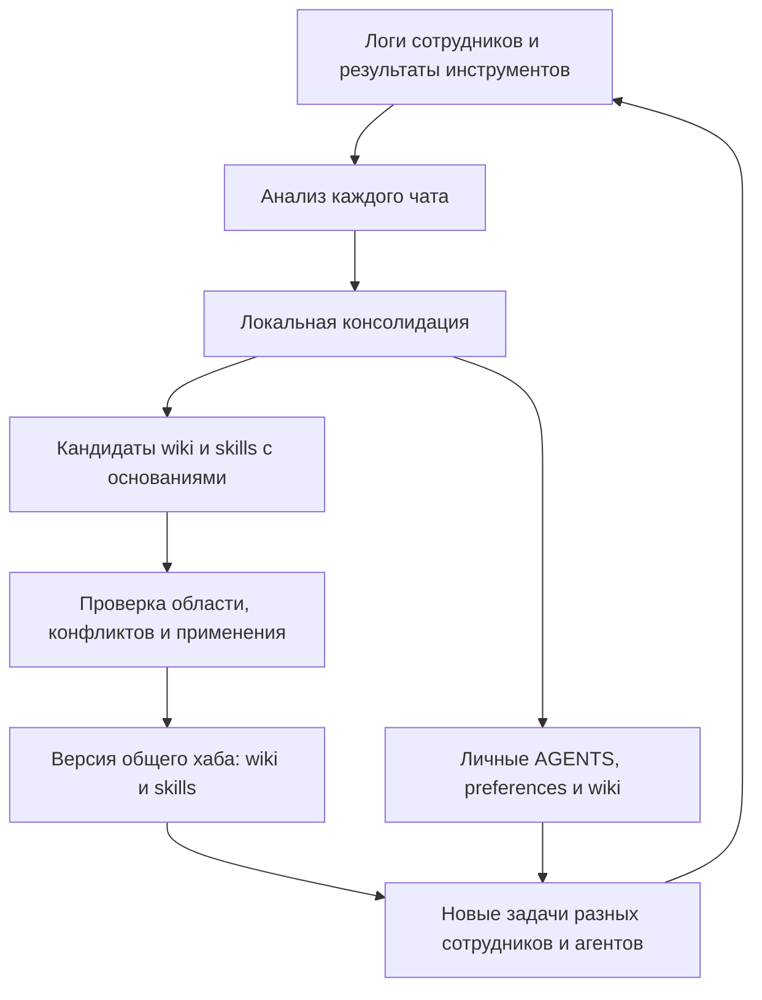

# Командная память из рабочих диалогов: направление для конференции

Дата: 2026-10-20. Статус: исследование и предложение для обсуждения. Новые механизмы публикации, проверки и внешние адаптеры пока не реализованы.

Уточнение пользовательского сценария: руководитель предложил помощь новичку через примеры задач коллег. [Архитектура сопровождения задачи](task-guidance-architecture.md) сравнивает варианты реализации и предлагает сохранять карточки конкретных задач внутри общей wiki наряду с определениями и skills.

## Принятое разделение

| Область | Содержимое |
|---|---|
| Личная | AGENTS.md, USER_PREFERENCES.md, wiki о человеке, локальных файлах, путях и окружении |
| Общая для подключённой команды | Рабочая wiki и переносимые skills с условиями применения |

AGENTS.md не распространяется через командный хаб. Рабочая wiki не включает автоматически всю личную wiki. Общий skill может содержать последовательность действий и проверки, но конкретные личные параметры получает у пользователя. Подключение хаба не означает открытую публикацию данных команды.

## Предлагаемое позиционирование

**«Как превратить рабочие диалоги сотрудников в проверяемую wiki и навыки для разных AI-агентов».**

Ценность для пользователя: сотрудник один раз объясняет предметную особенность или исправляет решение, а коллега получает пользу в новой задаче через своего агента. Система должна показать, какое знание помогло, откуда оно появилось и при каких условиях применимо.

Возможный исследовательский вопрос: помогает ли совместная поддержка рабочих определений и зависящих от них навыков переносить опыт между сотрудниками и разными агентами на новые задачи, в том числе после изменения этих определений?

Это гипотеза собственного вклада. Поиск ниже не доказывает мировое первенство или отсутствие похожей комбинации в других системах.

## Что уже исследовано

| Первичный источник | Близость к нашей идее | Следствие для позиционирования |
|---|---|---|
| [ShareMem, 2026](https://arxiv.org/html/2609.32511v1) | Общий опыт при личных предпочтениях, локальная и общая консолидация | Два уровня консолидации и сохранение предпочтений уже нельзя заявлять как новую идею |
| [Collaborative Memory, 2025](https://arxiv.org/abs/2505.18279) | Частная и общая память нескольких пользователей, происхождение и меняющиеся права доступа | Само разделение доступа и командная память уже имеют прямые аналоги |
| [AIM, 2026](https://arxiv.org/abs/2609.12320) | Личная/общая память и MUMBench для операций памяти нескольких пользователей | Нашу оценку стоит отличать от проверки создания и извлечения записей: измерять выполнение рабочих задач |
| [MUSE-Autoskill, 2026](https://arxiv.org/html/2605.27366v1) | Создание, проверка и развитие skills, эксперимент переноса в другой агент | Автогенерация skills, их тестирование и переносимость по отдельности также не новый вклад |
| [ACE, 2026, версия 3](https://arxiv.org/abs/2510.04618v3) | Развитие контекста через извлечение опыта и последовательные обновления | Анализ диалогов и накопление инструкций относятся к существующему направлению |
| [Dependency-Guided Rollback Repair, 2026](https://arxiv.org/abs/2608.10502) | Исправление зависимых воспоминаний и действий после обнаруженной ошибки | Зависимости и отзыв ошибочной памяти тоже имеют аналоги; наше применение нужно проверять сравнением |

Это обзор близких механизмов, а не воспроизведение результатов этих работ. Не следует переносить опубликованные ими проценты улучшения на наш проект.

## Что предлагается усилить

### 1. Связать рабочую wiki с навыками

Wiki отвечает на вопрос «что означает показатель и на каких данных он строится». Skill — «как выполнить расчёт и проверить результат». Они должны ссылаться друг на друга через устойчивые ID и версии.

Пример на нашей синтетике: определение approval_rate v2 исключает тестовые заявки. Метод расчёта ссылается на это определение, а не дублирует его как неизменное правило внутри большого текста. При изменении определения система находит затронутые методы и создаёт предложение на проверку. Успешная проверка может подтвердить, что менять сам метод не требуется.

Нужно различать дату действия определения и дату его получения. Историческая задача может требовать v1; публикация v2 не делает старый расчёт ошибочным для прошлого периода. Обнаруженный конфликт также не равен новой утверждённой версии.

На первом шаге достаточно явных ссылок и небольшого списка зависимостей. Полноту зависимостей, выведенных LLM из произвольных текстов, обещать нельзя.

### 2. Публиковать материал вместе с основаниями и границами применения

Предлагается промежуточный реестр между локальной консолидацией и хабом. Для кандидата сохраняются:

- Что утверждается или какой метод предлагается; версия формулировки.
- Команда/проект, данные, среда, условия и исключения.
- Ссылки на исходные события и доступное подтверждение: документ, исправление человека или проверенный результат выполнения.
- Тип основания: пользовательское утверждение, наблюдаемый результат или пока только предложение модели.
- Зависимости, найденные противоречия, проверки и причина решения о публикации.

Для wiki и skills нужны разные основания. Например, для определения может быть достаточно доступного утверждённого источника; метод можно дополнительно проверить выполнением на контрольных данных. Это предлагаемые политики, ещё не утверждённые правила. Универсальный порог «два сотрудника сказали — значит верно» не предлагается.

Проверки для публикации используют отдельные проверочные задачи. Финальный отложенный набор для оценки качества не участвует в подборе skills или решениях о публикации.

### 3. Сохранить переносимость без копирования личных параметров

Общий метод описывает нужные входы и возможности среды. Абсолютные пути, личный стиль ответа и предпочтительные инструменты автора не становятся обязательными для коллеги. Если skill требует недоступный инструмент, адаптер отмечает несовместимость; один перенос Markdown не гарантирует работоспособности.

Личные инструкции и предпочтения получателя применяются отдельно. Например, Анна получает короткий вывод с таблицей, а другой сотрудник — подробное объяснение того же корректного расчёта. Личные настройки формы не меняют смысл общего определения метрики.

Для демонстрации достаточно двух реально проверенных подключений. Поддержку Codex и Claude Code нужно подтвердить импортом журналов, загрузкой материалов и выполнением задач; сейчас таких адаптеров в проекте нет.

### 4. Замкнуть цикл на результат применения

При выполнении новой задачи полезно фиксировать, какие версии wiki/skills были доступны, какие агент прочитал и какие использовал. Чтение файла само по себе не подтверждает пользу.

Если человек исправляет ответ, анализ связывает исправление с затронутым материалом. Это основание для пересмотра, а не автоматический отзыв всех общих знаний. Успешный пример также не доказывает применимость ко всем задачам.

Повторные обработки одного лога и пересказ материала из хаба не становятся независимыми подтверждениями. В прототипе достаточно наблюдаемых ссылок на источник и подключённую версию; неизвестное происхождение остаётся неизвестным.

## Предлагаемый поток

Реестр хранит и ожидающие проверки кандидаты. В общий пакет попадают только материалы, допущенные выбранной политикой. Конкретный формат и алгоритм этой политики остаются предметом следующего этапа проектирования.

## Как проверить пользу

Основная единица оценки — новая рабочая задача получателя. Требуется проверять итоговый файл, запрос или расчёт независимым эталоном, а не только наличие правильной записи в wiki.

| Условие | Что получает основной агент |
|---|---|
| A: личная память | Одинаковые для всех условий личные настройки, без общего опыта |
| B: простой поиск по общему корпусу | Фрагменты доступных командных логов без нашей консолидации, в сопоставимом бюджете контекста |
| C: wiki | Личные настройки и общие определения |
| D: wiki + skills | Те же настройки, определения и переносимые методы |
| E: wiki + skills с пересмотром зависимостей | То же, с проверками связанных методов при изменении знания |

Условия C–E — последовательные отключения частей системы, чтобы установить, что именно помогает. Для пилота можно начать с A, B и D; E требуется для заявления пользы пересмотра зависимостей. Для исследовательской статьи нужен также честный сопоставимый baseline из ближайшей работы, например ShareMem, если доступные код и протокол позволят его воспроизвести. Собственную упрощённую версию следует так и обозначать.

Предлагаемые семейства задач:

1. Перенос: один сотрудник объяснил особенность данных, другой решает новую задачу без исходного диалога.
2. Объединение: определение известно из чата Анны, метод проверки — из чата Бориса; задача требует обоих.
3. Изменение: новое определение влияет на метод; отдельно проверяются текущий и исторический периоды.
4. Противоречие: заметки предлагают разные SLA без утверждения; агент должен сохранить неопределённость.
5. Границы: похожее имя метрики в другой системе не должно получить чужое определение; личные пути и формат ответа не переносятся.
6. Совместимость: знания подготовлены через одного агента, новая задача выполняется через другого.

Результаты: доля правильно решённых задач; нарушения личных предпочтений; применение устаревших или чужих определений; вредный перенос — когда добавленная память испортила ранее правильный ответ; попадание синтетических личных маркеров в общий пакет; время, токены и стоимость. Расход на анализ и консолидацию учитывается отдельно и вместе с применением, а не скрывается за экономией основного агента.

Для одинаковых задач фиксируются модель, инструменты, доступные данные и бюджеты. Нужны повторные прогоны, парные сравнения и интервалы неопределённости; точное число задач выбирается после пилота по разбросу результатов. Факт чтения skill помогает разобрать причину, но причинный эффект оценивается сравнением условий.

Разделение наборов проводится до разработки правил: исходные диалоги, проверочные задачи для публикации и финальные отложенные задачи. В отложенных задачах меняются данные и постановка; точные ответы из исходного чата не должны быть решением теста. Материалы отложенного набора не идут обратно в хаб до завершения оценки.

Строгий перенос проверяется без повторного доступа к документам, которые обучали донора: получателю доступны новая задача, её входные данные и назначенная память. Отдельный реалистичный режим может разрешать поиск по рабочим документам. Эти режимы нельзя смешивать в одной цифре.

Наши восемь чатов подходят для пилота, но ещё не доказывают перенос. В существующем запуске основные агенты сами редактировали личные файлы памяти; последующие сеансы уже могли использовать эти изменения. Это отмечено в [проверке запуска](../../data/synthetic-team-runs/20261020T040159Z-a0d71f0d/review.md). Для сравнения нужны отдельные чистые области, одинаковые исходные личные настройки и записанные версии материалов.

## Демонстрация для доклада

1. Анна уточняет рабочую метрику в обычном диалоге; Борис исправляет способ выбора исторического статуса.
2. После анализа показываем два кандидата и конкретные основания из логов.
3. После проверок публикуем связанную страницу wiki и skill.
4. Новый сотрудник в другом агенте решает новую задачу, применяет оба материала и сохраняет свой формат ответа.
5. Меняем рабочее определение. Показываем затронутый метод, результат его пересмотра и корректные ответы для текущего и прошлого периодов.
6. Рядом показываем результаты одинаковых задач с памятью и без неё, включая неудачные случаи и полную стоимость обработки.

Показ не должен зависеть от удачно выбранной единственной генерации. Для сцены можно использовать сохранённый воспроизводимый запуск, а живой прогон отделять от результатов эксперимента.

## Минимальный порядок работ

1. Закончить проверку текущей локальной консолидации на синтетической команде. Сохранить эталон и отделить уже работающий цикл от новых механизмов.
2. Согласовать минимальный кандидат wiki/skill: происхождение, область, версия и зависимости. Расширить существующие analyze-chat/consolidation, а не писать второй анализатор содержимого файлов.
3. Сделать локальный реестр и файловые выпуски общего хаба. Для первого одного процесса записи подходят SQLite и Markdown; распределённая инфраструктура пока не требуется.
4. Подготовить изолированные переносные задачи и сравнить A/B/D в DeepAgent. По результатам выбрать, какие механизмы действительно нужны.
5. Реализовать и проверить второй агентский адаптер. Затем добавить сценарии изменения знаний и сравнение D/E.
6. Собрать пакет доклада: схема, воспроизводимый набор задач, эталоны и результаты с ограничениями. Для статьи дополнительно уточнить вклад относительно ближайших работ и расширить сравнения.

Не требуется сначала строить универсальный граф, веб-панель, распределённую синхронизацию или обучать модель. Следующий конкретный результат — согласованная карточка кандидата и протокол одного измеримого переноса между сотрудниками. После этого можно утверждать поведение первой реализации.
