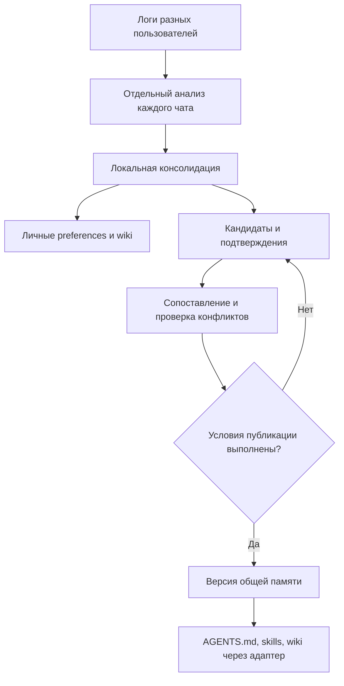

# Research: промежуточное хранилище и публикация общей памяти

Дата исследования: 2026-10-20. Статус: архитектурное предложение, без изменения работающего кода или правил skills.

> Обновление решения от 2026-10-20: пользователь оставил AGENTS.md на личном уровне. Общий хаб содержит skills и рабочую wiki. Рассуждения ниже об общем AGENTS.md, обязательном подтверждении несколькими пользователями и ограничениях личного режима относятся к прежнему варианту и не являются актуальными требованиями. Сохраняется предложение о реестре кандидатов, происхождении, конфликтах и версиях; критерии для skills/wiki ещё нужно выбрать. Актуальное направление: [предложение для конференции](conference-direction.md), [общая архитектура](../proposed-personal-team-memory.md).

## Основной вывод

Для команды нужен устойчивый слой кандидатов и подтверждений между анализом чатов и публикуемой общей памятью. Общий AGENTS.md должен собираться из допущенных к публикации правил. Анализ одного пользователя создаёт предложения, а не немедленно меняет поведение всей команды.

Хранилище «промежуточное» по месту в потоке, но не одноразовое: подтверждения и решения остаются после публикации, чтобы пересматривать правила, исправлять ошибки и объяснять происхождение каждой версии.

Условие подтверждения несколькими пользователями прямо следует из нового требования пользователя. Конкретное минимальное число, механизм оценки независимости и политика спорных случаев пока не согласованы. Ниже два пользователя используются как минимальный пример, а не как доказанный исследованиями порог корректности.

## Что найдено в первичных источниках

| Источник | Что описано в источнике | Что предлагаем использовать |
|---|---|---|
| [LangMem: Core Concepts](https://langchain-ai.github.io/langmem/concepts/conceptual_guide/) | Извлечение и консолидация памяти, различие фактов и правил поведения, фоновая обработка, пространства имён | Переиспользовать наш анализ/консолидацию, отделить персональные сведения от общих инструкций |
| [Zep / Graphiti, статья](https://arxiv.org/html/2501.13956v1) | Связь фактов с исходными эпизодами, время действия факта и время появления в системе, сопоставление новых и прежних фактов | Сохранять происхождение и интервалы действия, не считать каждое различие текста противоречием |
| [W3C PROV-DM](https://www.w3.org/TR/prov-dm/) | Модель происхождения сущностей, действий и участников, отношения производности, цитирования и пересмотра | Отслеживать первичный источник и производные копии, чтобы не считать их независимыми подтверждениями |
| [Microsoft: CQRS](https://learn.microsoft.com/en-us/azure/architecture/patterns/cqrs) | Разделение записи и чтения, включая вариант с одной БД; проекции для чтения | Кандидаты и решения записываем в реестр; AGENTS.md/skills/wiki выдаём агентам как опубликованное представление |
| [AWS: Transactional Outbox](https://docs.aws.amazon.com/prescriptive-guidance/latest/cloud-design-patterns/transactional-outbox.html) | Совместная фиксация изменения и события доставки, повторная отправка и идемпотентность получателя | При сетевой доставке связать выпуск версии с заданием доставки; повтор не создаёт дополнительного подтверждения |
| [SQLite: Appropriate Uses](https://www.sqlite.org/whentouse.html) | Уместность локального хранения, ограничение одного одновременного writer, ограничения прямой сетевой работы с общим файлом | Для прототипа использовать локальную SQLite у одного владельца записи; несколько машин не должны напрямую редактировать общий SQLite-файл |

Это опорные архитектурные идеи. Ни один из перечисленных источников не устанавливает универсальное правило «два пользователя без противоречий → верная инструкция». Проверяемая политика продвижения общего AGENTS.md — наша проектная задача. Мы не сравнивали производительность библиотек и не доказали превосходство одного продукта.

## Обновлённое движение данных

Кандидаты не подключаются к основному агенту как обязательные общие инструкции. Агент читает опубликованную версию. Личный канал обновления работает отдельно, пока общий кандидат накапливает подтверждения.

Обновление хаба и загрузка новой версии всеми уже запущенными агентами — разные события. Некоторые клиенты применят её при новом сеансе или перечитывании. Требуется знать опубликованную и подключённую версию; одновременность всех клиентов обещать нельзя.

## Что должно храниться

Предлагаются пять логических сущностей. Это не утверждённая SQL-схема и не требование немедленно создавать пять таблиц.

### Кандидат

- Стабильный ID и версия формулировки.
- Тип: общая инструкция, skill, рабочее знание.
- Точная формулировка или содержимое материала.
- Область: команда, проект, система данных, среда, класс задач.
- Условия применения и исключения.
- При необходимости — период действия знания и версия определения.
- Состояние проверки.

Если «проверять уникальность ключа при соединении истории» переписали в «всегда запрещать любые дубли», это новая по смыслу формулировка. Старые подтверждения нельзя автоматически засчитать более широкому правилу. Косметическое редактирование также должно оставлять прослеживаемую связь версий.

### Подтверждение или возражение

- ID источника, общий ID человека, исходный агент, сеанс и сообщение/результат инструмента.
- Краткий контекст и доступное подтверждение; полный личный лог не обязан передаваться в общий реестр.
- Отношение к конкретной версии кандидата: подтверждает, возражает, ограничивает область либо только упоминает.
- Кто утверждает содержание: пользователь, документ, результат выполнения или предложение LLM.
- Исходный источник и связь с производными копиями/версией хаба, если она известна.
- Время события и время поступления в реестр.

Отсутствие возражения не является подтверждением. Имя персонажа в тексте не удостоверяет личность: в настоящей командной интеграции user_id задаётся подключением и сопоставляется между агентами. Один человек в Codex и Claude Code не становится двумя пользователями. Для синтетического теста 101–104 — тестовые идентичности.

### Связи между кандидатами

Нужны отношения совпадения, дополнения, несовместимости и замены версии. Наличие двух формулировок само по себе не определяет, какое отношение между ними.

Для конфликта сравниваются предмет, область и пересекающееся время действия. «В v1 тесты включались» и «в v2 тесты исключаются» могут сосуществовать. «SLA D+3» и «SLA D+5» не нужно разрешать выбором самой новой заметки, если обе не утверждены.

### Решение о продвижении

Сохраняется решение по точной версии кандидата: рассмотренные источники, ограничения, обнаруженные конфликты, версия политики проверки, результат и причина. Неуверенность модели — повод оставить кандидат на проверке, а не записать нулевое число конфликтов.

### Публикация

Версия/ID выпуска, ID и версии вошедших материалов, их контрольные суммы, предыдущая версия и статус готовности. Клиент получает только готовый выпуск. Старую версию можно восстановить; факт публикации и подтверждения не исчезают при последующей замене.

Небольшой Markdown-файл агента не должен содержать весь журнал подтверждений. Реестр даёт возможность проверить происхождение, а клиентский файл остаётся кратким.

## Как считать несколько подтверждений

Примеры для общего AGENTS.md:

| Ситуация | Как учитывать |
|---|---|
| Два чата Анны содержат одинаковое правило | Один пользователь; могут усилить подтверждение внутри его опыта, но не выполнить условие нескольких пользователей |
| Анализ и консолидация повторно обработали тот же сеанс | То же свидетельство, не новое |
| Анна использует два разных основных агента | Один человек, не два подтверждающих пользователя |
| Другой сотрудник процитировал уже опубликованный AGENTS.md | Повтор общего источника; не независимый опыт применения |
| Два сотрудника прочитали одну методичку | Один документ как основание; сам по себе повтор текста не доказывает независимого подтверждения |
| Второй сотрудник явно подтвердил применимость правила на своей задаче | Возможное отдельное подтверждение; нужно проверить смысл, контекст и происхождение |
| LLM дважды предложила одно правило | Предложения модели, не два пользовательских подтверждения |
| Пользователь возразил в той же области применения | Возражение сохраняется; нельзя просто перекрыть его количеством сторонников |

Происхождение не всегда наблюдаемо полностью. Если неизвестно, является ли повтор независимым, это неизвестность, а не доказанная независимость. Даже два независимых согласия не гарантируют истинность: порог снижает риск единичного обобщения, но не заменяет проверку содержания.

## Предлагаемая политика публикации AGENTS.md

Для первого теста можно рассмотреть следующую политику; она требует согласования:

1. Кандидат действительно является общим правилом поведения, не личным предпочтением или определением таблицы.
2. Указана проверяемая область применения.
3. Есть подтверждения от нескольких разных людей. Минимальный пример порога — 2, точное значение не утверждено.
4. Эти подтверждения относятся к точной формулировке/области кандидата и не состоят только из копий одного утверждения.
5. Нет обнаруженных неразрешённых противоречий с относящимися к этой области источниками и уже опубликованными правилами. Противоречия ищутся и среди неопубликованных кандидатов.
6. Выполнены нужные проверки применимости; неопределённость явно разрешена или кандидат остаётся на проверке.
7. Решение зафиксировано, версия опубликована целиком.

Нельзя заменять эти условия голосованием «за больше, чем против» или одной оценкой confidence от LLM. На малом каталоге общие инструкции можно проверять целиком; на большом потребуются отбор связанных материалов и оценка полноты поиска. Смысловую непротиворечивость всех произвольных текстов автоматически гарантировать нельзя.

Для явно утверждённых правил руководителя/официальной политики возможен отдельный канал принятия, но он не включается в проект автоматически: пользователь сейчас потребовал подтверждение несколькими пользователями. Исключение из этого требования нужно обсуждать отдельно.

Для skills и data knowledge нужен тот же реестр, но не обязательно тот же порог публикации. Проверенный метод, определение из документа и общее обязательное правило имеют разные основания. В этой работе предлагается механизм хранения и продвижения; политика для каждого типа ещё не утверждена.

## Жизненный цикл кандидата

| Состояние | Значение |
|---|---|
| proposed | Извлечено предложение; основание ещё проверяется |
| pending | Недостаточно подтверждений или неясна область/независимость |
| disputed | Есть неразрешённое противоречие или значимое возражение |
| accepted | Условия политики выполнены; материал может войти в выпуск |
| published | Эта версия включена в опубликованный выпуск |
| superseded / withdrawn | Заменена или отозвана с сохранением истории |

Это предлагаемая модель состояния, не обязательные имена будущих enum. Часть состояний можно хранить отдельно как решение проверки и состояние доставки. Новый спорный факт после публикации открывает пересмотр связанного правила; порядок временной приостановки его применения тоже должен быть определён политикой.

## Роль LLM и обычного кода

**LLM:** выделяет кандидаты, сопоставляет смысл, предлагает связи подтверждения и конфликта, восстанавливает условия применения, предлагает точную новую формулировку.

**Код:** проверяет наличие обязательных метаданных, уникальность свидетельств, идентичности пользователей и версии, считает подтверждения, соблюдает состояния и права записи, выполняет транзакции и формирует файлы только из допущенного содержания.

Код может проверить, что для источника записана связь с кандидатом. Он не доказывает, что смысл этой связи определён без ошибки. Решение LLM не становится формально доказанной непротиворечивостью.

Изменение опубликованной формулировки при красивом переписывании AGENTS.md должно проходить как новая версия кандидата. Для первой реализации лучше собирать файл из точных принятых формулировок, не давать финальному генератору произвольно расширять их смысл.

## Публикация и повторная доставка

Предлагается один владелец публикации общей версии. Основные агенты и анализаторы создают предложения, не перезаписывают общую память напрямую. Технический режим доступа должен поддерживать это разделение; одного запрета в prompt недостаточно.

При подготовке выпуска система фиксирует версии кандидатов и текущую базовую версию каталога, строит полный неизменяемый набор файлов, проверяет его и лишь затем помечает выпуск доступным. Если за время подготовки каталог изменился, решение нужно сверить с новой версией, чтобы параллельные обновления не затёрли друг друга.

Если есть отдельная доставка клиентам, принятие выпуска и запись задания доставки фиксируются вместе; исполнитель повторяет незавершённые задания. Саму БД и несколько клиентских файлов нельзя считать одной транзакцией. Клиент скачивает полный выпуск, проверяет его и переключается после готовности. Повтор получения того же ID выпуска не добавляет свидетельств и не создаёт новые версии.

В исходном AGENTS.md пользователя могут быть вручную написанные правила. Экспорт должен управлять своим явно определённым файлом/разделом или импортом; он не получает права затирать весь пользовательский файл. Точный способ зависит от выходного адаптера.

## Какое хранилище выбрать для первого шага

Наша рекомендация для текущего небольшого проекта: локальная реляционная БД кандидатов и свидетельств плюс Markdown-файлы опубликованных материалов. Первый вариант можно выполнить на SQLite через один последовательный процесс, оставив прежние chat_logs.db источниками логов.

Пока не нужны графовая БД, брокер сообщений, сложная система голосования, векторное хранилище или полный Event Sourcing. Контекстные связи можно сначала хранить обычными записями. Из CQRS берём разделение записи предложений и чтения опубликованных файлов, не всю распределённую инфраструктуру.

Для команды на разных машинах можно передавать подготовленные пакеты одному владельцу реестра через согласованный интерфейс. Не предлагается раздать всем прямой доступ к одному SQLite на сетевой/синхронизируемой папке. При необходимости нескольких серверных writers можно перейти на серверную БД, сохранив модель кандидатов и адаптеры.

Название базы, число таблиц и API не выбираются в этом исследовании. Содержимое подтверждения может оставаться Markdown/JSON; структурируются технические идентификаторы, связи, состояния и версии. Это не возврат к жёсткой Python-схеме всего аналитического текста.

## Какие варианты сравнивались

Следующая таблица — наша оценка применимости к проекту, не результаты опубликованного benchmark.

| Вариант | Оценка |
|---|---|
| Сразу редактировать общий AGENTS.md после каждого пользователя | Не выполняет требование накопления подтверждений и отделения кандидатов от принятого |
| Хранить только Markdown-предложения | Хороший ручной старт, но подтверждения, дубли и состояния придётся дисциплинированно учитывать отдельно |
| Git с предложениями изменений | Полезен для истории/доставки; сам по себе не определяет, кто независимо подтвердил правило |
| Только векторный поиск памяти | Помогает находить близкие тексты, но не заменяет версии, статусы, происхождение и политику публикации |
| Временной граф знаний | Полезен при развитых связях и обновлениях фактов, но избыточен для первого набора правил; временную модель можно перенять отдельно |
| Реляционный реестр + опубликованные Markdown | Предлагаемый первый вариант: проверяемые связи и версии без зависимости основного агента от новой технологии |

## Что изменить в текущем проекте после согласования

1. Оставить отдельный анализ каждого чата, но дополнить выжимку источниками, областью и явными кандидатами. Заголовок AGENTS.md в выжимке означает предложение, а не разрешение публикации.
2. В локальной консолидации сохранить личные preferences/wiki. Вместо прямой записи общего AGENTS.md формировать кандидаты и подтверждения. Для skills и рабочих знаний использовать общий реестр с отдельной политикой.
3. Добавить сопоставление кандидатов разных пользователей и их свидетельств с существующим реестром. Чтение накопленного нужно до принятия решения, не после перезаписи файла.
4. Добавить проверку политики продвижения и журнал решений.
5. Добавить формирование версии общей памяти и её подключение через адаптеры.
6. Запретить обход публикации самостоятельной записью основного агента в управляемые общие материалы. В синтетическом прогоне такой обход уже наблюдался для локальных файлов; не считать его работой фонового этапа.

Реализация не выполнялась. Существующие файлы анализатора и skills остаются в текущем состоянии. В частности, нынешняя консолидация ещё умеет напрямую изменять AGENTS.md: это расхождение с целевой архитектурой, а не уже работающая проверка нескольких пользователей.

## Проверка на нашей синтетической команде

1. Правило есть только в C01/C05 Анны → остаётся кандидат; distinct user count = 1.
2. Повторный анализ C01 → не меняет число независимых свидетельств.
3. Борис подтверждает то же правило в своей области применения → проверяются содержание и независимость; только затем пересматривается допуск.
4. Вера возражает в той же области → кандидат становится спорным; простое большинство не публикует его.
5. Возражение относится к другой среде → сначала разделить области, затем оценить каждую версию.
6. v1/v2 метрики → сохранить период и версию; не объявлять историческое изменение логической ошибкой.
7. Один общий документ процитирован четырьмя людьми → четыре цитирования не становятся четырьмя независимыми первоисточниками.
8. Агент пересказал подключённый AGENTS.md → не усиливает правило без нового опыта применения.
9. Сбой между записью решения и доставкой → повтор доставляет ту же версию без новых подтверждений.
10. Новое доказательство меняет уже опубликованное правило → сохраняются история и связь с заменяющей версией; политика пересмотра применяется явно.

Это будущие проверочные сценарии, не выполненные тесты.

## Личный режим и решения до реализации

При одном человеке невозможно выполнить условие нескольких разных пользователей. Личный режим должен иметь отдельную явно выбранную политику: например, повторные независимые эпизоды одного владельца. Такое персональное принятие не должно автоматически означать допуск в командный AGENTS.md при последующем подключении команды. Точный критерий личного режима ещё не согласован.

Перед первым кодом нужно согласовать: минимальное подтверждение общего правила, смысл независимости, политику нового возражения к действующему правилу и отдельные критерии для skills/wiki. Эти решения существенно влияют на поведение системы; их нельзя незаметно подменять эвристиками LLM.
