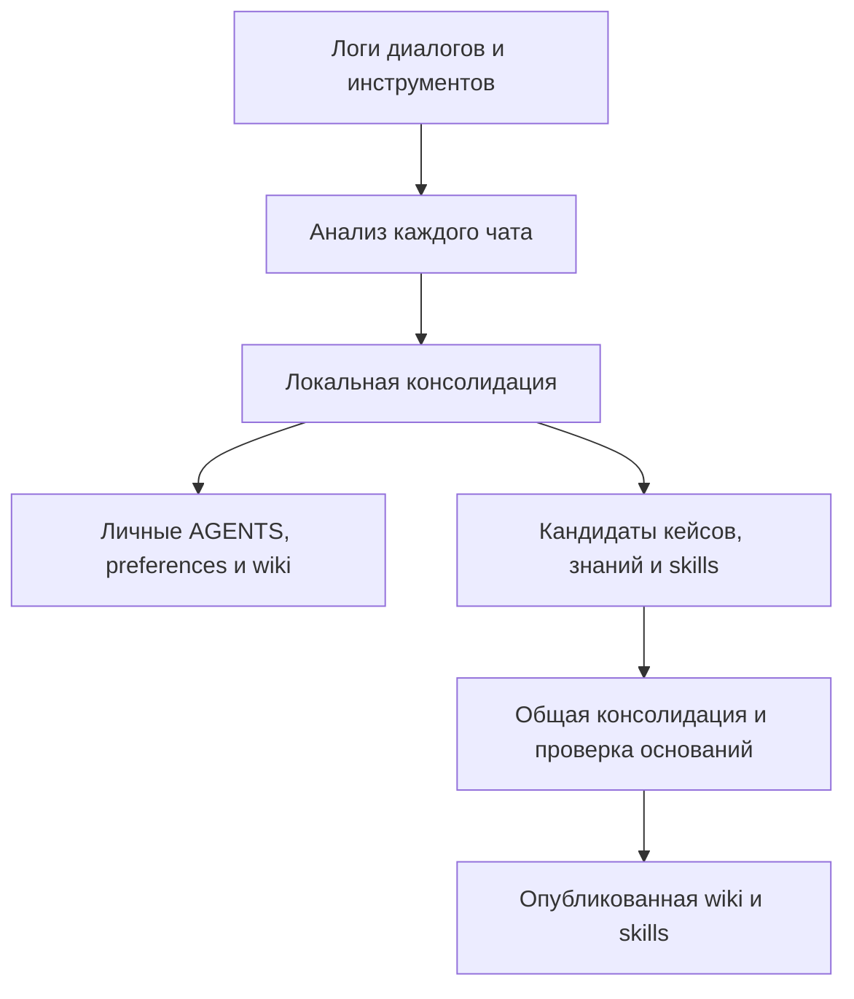
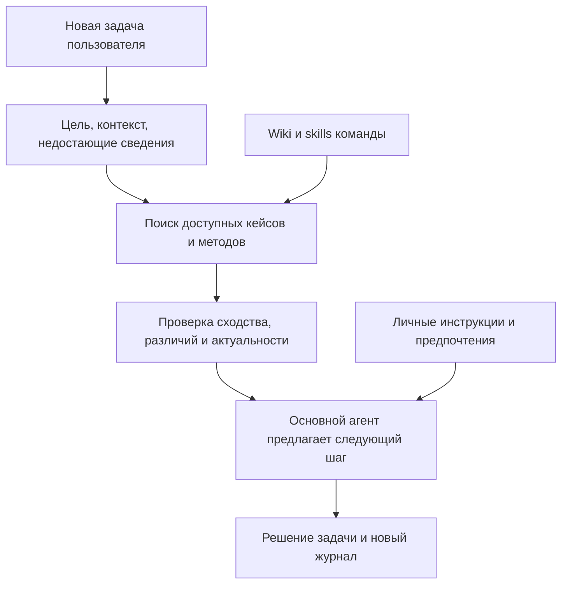

# Помощь новому сотруднику на основе опыта команды

Дата: 2026-10-20. Статус: архитектурное предложение после уточнения сценария руководителем. Описанные дополнения пока не реализованы.

## Основной вывод

Существующий цикл анализа и консолидации подходит для получения знаний. Для нового сценария его нужно дополнить памятью о конкретных задачах и механизмом обращения к ней во время работы.

Предлагаемая цель: пользователь описывает желаемый результат, а основной агент сам находит подходящий опыт команды, объясняет сходство и ограничения, помогает выбрать способ решения и предлагает первый шаг.

В первом прототипе рекомендуются карточки задач внутри общей wiki, связанные определения и skills, индекс каталога и skill сопровождения новой задачи. Главный агент пользуется существующими файловыми инструментами. Центральный поисковый сервис можно добавить позже через отдельный адаптер.

AGENTS.md и USER_PREFERENCES.md остаются личными. Общая wiki содержит рабочие определения и опубликованные карточки задач. Общие skills содержат переносимые методы. Это предложение о новой части wiki, а не решение публиковать личные логи команды.

## Как меняется пользовательский сценарий

Раньше основной проверкой было: новый сеанс использует сохранённый метод и предпочтения. Теперь требуется также:

1. Понять цель, даже когда пользователь не знает нужных источников и последовательности действий.
2. Самостоятельно обратиться к опыту команды.
3. Показать один-два полезных примера с объяснением применимости.
4. Уточнить действительно недостающую информацию и предложить следующий шаг.
5. По ходу решения повторить поиск, если задача существенно изменилась или возникло препятствие.

«Проактивность» здесь означает инициативу внутри начатой пользователем задачи. Для этого сценария не требуется наблюдать за другими приложениями, запускать уведомления или угадывать задачу до первого запроса.

Пример желаемого диалога, иллюстрация на основе нашей синтетики:

> Пользователь: «Нужно собрать отчёт по одобрениям за прошлый месяц. Я не понимаю, с чего начать».
>
> Агент: «В опыте команды есть два близких случая: сверка определения показателя и построение исторического среза. В первом проверяли состав заявок в знаменателе, во втором учитывали время события и время его загрузки. Для вашего отчёта сначала нужно определить: воспроизводим то, что было известно тогда, или пересчитываем прошлый период с учётом поздних данных? После этого предложу состав выгрузки».

В настоящем ответе названия кейсов должны вести к доступным карточкам. Агент не должен говорить «мы успешно решали», если в журнале есть только предложение метода без результата.

## Что уже есть и чего не хватает

| Компонент | Фактическое состояние | Изменение для нового сценария |
|---|---|---|
| Журнал основного агента | SQLite с сообщениями, tool results и message_json | Использовать ID событий, время и связи вызовов как основания карточек |
| Анализ чата | Отдельный экземпляр агента на каждый сеанс, Markdown-отчёт | Сохранять конкретные рабочие эпизоды вместе с обобщёнными выводами |
| Консолидация | Дополняет локальную память, обобщает методы | Сохранять кейсы, связывать их с wiki/skills, учитывать результаты и версии |
| Wiki | Текущие skills ограничивают её определениями, сообщёнными пользователем | Расширить правила на наблюдаемые рабочие знания и карточки задач |
| Происхождение | Оба skills запрещают ссылки на чаты и историю извлечения | Разрешить проверяемые источники в карточках/метаданных |
| Общий хаб | Описан в документации; отдельная публикация ещё не реализована | Подготовить кандидатов, опубликованный каталог и индекс |
| Помощь по похожим задачам | Отдельного механизма нет | Добавить поиск, проверку применимости и поведение наставника |
| Другие агенты | Адаптеры ещё не реализованы | Проверить подключение на втором потребителе после локального пилота |

Основания: [анализатор](../../analyze_chats_codex.py), [консолидация](../../consolidate_reports_codex.py), [основной агент](../../user_workspace/main.py), [skill анализа](../../agents/analyze-chat/skills/analyze-chat/SKILL.md), [skill консолидации](../../agents/consolidation/skills/consolidation/SKILL.md).

При проверке analyzer настроен на Бориса, user_id=102, и два его сеанса. Consolidator по-прежнему читает отчёты из обычного user_workspace. Это разные рабочие области; наличие файлов ещё не означает, что командная консолидация была выполнена.

В действующих skills также осталось прежнее трактование AGENTS.md как общих правил организации. Документация уже отражает решение оставить его личным, но правила исполнения ещё нужно согласованно обновить. Настоящее исследование их не меняет.

## Три вида общей памяти

| Вид | На какой вопрос отвечает | Пример |
|---|---|---|
| Кейс, или эпизод задачи | Что команда действительно делала в похожей ситуации? | Восстановление исторического состояния заявок с поздними загрузками |
| Рабочее знание | Что означают данные и какие правила действуют? | Значение occurred_at и loaded_at; определение метрики конкретной версии |
| Skill | Как решать этот класс задач? | Выбор временного среза, определённый порядок событий, проверка кардинальности |

Один полезный рабочий эпизод может заслуживать карточки, даже если его недостаточно для универсального skill. Неудачная попытка тоже может сохраняться с явным исходом и объяснением ограничения.

Несколько кейсов могут поддерживать один skill. Консолидация не должна стирать различия между ними. Конкретный кейс остаётся историческим фактом, даже когда общий метод уже изменился.

Предлагаемая организация опубликованных материалов:

```text
hub/
  wiki/
    index.md
    cases/
    knowledge/
  skills/
```

Это иллюстрация структуры, новые каталоги в этой работе не создавались. Полный журнал источников и кандидаты могут храниться отдельно от этого представления.

## Содержимое карточки задачи

Для пилота достаточно следующих полей, без сложной онтологии:

| Поле | Назначение |
|---|---|
| ID и версия | Ссылка на тот же кейс при повторной обработке и уточнении |
| Цель и результат работы | Найти кейс по намерению пользователя, а не только по названиям таблиц |
| Проект, данные, условия, период | Проверить, применим ли опыт в новой задаче |
| Исходная проблема | Сохранить существенное затруднение, которое решали |
| Принятый подход и причины выбора | Объяснить пользователю последовательность и развилки |
| Ошибочные попытки и ограничения | Предупредить повторение конкретной ошибки |
| Наблюдаемый итог | Отличать предложение, выполненную попытку, проверенный результат и неизвестный исход |
| Источники и артефакты | Привязать утверждения к событиям; указать, доступен ли запрос или файл |
| Ссылки на wiki и skills | Перейти от примера к определению или общему методу |

Статус результата должен опираться на наблюдаемое подтверждение: выполненную проверку, артефакт, инструментальный результат или явную оценку человека. Последняя уверенная реплика LLM не доказывает успех.

В опубликованной карточке может находиться переносимый SQL-шаблон или доступный артефакт. Если лог содержит только имя файла, нельзя восстановить его содержимое из этого имени или обещать, что коллега сможет его скачать. Личные пути заменяются входными параметрами.

Источник кейса должен быть проверяем владельцем системы. Получатель видит разрешённую карточку и доступные основания; ссылка на чужую приватную SQLite сама по себе не даёт ему возможности проверить вывод.

## Накопление опыта



Анализатор получает события с идентификаторами и выделяет рабочие эпизоды в том же проходе, где извлекает предпочтения и методы. Обязательный отдельный проход по всем файлам не требуется. Используется только содержимое, реально присутствующее в доступных журналах; обрезанные результаты обозначаются как неполные.

Один чат может содержать несколько задач, а одна задача — продолжаться в нескольких чатах. Для первого прототипа можно создавать отдельные карточки эпизодов и связывать явно подтверждённые продолжения. Автоматически объединять их только по похожей теме нельзя.

Реестр сохраняет кандидата, источники, найденные конфликты и решение о публикации. Обычный код отвечает за версии, запись и повторную обработку; LLM предлагает смысловые связи и формулировки. Повтор того же события не становится новым подтверждением.

Кейс можно опубликовать как подтверждённое описание одной ситуации без ожидания нескольких пользователей. Это не делает его универсальным методом. Условия продвижения в общий skill проверяются отдельно. Такой подход позволяет системе приносить пользу даже небольшой команде.

## Использование опыта в новой задаче



Предлагаемый порядок:

1. Сформировать краткое описание цели, результата и известных ограничений. Не требовать от новичка знать точные названия источников.
2. Искать по цели и проблеме, дополнительно используя предметную область, сущности и названия данных. Ограничить поиск доступной командой/проектом до передачи найденного контекста LLM.
3. Прочитать небольшой набор карточек, связанные определения и подходящий skill. Для пилота можно начать с 3–5 кандидатов; число уточняется экспериментом.
4. Проверить совместимость данных, времени, среды и ожидаемого результата. Сходство формулировок ещё не означает применимость метода.
5. Выбрать один-два полезных случая и объяснить: что было, почему это похоже, что отличается, какой шаг предлагается.
6. Если принципиальная развилка неясна, задать конкретный вопрос. Если подходящих кейсов нет, предложить обычный план без выдуманной ссылки на опыт команды.

Повторный поиск нужен при существенном уточнении цели, новой подзадаче или препятствии. После каждого короткого ответа пользователя повторять одинаковые примеры не требуется. Сессия хранит уже показанные кейсы и выбранный способ работы.

В пилоте поиск выполняется через индекс и файловое чтение. Затем можно добавить полнотекстовый и семантический поиск: первый полезен для точных имён, второй — для разных формулировок одной цели. Выбор поисковой технологии должен опираться на пропуски и ошибки в контрольных задачах.

Личные предпочтения влияют на подачу и допустимый способ выполнения. Они не меняют смысл командных определений. Автор кейса не обязан быть назван в ответе: для полезной подсказки обычно достаточно доступной карточки задачи.

## Как инициировать поиск без изменения основного агента

В [исходной концепции](../vision.md) зафиксировано ограничение: не менять исходный код, модель, system prompt и реализацию инструментов основного агента. Рекомендуемый пилот ему соответствует.

Предлагается подключаемый skill сопровождения рабочих задач. Его условие применения: новая содержательная задача, неясный способ решения или препятствие. Он задаёт поиск кейсов, проверку их применимости и форму предложения пользователю. Каталог памяти доступен через уже поддерживаемые файловые инструменты.

Это поведение нужно проверять на запросах без фраз «вспомни» и «найди похожие задачи». Skill и его описание повышают вероятность обращения к памяти, но не гарантируют вызов на каждом нужном шаге у любого агента.

Более строгий запуск возможен через поддержанный клиентом hook или middleware до ответа. Такой вариант требует интеграции с конкретным агентом и отдельно согласованного изменения исходных ограничений, если нужно менять его код. MCP предоставляет доступ к инструментам памяти, но сам по себе не обеспечивает обязательный вызов.

## Варианты и сложность

Оценки ниже — предварительные трудозатраты одного разработчика, знакомого со стеком, от текущего прототипа до локальной демонстрации с базовой проверкой. Диапазоны разных вариантов не суммируются. В них не входят промышленная авторизация, эксплуатация сервиса, адаптеры всех внешних агентов и полноценное пользовательское исследование.

| Вариант | Устройство | Преимущества | Основные ограничения | Оценка |
|---|---|---|---|---|
| A. Только wiki и skills | Дополнить нынешние файлы и научить агента предлагать методы | Быстро; мало новых компонентов | Сведения о конкретных задачах и основаниях теряются при обобщении | 2–4 рабочих дня, низкая сложность |
| B. Каталог кейсов + wiki + skills | Карточки в wiki, индекс, простой реестр, skill сопровождения | Прямо покрывает сценарий; понятные источники; соответствует файловому подключению | При росте каталога нужен более качественный поиск; инициатива агента требует оценки | 7–12 рабочих дней, средняя сложность; рекомендуемый пилот |
| C. Центральный поиск | Та же модель материалов, сервер поиска, фильтрация доступа, подключение через MCP/API | Удобнее для нескольких клиентов и большого каталога | Аутентификация, синхронизация, версии клиентов, поиск и доступность сервиса | 15–25 рабочих дней, средняя/высокая сложность |
| D. Граф задач и знаний | Явные связи задач, источников, данных, решений и зависимостей | Помогает находить связанные методы и последствия изменений | Качество извлечения связей и их сопровождения; усложняет диагностику | 25–45 рабочих дней, высокая сложность |

Главный источник неопределённости в оценках — качество извлечения кейсов и применимости рекомендаций. Если журналы не сохраняют результаты или обрезают нужные данные, потребуется исправлять сбор логов. Индекс сам эту проблему не решит.

Отдельный агент-наставник — ещё один выбор, независимый от вида хранилища:

- Основной агент может сам искать кейсы и общаться с пользователем. Это самый короткий путь для нашего пилота.
- Отдельный консультант может принимать описание задачи и возвращать основному агенту варианты с источниками. Он централизует рассуждения, но добавляет LLM-вызовы, передачу контекста и возможность расхождения рекомендаций.
- Отдельный пользовательский чат наставника удобен как самостоятельный продукт, но потребует переходить между ним и исполнителем. Для цели «подключить к любому своему агенту» это менее прямой путь.

Количество агентов не заменяет правильную модель памяти. В первом варианте онлайн-консультант как отдельный LLM-процесс не требуется.

## Минимальный план реализации варианта B

| Работа | Результат | Ориентир |
|---|---|---|
| Уточнить формат кейса и критерии результата | Проверяемая карточка на примерах существующих чатов | 1 день |
| Расширить анализ и консолидацию | Автоматическое извлечение карточек и источников; сохранение личных настроек | 2–3 дня |
| Добавить реестр и публикацию | Повторы не создают копии; подготовленные кейсы, wiki и skills доступны через индекс | 1–2 дня |
| Подключить сопровождение задачи | Основной DeepAgent сам использует каталог и предлагает действия | 1–2 дня |
| Проверить новые задачи и ошибки | Отложенные сценарии, сравнение вариантов, исправление основных дефектов | 2–4 дня |

Диапазон по работам составляет примерно 7–12 дней; это ориентир для планирования, не обещание срока. Сначала проверяем несколько кейсов нашей синтетики. Внешний агент подключается после подтверждения пользы локального цикла; его адаптер оценивается после изучения реального формата журналов и способа подключения.

## Проверки, отличающие наставника от обычной памяти

| Сценарий | Что наблюдаем |
|---|---|
| Новичок описал только цель | Агент сам нашёл кейс и предложил полезный шаг |
| У задачи две правдоподобные трактовки | Агент уточнил существенную развилку, а не выбрал случайную |
| Похожая формулировка, другой проект | Чужое определение не перенеслось автоматически |
| В прошлом кейсе был только план | Агент не представил его как доказанно успешное решение |
| Упомянутый файл отсутствует в общем доступе | Агент не обещал готовую выгрузку и не выдумал её содержимое |
| Есть обновлённое определение | Агент учитывает нужную версию и период |
| Нет подходящего кейса | Агент прямо обозначил отсутствие примера и продолжил помогать |
| Повторный анализ тех же логов | Не появилось новых копий кейсов или фиктивных подтверждений |

В текущих holdout-запросах пользователь прямо просит пользоваться памятью и называет нужную предметную проблему. Для нового сценария нужно добавить запросы новичка без таких подсказок. Эталонные кейсы и допустимые первые шаги задаются отдельно от входа агента.

Сравнение: личная память; поиск по разрешённым исходным логам; wiki + skills; кейсы + wiki + skills. Для всех условий одинаковы задачи, личные настройки, модель, инструменты и лимиты. Условия с кейсами и без них позволяют проверить пользу именно нового представления.

Метрики: правильность конечного результата; уместность первого предложенного шага; правильность выбора кейса; наличие оснований у исторических утверждений; число лишних уточнений и повторных подсказок; время и стоимость. Число ссылок или частота открытия skill не являются самостоятельной мерой пользы.

Проверки на синтетике покажут работоспособность механизма. Для заявления «новичкам стало проще» нужен небольшой отдельный пилот с людьми: измерить время до первого полезного действия и завершения задачи, долю завершённых задач и понятность подсказок. Симулятор пользователя не заменяет такую проверку.

## Связь с исследованиями и конференцией

- [Agent Workflow Memory](https://arxiv.org/abs/2409.07429) показывает подход извлечения повторно используемых рабочих процессов из опыта агента. Это опора для нашей процедурной памяти, а не доказательство качества наставничества новичков.
- [ShareMem](https://arxiv.org/html/2609.32511v1) изучает передачу опыта между пользователями с сохранением личных предпочтений. Это близкая основа для разделения общей и личной памяти.
- [CBR-augmented R&D-Agent](https://arxiv.org/abs/2606.05250) исследует структурированные кейсы, программные артефакты и сведения о качестве. Это конкретный пример применения памяти кейсов; его ограниченная оценка не доказывает преимущество для нашего рабочего сценария.

Предлагаемый акцент доклада: «Агент помогает новичку выбрать первый рабочий шаг, используя проверяемый опыт коллег, автоматически извлечённый из диалогов».

Возможный вклад — реализация и воспроизводимая оценка этого сценария: неполная постановка задачи, сведения от разных сотрудников, подходящие и неподходящие аналогии, сохранение личных настроек, выполнение в другом агенте. Новизна всей комбинации пока не доказана и требует отдельного сопоставления; архитектура кейсов и извлечение опыта имеют предшествующие работы.

Следующее решение перед кодом — утвердить карточку кейса и поведение первого ответа на один запрос новичка. Этого достаточно, чтобы перейти к небольшому сквозному прототипу и измерить пользу.
