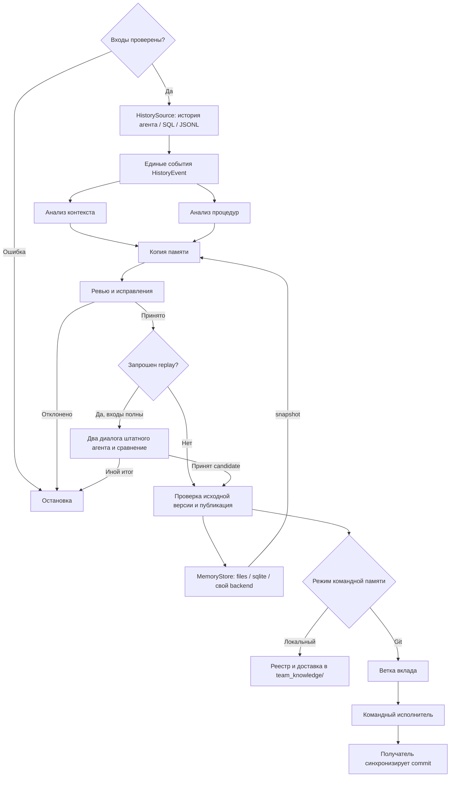

# Руководство по запуску Command Agent Memory

Установка скиллов, настройка Python CLI и сборка проекта. Команды для исходного кода выполняются из корня репозитория. [Обзор проекта](../README.md).

## Два способа запуска

| Поставка | Кто управляет этапами | Что устанавливать |
| --- | --- | --- |
| Автономные Agent Skills | Штатный агент клиента вызывает восемь скиллов этапов, ведёт журнал и передаёт результаты следующему исполнителю | Из `agent-memory-skills-with-setup.zip` распакуйте **все десять папок** в каталог скиллов клиента. Нужен Python 3.11+ для файловых операций, SQLite и Git. |
| Python-приложение | `run_pipeline` вызывает агентный harness на каждом модельном этапе. Встроены Codex CLI и OpenRouter DeepAgents | Установите wheel или исходный проект. Для OpenRouter установите дополнение `[openrouter]`. |

В автономной поставке главный скилл называется `agent-memory-cycle`. Пример запроса:
«Через agent-memory-cycle обнови память по последнему диалогу этого проекта».
Для replay укажите сценарий, для командной доставки — настройки team. Модели
и инструменты предоставляет текущий клиент. Дополнения OpenRouter и установка
Python-приложения для этого пути не требуются. Инструкции этапов можно вызывать
по отдельности. [Порядок работы](../.agents/skills/agent-memory-cycle/SKILL.md).

Сборка автономного архива из checkout:

```powershell
python scripts/build_memory_skill.py --standalone --output dist/agent-memory-skills-with-setup.zip
```

Команда может назначить одного фонового исполнителя. Для пилота на Windows он запускается раз в пять минут. Участники отправляют вклады и смотрят их статус из своих скиллов. [Установка исполнителя](git_team_memory.md#фоновый-исполнитель-на-windows).

## Совместимый скилл с Python-конвейером

Скилл `update-agent-memory` запускает обновление через штатных субагентов
текущего клиента. Комплект включает конвейер и встроенные инструкции этапов.
Для личного обновления достаточно Python 3.11+ и агента с доступом к локальным
файлам и штатным субагентам или отдельным сессиям. Модельные задания передаются
им через локальные файлы. Аккаунт и модель остаются у клиента.

Из архива `update-agent-memory-with-setup.zip` распакуйте папки `update-agent-memory` и `agent-memory-setup`
в `.agents/skills/` для Codex или в `.claude/skills/` для Claude Code. В рабочем
проекте попросите агента
«Обнови память проекта по последнему диалогу через update-agent-memory».
Без конфига скилл найдёт историю текущего проекта и применит принятую версию
к `AGENTS.md` или `CLAUDE.md`. Знания и локальные журналы находятся в
`.agent-memory/knowledge/` и `.agent-memory/runs/`. Скилл создаёт `.gitignore`
внутри штатного каталога журналов до записи рабочей истории. Для своего
`workspace` настройте Git отдельно. Ранее добавленные в Git файлы журналов
остаются в индексе.
Для другого агента скилл принимает экспорт JSONL, а для пользовательских источников,
хранилищ и Git использует существующий `memory_pipeline.json`.

В Codex скилл может провести replay на двух независимых штатных сессиях с
проверкой профилей. Для этого нужны исходные реплики, входные данные и эталон.
Запрошенный через скилл replay без этих материалов останавливается до публикации.
В исходном CLI рабочий агент выбирается через фабрику сценария.
[Режимы скилла](../.agents/skills/update-agent-memory/references/modes.md).

### Первый запуск скиллов

В рабочем проекте попросите «Через `agent-memory-setup` настрой память для этого
проекта». Скилл проверит существующий `memory_pipeline.json` или предложит новый.
Для Codex и Claude Code он попробует найти журнал по рабочему каталогу проекта.
Если источник не удалось подключить, скилл уточнит путь или поможет настроить запись
или экспорт. Он сохраняет конфиг после проверки чтения истории. Обновление памяти
запускается отдельным запросом. Оба скилла обновления подхватят конфиг из корня проекта.
[Скилл настройки](../.agents/skills/agent-memory-setup/SKILL.md).

### Проверенные клиенты и режимы

- **Codex Desktop.** Распакованный комплект прошёл обновление и парный replay
  на штатных субагентах в изолированном проекте. Новая сессия получила правило
  из предложенной памяти.
- **Codex CLI на Windows.** В отдельном запуске `0.171.0` обнаружил установленный
  скилл. Политика запуска команд в проверочной среде остановила shell до старта
  конвейера.
- **Claude Code.** Из каталога `.claude/skills/` проверено чтение синтетического
  лога текущего проекта. Полный прогон с моделями требует авторизации клиента.
- **Командный Git.** Проверен полный цикл через локальный bare-репозиторий
  и чтение доставленного снимка новым агентом. [Проверки Git](../specifications/distributed_team_memory.md#проверки-и-история).

## Установка и запуск

Требуется Python 3.11 или новее. Из каталога проекта:

```powershell
python -m venv .venv
.venv\Scripts\Activate.ps1
python -m pip install -e .
python -m command_agent_memory --config docs/examples/jsonl_to_file_memory/memory_pipeline.json --validate-only
```

Базовый пакет работает без сторонних Python-библиотек. Для исполнения через
Codex нужен отдельно установленный и авторизованный Codex CLI.
Для OpenRouter и диалоговой проверки:

```powershell
python -m pip install -e ".[openrouter,replay]"
$env:OPENROUTER_API_KEY = "ваш ключ"
```

Для сжатых историй `.jsonl.zst` установите дополнение `.[zstandard]`.
Драйвер внешней SQL-базы устанавливается отдельно.

Для replay явно задайте штатную фабрику рабочего агента в поле `agent` сценария.
Она сохраняет его модель, инструменты и права. Встроенная общая сборка находится
в `command_agent_memory.working_agent`; её использует также обычное приложение.
Сравниваются два свежих запуска с прежней и предложенной памятью.

Пример поля `agent` в replay-сценарии для встроенного рабочего агента:

```json
"agent": {
  "factory": "command_agent_memory.working_agent:create_session",
  "options": {
    "model": "YOUR_WORKER_MODEL_ID",
    "model_parameters": {"temperature": 0}
  }
}
```

Для внешнего агента укажите его собственную фабрику, которая создаёт независимую
сессию с исходными инструментами и настройками. Формат истории не восстанавливает
инструменты автоматически. Несовпадение профилей двух сессий блокирует сравнение.
Docker не требуется. Локальный shell сохраняет права пользователя; рабочая копия
файлов не ограничивает доступ к ОС. Подключение к внешним ресурсам и подготовку
их состояния для каждого прогона обеспечивает фабрика.

Основные режимы CLI вызываются из корня рабочего проекта.

```powershell
command-agent-memory --config memory_pipeline.json --validate-only
command-agent-memory --config memory_pipeline.json
command-agent-memory --config memory_pipeline.json --evaluate-by-replay
```

Те же параметры принимает `python -m command_agent_memory`.
`--validate-only` проверяет входы без моделей и записи памяти.
Рабочий запуск обращается к выбранным моделям и публикует принятый результат.
После общей валидации отказ или ошибка одного участника оставляют его прежнюю
память и позволяют обработать остальных. CLI сообщает причину и возвращает
ненулевой код, если хотя бы один цикл был отклонён или завершился со сбоем.
Флаг `--json` выводит структурированный итог, сообщения этапов идут в stderr.
Проектный скилл `$update-agent-memory` использует тот же конвейер со штатными
субагентами клиента в роли исполнителей.
Пользовательские расширения выполняются как доверенный Python-код, включая импорт
при validate-only; их автор должен соблюдать договор о чтении без записи.

## Конфигурация

```json
{
  "defaults": {"provider": "codex", "model": "YOUR_MODEL_ID"},
  "users": [
    {
      "user_id": "alice",
      "workspace": "./runs/alice",
      "source": {"type": "jsonl", "path": "./conversation_events.jsonl"},
      "memory": {
        "type": "files",
        "root": "./agent-project",
        "personal": ["AGENTS.md"],
        "knowledge": ["notes"]
      }
    }
  ]
}
```

Замените `YOUR_MODEL_ID` на доступную вам модель. Все относительные пути считаются
от каталога конфигурации. `conversation_events.jsonl` содержит один объект на строку:

```jsonl
{"id":"1","session_id":"chat-1","role":"user","content":"Пиши документацию на русском."}
{"id":"2","session_id":"chat-1","role":"assistant","content":"Принято."}
```

Память можно хранить в SQLite, заменив блок `memory`:

```json
"memory": {
  "type": "sqlite",
  "path": "./memory/alice.db",
  "personal": ["AGENTS.md"],
  "knowledge": ["notes"]
}
```

В SQLite используется таблица `memory_documents(path, content)`.
Конвейер работает с локальной копией документов и сохраняет результат в БД.
Чтение этой БД самим рабочим агентом подключается средствами его SDK.
Для агентов, читающих файлы инструкций, используйте файловую память.

Модели отдельных этапов переопределяются через `stages`; `wishes_file` добавляет
общие пожелания к каждому запросу. Ключи передавайте через окружение.
Необязательные локальные настройки находятся в `local_settings/agent_settings.py`;
пример — `local_settings/agent_settings.example.py`. Этот файл не входит в пакет и Git.

Для собственного подключения скопируйте `memory_pipeline.example.json` в
`memory_pipeline.json` и замените модель, `USER_ID` и внешние пути. Поле
`users[].workspace` задаёт каталог обработки приложения, например `./runs/USER_ID`;
действующая файловая память агента задаётся через `memory.root`. Локальная
конфигурация и `runs/` исключены из Git. Шаблон не запускается до подстановки
ваших путей к истории и памяти.

## Схема работы



В CLI и в скиллах запрошенный replay требует полного сценария. Неполные входы останавливают запуск до публикации.
При выполненном replay публикация требует выбора `candidate`.
Ревью по умолчанию ограничено 300 секундами и 24 вызовами OpenRouter;
исчерпание бюджета сохраняет прежнюю память. Параметры задаются в `stages.review`
через `timeout_seconds` и `max_model_calls` (для Codex — только время).
У консолидаторов OpenRouter файловые инструменты разрешают запись только в область
текущего этапа; shell при этом отключён. Встроенные исполнители передают описание фактической ОС
и рабочего каталога. Подробнее — в руководстве по настройке.
`"team":{"root":"./shared-memory"}` включает командное объединение знаний;
личные правила в него не передаются. Командная память публикуется в файлы.
Для локальной доставки добавьте `"workspaces":["./agent-b"]` в `team`.
Каталоги получателей должны существовать; в каждом обновляется `team_knowledge/`.
Относительные пути считаются от конфигурации. Доставка выполняется после принятия
командной версии, включая повторный запуск без новой консолидации. Запускайте её
между задачами рабочего агента: несколько файлов не заменяются атомарно для читателя.
DeepAgents-агент из этого пакета подключает командный индекс и skills при создании;
для других агентов способ подключения задаётся отдельно.

В распределённом режиме `team.type: git` личный цикл отправляет выбранные
знания. `--team-process` применяет вклады, `--team-sync` доставляет снимок
конкретного commit. Для задачи DeepAgents используйте `create_team_session()`.
[Настройка Git-доставки](git_team_memory.md).

Файловая публикация сохраняет backup и устойчивый журнал, восстанавливается после
остановки процесса до следующего чтения через хранилище и сохраняет внешние правки
при откате. `read_session()` фиксирует память на время задачи. Независимого читателя
нужно останавливать между задачами: несколько файлов не меняются одной операцией ОС.
SQLite-публикация выполняется одной транзакцией с проверкой исходного снимка.
Неизменные принятые результаты используются повторно.
Версии встроенных `SKILL.md` и `references/` входят в отпечаток запуска;
изменение инструкций отменяет повторное использование результата.

Командный реестр `.registry/state.json` сохраняет источники, версии и основания
решений. Действующая память и доставка включают только `accepted`; кандидаты
`pending` и несовместимые утверждения `conflicts` остаются в реестре.
Консолидатор возвращает решения по знаниям, приложение проверяет их и публикует
документы. Числовой порог подтверждений не вводится.
Формат, переходы и перенос прежней памяти: [командный реестр](team_memory_registry.md).

## Что поддерживается

| Область | Встроено | Расширение |
| --- | --- | --- |
| История | Claude Code, Codex rollout, GigaAgent/LangGraph, Phoenix, JSONL, SQLite | `HistorySource` |
| SQL-история | DB-API драйвер, свой SELECT и параметры | Драйвер БД; для NoSQL — собственный источник |
| Модели | Codex CLI, OpenRouter | `ModelAdapter` |
| Память | Файлы/каталоги, SQLite | `MemoryStore` |
| Командная доставка | Локальные каталоги, Git | Внешняя интеграция чтения памяти для рабочего агента |

Для произвольной системы нужен адаптер или поддерживаемый экспорт.
Автоматического распознавания любого агента или базы нет.

## Структура

[Схема модулей](architecture/project-structure.md) · [Карта файлов и импортов](project_structure.md).

Каждый скил содержит `SKILL.md` с полями `name` и `description`; `name` совпадает
с именем каталога и использует строчные буквы и дефисы. Дополнительные материалы
располагаются в `references/` соответствующего скила. Загрузчик
`get_skill_path(name, resource="SKILL.md")` разрешает пути внутри выбранного пакета.
Встроенные скилы включаются в wheel и доступны после установки приложения.

Структура соответствует [Agent Skills](https://agentskills.io/specification)
и [формату скилов Hermes](https://hermes-agent.nousresearch.com/docs/user-guide/features/skills).
В Hermes основной пользовательский каталог — `~/.hermes/skills/`, проектные каталоги —
`.hermes/skills/` и `.agents/skills/`. Наши встроенные пакеты можно подключить через
`skills.external_dirs`, указав абсолютный путь к `command_agent_memory/skills`.
Это отдельная настройка Hermes; конвейер загружает скилы своим загрузчиком.

- [Жизненный цикл и спецификация](../specifications/memory_lifecycle.md).
- [Спецификация Git-доставки](../specifications/distributed_team_memory.md).
- [Настройка источников и этапов](configuring_agents_and_databases.md).
- [Контракты и добавление адаптеров](adding_integrations.md).
- [Диалоговая проверка](evaluating_memory_with_replay.md).
- [Самостоятельный replay на синтетических данных](examples/portable_replay/README.md).
- [Права replay и восстановление файловой публикации](publication_and_replay_safety.md).
- [Сквозной локальный опыт: личная память → replay → команда → другой агент](examples/full_memory_cycle.md).
- [Запуск в PyCharm](running_in_pycharm.md).

`project_archives/`, `data/`, `tmp/` и корневой `knowledge/` используются
для локальных архивов и результатов запусков. Они исключены из исходников.

## Проверки и сборка

27 ноября 2026 года на исходниках `0.3.0rc3` в Windows прошли 194 из 195 тестов. Проверка публикации при наличии символической ссылки требовала права на создание ссылок и прошла отдельно в Ubuntu. Оба ZIP со скиллами совпали по SHA-256 с файлами выпуска.

Команды выполняются из корня репозитория. Для новой сборки выберите свободный каталог вывода. Сборщик ZIP сохраняет существующие архивы.

```powershell
python -m pip install -e ".[replay]"
python -X utf8 -m unittest discover -s tests
python -m pip wheel . --no-deps --wheel-dir dist
python scripts/build_memory_skill.py --output dist/update-agent-memory-with-setup.zip
python scripts/build_memory_skill.py --standalone --output dist/agent-memory-skills-with-setup.zip
python -m zipfile -t dist/update-agent-memory-with-setup.zip
python -m zipfile -t dist/agent-memory-skills-with-setup.zip
```

Модельные этапы в тестах используют имитации. Доступ к вашим моделям,
внешним серверам и конкретным SQL-драйверам проверяется в вашем окружении.
Перед применением к новому рабочему агенту проверьте получение его истории,
обновление памяти и применение знаний в новой задаче. В учебном примере
есть фактические результаты replay через штатные сессии Codex и отдельную
фабрику с DeepSeek. [Измерения replay](examples/portable_replay/README.md).
