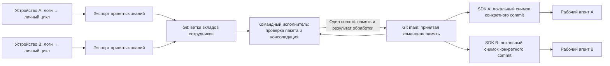

# Командная память на разных устройствах

Документ описывает размещение общей памяти в Git, обмен принятыми знаниями,
командную консолидацию, доступ и доставку памяти рабочим агентам.
Функций и классов в документе нет.

Статус: архитектурное предложение от 29 октября 2026 года. Код, конфигурация
и утверждённый порядок принятия памяти этим документом не изменяются.
Описанные ниже новые параметры и компоненты пока не реализованы.
Уточнение от 30 октября 2026 года о допустимых вариантах знаний описано
в разделе 10.1 и также относится к архитектуре, без изменения кода.

## 1. Задача и границы

Сотрудники работают на разных устройствах. SDK анализирует доступную каждому
сотруднику историю, обновляет личную память и передаёт разрешённые принятые
знания в репозиторий команды на GitHub или Bitbucket.
Рабочие агенты получают опубликованную командную память из того же репозитория.

Предлагаемая начальная граница: один приватный репозиторий обслуживает одну
командную область знаний. Если двум группам нужны разные права чтения,
используются разные репозитории. Каталог внутри общего репозитория сам по себе
не является границей доступа.

Репозиторий хранит документы и версии. Для вызова LLM и объединения вкладов
нужен исполнитель. Предлагается один командный исполнитель: тот же пакет SDK,
запускаемый вручную на выделенном устройстве либо в CI команды. Постоянный
сервер нашего продукта для этого варианта не требуется.

Автоматическая работа требует однократной настройки командного исполнителя,
его моделей, credentials и запуска. Одних URL и credentials на устройствах
сотрудников достаточно для обмена пакетами и чтения памяти, но недостаточно
для автоматической общей консолидации без исполнителя.

## 2. Что есть сейчас

- `memory_pipeline.py` принимает для команды только `team.root` и передаёт
  консолидатору локальные пути принятых личных запусков.
- `read_accepted_knowledge()` проверяет статус, основание принятия и хеши
  снимка, затем выбирает знания согласно личному layout.
- `consolidate_team_memory()` объединяет знания в локальной копии одним
  LLM-консолидатором. Отдельного командного LLM-review нет.
- `memory_lock()` блокирует писателей на одном устройстве.
- `MemoryStore` уже отделяет снимок памяти от его хранения, но командный
  консолидатор пока привязан к файловой публикации.
- `sync_team_memory()` копирует локальную общую память в `team_knowledge/`
  и ограничен каталогами текущего проекта. Основной `run_pipeline()` эту
  функцию не вызывает; удалённой доставки через неё пока нет.

Поэтому удалённый backend хранения решает только часть задачи. Также нужны
переносимый вход консолидации и подключение опубликованной памяти агентам.

## 3. Предлагаемый процесс



1. SDK получает опубликованную память и фиксирует её commit для новой задачи.
2. Личный цикл анализирует логи и принимает личный результат по существующим
   правилам review и необязательного replay.
3. Из принятого результата формируется отдельный пакет командных знаний.
4. SDK сохраняет пакет в локальной очереди отправки и публикует его в
   отдельной ветке `contributions/<contribution_id>`.
5. Исполнитель читает ещё не обработанные пакеты и текущую версию `main`.
   Событие push может ускорить запуск, но при каждом запуске исполнитель
   сверяет ветки и результаты обработки: пропущенное событие не теряет вклад.
6. Исполнитель проверяет пакет и объединяет его знания с командной памятью.
   Для первой версии пакеты обрабатываются последовательно.
7. При принятии он одним commit сохраняет новую память и результат обработки
   пакета. При смысловом противоречии память сохраняется прежней, а результат
   обработки явно сообщает `needs_resolution`.
8. SDK сотрудников получают новую версию перед следующей задачей или по
   явной синхронизации. Уже работающий агент продолжает свой снимок.

Передача пакета и принятие знаний командой — разные события. Успешный push
не должен отображаться как успешная публикация командной памяти.

## 4. Данные в репозитории

Предлагаемое содержимое опубликованной ветки `main`:

```text
knowledge/
  INDEX.md
  wiki/
  cases/
  skills/
receipts/
  <contribution_id>.json
```

`receipts` содержит технические результаты обработки: идентификатор и хеш
пакета, исходный commit командной памяти, исход `applied`, `unchanged` или
`needs_resolution`, а также краткое пояснение. Запись результата и изменение
знаний входят в один commit. Его SHA берётся из Git после записи; собственный
SHA не записывается внутрь этого же commit.

Ветка вклада создаётся от известной версии `main` и добавляет только:

```text
contributions/<contribution_id>/
  manifest.json
  knowledge/
    ...разрешённые принятые документы сотрудника...
```

Исполнитель читает этот пакет по конкретному SHA. Он не сливает ветку вклада
целиком в `main`, а формирует новый commit только из разрешённого результата.
Наличие файла в ветке сотрудника не делает его действующей памятью.

Пакет включает версию формата, область команды, стабильный идентификатор
вклада, идентификатор автора и принятого личного запуска, статус принятия,
основание review/replay, относительные пути и хеши экспортированных файлов,
а также commit командной памяти, использованный личным агентом, если он был.
Идентификатор и содержимое сформированного пакета сохраняются для повторной
отправки. При изменении содержимого создаётся новый пакет.

В первой версии передаётся разрешённый снимок принятых личных знаний.
Слияние и исключение повторов остаются задачей консолидатора. Парсинг
Markdown для извлечения отдельных утверждений и новый формат базы фактов
для этого изменения не требуются.

## 5. Граница экспорта и доверия

Экспортируются только явно выбранные принятые знания. Статус принятия личной
памяти не означает разрешение передать все её документы команде.

За пределами пакета остаются исходные логи, аналитические отчёты, личные
`AGENTS.md`, `USER_PREFERENCES.md`, `user_llm_wiki/`, credentials, локальные пути
и внутренние журналы исполнения. Проверка разрешённых путей дополняется
проверкой содержимого перед отправкой: чувствительные данные могут оказаться
и внутри разрешённой wiki. При обнаружении секрета отправка блокируется;
автоматическое удаление всех видов чувствительных данных не гарантируется.

Credentials Git получает транспортный код. Они не передаются LLM и не
сохраняются в URL, prompt, пакетах или диагностике. Исполнитель использует
доверенную установленную версию SDK и свои настройки моделей. Код, hooks,
конфигурация CI и команды из пакета сотрудника не исполняются. Skills
рассматриваются как содержимое памяти, проходящее командную консолидацию.

Manifest и хеши позволяют проверить целостность переданного снимка, но сами
по себе не доказывают истинность знания или фактическое выполнение replay.
Право отправлять вклад проверяется средствами хостинга. Поле `user_id` и
имя автора Git-commit сами по себе не являются проверенной идентичностью.
Граница доверия первой версии — участники с доступом к репозиторию команды.

## 6. Конкурентная запись и повторные запуски

Сотрудники пишут в отдельные ветки вкладов. Каноническую ветку изменяет один
командный исполнитель; ограничение записи в неё настраивается на хостинге.
Локальная блокировка остаётся полезна внутри одного процесса, но не служит
межмашинной блокировкой.

Исполнитель формирует commit с единственным родителем — прочитанным commit
`main` — и отправляет его обычным fast-forward push. Если другой писатель
успел изменить ветку, push отклоняется. Тогда исполнитель читает новую
версию, заново выполняет консолидацию и проверки и делает новую попытку.
Результат, полученный относительно старой памяти, нельзя просто перебазировать
и считать проверенным относительно новой. Число повторов ограничивается;
необработанный вклад остаётся доступен следующему запуску.

Force push не используется. Административное переписывание истории `main`
также запрещается политикой репозитория. Обычная ошибка исправляется новым
commit, сохраняющим историю обработки и актуальные результаты.

`contribution_id` обеспечивает повторяемую доставку, а хеш пакета защищает
от подмены содержимого под тем же идентификатором. При сетевом таймауте SDK
сначала проверяет удалённую ветку, а исполнитель — `receipts` в актуальном
`main`. Уже применённый пакет повторно не консолидируется.

Результат `needs_resolution` сохраняется, чтобы не запускать одну и ту же
неудачную обработку бесконечно. Повторное рассмотрение после уточнения —
явная операция с новым пакетом, связанным с предыдущим. Автоматический
реестр смысловых конфликтов этим транспортом не вводится.

## 7. Чтение командной памяти

SDK получает ветку и материализует только `knowledge/` из выбранного commit
в отдельный локальный каталог версии. Сначала проверяется весь снимок,
затем он подключается к новой задаче агента. Рабочий агент не читает каталог,
который в этот момент изменяется через `git pull`.

В течение одной задачи commit памяти фиксирован. Для SDK-агента передаются
путь и версия снимка. Для нативного агента требуется его способ подключения
контекста или файлов памяти; доставка файлов сама по себе ещё не означает,
что Codex, Claude Code либо другой агент действительно прочитал эти знания.
Личную память и настройки агента при подключении команды не перезаписывают.

При отсутствии сети используется последний полностью полученный снимок с
явно указанным commit и временем синхронизации. Если снимка ещё нет,
командная память отображается как недоступная. Личный цикл может продолжаться,
но успешную публикацию в репозиторий при этом не фиксируют.

При восстановлении связи пакеты из локальной очереди отправляются повторно
с прежними идентификаторами. Отзыв доступа на хостинге останавливает дальнейшую
синхронизацию, но не удаляет уже скачанные копии на устройствах сотрудников.

## 8. Подключение и credentials

Команда один раз создаёт приватный репозиторий, задаёт права на опубликованную
ветку, настраивает исполнителя и разрешённую область экспорта. Каждый сотрудник
настраивает источник своих логов, URL команды и собственный способ доступа.
Общий персональный токен на всех сотрудников не распространяется.

Предлагаемый дополнительный блок конфигурации для HTTPS:

```json
{
  "team": {
    "type": "git",
    "repository": "https://github.com/example/team-memory.git",
    "branch": "main",
    "knowledge_path": "knowledge",
    "cache_dir": "./.team-memory",
    "auth": {
      "type": "https_token",
      "username": "x-access-token",
      "token_env": "TEAM_MEMORY_TOKEN"
    }
  }
}
```

Это проект интерфейса, а не рабочая конфигурация текущей версии:
сейчас `team` допускает только `root`. Сам токен задаётся через окружение;
в JSON хранится только имя переменной. Для Bitbucket Cloud транспорт также
может использовать API token, но параметры username и права выбираются
согласно документации Bitbucket, а не копируются из примера GitHub.

Альтернативный способ доступа — SSH с локальным ssh-agent либо существующий
Git credential helper. При таком варианте SDK делегирует аутентификацию Git
и не читает закрытый ключ. Для корпоративного размещения проверяется доверие
к серверу; отключение проверки TLS или SSH host key не является способом
подключения.

Читателю достаточно чтения репозитория. Отправителю нужны чтение и запись
веток вкладов; исполнителю — дополнительно разрешённая запись в `main`.
Административные права SDK для обычной работы не нужны. Разделение веток
обеспечивается правилами хостинга, а не одним полем роли в JSON.

Базовые операции реализуются общим Git-транспортом для GitHub и Bitbucket.
Для будущей управляемой интеграции GitHub App позволяет ограничить доступ
репозиториями и использовать короткоживущие токены. Для Bitbucket Cloud
используются актуальные API tokens или подходящие access tokens. Способы
аутентификации Bitbucket Data Center рассматриваются отдельно.

В базовом процессе PR не требуется: он не вводит новый обязательный ручной
review. PR можно добавить как выбранную командой политику хостинга, но тогда
нужны соответствующие API-права, адаптер и согласование порядка принятия.

## 9. Изменения компонентов при реализации

| Компонент | Предлагаемая ответственность |
| --- | --- |
| `memory_pipeline.py` | Сохранить личный цикл; добавить экспорт и отправку после принятия; не требовать локальные пути других сотрудников |
| `team_memory.py` | Отделить проверку локального принятого запуска от консолидации переносимых пакетов; сохранить один командный LLM-сеанс без отдельного review |
| `memory/storage_registry.py` и Git backend | Чтение документов и условная публикация относительно конкретной Git-версии |
| Экспорт и транспорт вкладов | Manifest, разрешённые файлы, стабильный ID, локальная очередь, Git-отправка и повторная доставка |
| Командный исполнитель | Поиск вкладов, проверка, последовательная консолидация, запись памяти и `receipts` одним commit |
| Доставка рабочему агенту | Получение конкретного commit, проверка локального снимка и подключение его на время задачи |

Текущий `MemoryStore.snapshot()` возвращает только документы. Для Git также
нужно удерживать commit, на котором построен результат. При реализации
следует выбрать минимальный явный контракт версии для командного backend;
нельзя незаметно подменять исходный commit при каждом вызове `snapshot()`.
Добавление одного `GitMemoryStore` без изменения входа консолидатора и
доставки агенту не завершит задачу.

Новые модули разделяются по этим обязанностям при реализации, без заранее
созданных пустых абстракций. Источники истории и исполнители моделей остаются
независимыми от Git-провайдера.

## 10. Совместимость с утверждённой архитектурой

Командный вход по-прежнему состоит из принятых личных знаний. Review и replay
личного цикла сохраняются. Командный консолидатор остаётся одним этапом.
Неразрешённое смысловое противоречие сохраняет действующую память прежней.

`receipts` учитывает доставку и обработку пакетов, а не независимые
подтверждения утверждений. Повторная отправка, повторный анализ и replay не
должны считаться новым подтверждением. Подключённая командная память также
не становится независимым личным источником только потому, что другой агент
повторил её в своём ответе; использованный commit сохраняется как контекст
происхождения, а не как дополнительное подтверждение.

Полный смысловой реестр, `pending`, `conflicts`, голосование и новые пороги
допуска не входят в первую реализацию. Удаления в личном снимке не означают
автоматический отзыв опубликованного знания команды. Для первой версии отзыв
выполняется явным исправлением общей памяти с проверкой и новым commit.

## 10.1. Допустимые варианты определений и способов решения

Уточнение пользователя от 30 октября 2026 года: общая память должна сохранять
разные корректные подходы команд и участников вместе с постановкой задачи
и кейсом применения. Различие методов, формул или таблиц не означает ошибку.
Несколько подходов могут быть допустимыми и для одной общей цели.

Консолидатор различает три ситуации:

| Сопоставление | Действие |
| --- | --- |
| Разные определения или методы с достаточными основаниями для своего применения | Сохранить связанные варианты в действующей памяти |
| Контекст не позволяет установить применимость нового вывода | Сохранить неизвестные условия; при недостаточных основаниях оставить кандидат в `pending` |
| Несовместимые утверждения об одном определении или варианте при одинаковых условиях | Рассматривать как смысловое противоречие по правилам выбранного этапа реализации |

Для варианта сохраняются постановка и цель задачи, определение метрики или
шаги решения, использованные источники данных и известные условия, кейсы,
происхождение и статус проверки. Состав необходимых условий зависит от
самой задачи. Для метрики это могут быть числитель и знаменатель, единица
наблюдения, фильтры, период и версия определения; для выгрузки — состав
данных, детализация, таблицы и условия соединения. Отсутствующие сведения
не дополняются предположениями консолидатора.

Совпадение названий метрик не является основанием объединить их определения.
При объединении знаний консолидатор сохраняет значимые различия и ссылки
на исходные кейсы. Команда или автор обозначают происхождение подхода;
выбор для новой задачи определяется её условиями и доступными пользователю
знаниями. Права доступа к репозиториям действуют независимо от этого выбора.

Рабочий агент сначала сопоставляет постановку с условиями вариантов. При
однозначном определении использует соответствующий подход и сообщает,
на какой кейс или правило опирается. Если существенные условия не заданы,
показывает доступные варианты с различиями и кейсами, затем уточняет выбор
или недостающие условия до выполнения расчёта. Нельзя молча выбирать метод
по числу упоминаний, смешивать разные определения или выдавать использованный
в одном кейсе подход за обязательное правило всей команды.

В существующей структуре wiki описывает определения и различия, Cases хранят
постановку и фактический опыт применения, Skills — воспроизводимые процедуры
с условиями выбора. Отдельный обязательный каталог `variants/` или четвёртое
состояние знания не вводятся: вариант может быть принят, ожидать оснований
или содержать спорное утверждение независимо от наличия других вариантов.

Это уточнение меняет критерий распознавания противоречия и содержание памяти,
но не отменяет отложенный статус полного реестра. Временный командный режим
должен сохранять допустимые варианты; выявленное настоящее противоречие
по-прежнему отклоняет обновление. Выборочное снятие спорного утверждения
появится вместе с целевым реестром.

## 11. Порядок реализации и проверка результата

1. Определить переносимый пакет и экспорт из текущего принятого запуска.
2. Добавить Git-транспорт, способы аутентификации и повторяемую отправку.
3. Подключить пакет к существующей командной консолидации и публиковать
   память с результатом обработки относительно исходного commit.
4. Добавить загрузку снимка и явное подключение к рабочему агенту.
5. Настроить один командный исполнитель и выполнить сценарий двух устройств.

Для проверки нужны два изолированных каталога с разными личными историями
и общий тестовый remote. Большинство сбоев можно проверить на локальном Git
remote; аутентификацию и ограничения веток нужно отдельно проверить на
выбранном хостинге.

Критерии готовности: вклад A доступен агенту B после принятия; одинаковая
повторная отправка не вызывает повторного объединения; сбой после успешного
push восстанавливается по удалённому состоянию; устаревшая публикация
отклоняется и пересчитывается; отклонённое объединение не меняет знания;
командный исполнитель восстанавливается без зависимости от пропущенных
событий; отсутствие сети сохраняет рабочий снимок; личные файлы и секреты
не попадают в пакет; агент использует один commit в пределах задачи.

Дополнительные сценарии для вариантов: две формулы под одинаковым названием
сохраняются с разными определениями и кейсами; разные методы для общей цели
не объявляются конфликтом только из-за различий; неоднозначный запрос получает
объяснение вариантов и уточнение; явно заданная постановка выбирает подходящий
вариант; настоящие несовместимые утверждения внутри одного определения
распознаются отдельно; недостающие условия применения не выдумываются.

## Источники по Git и аутентификации

- [Git: правила push и fast-forward](https://git-scm.com/docs/git-push).
- [GitHub: выбор GitHub App](https://docs.github.com/en/apps/creating-github-apps/about-creating-github-apps/deciding-when-to-build-a-github-app).
- [GitHub App: разрешения для Git](https://docs.github.com/en/apps/creating-github-apps/registering-a-github-app/choosing-permissions-for-a-github-app).
- [Bitbucket Cloud: применение API tokens](https://support.atlassian.com/bitbucket-cloud/docs/using-api-tokens/).
- [Bitbucket Cloud: repository access tokens](https://support.atlassian.com/bitbucket-cloud/docs/using-access-tokens/).

Это источники возможностей транспорта и аутентификации. Схема пакетов,
единственный командный исполнитель и правила доставки выше являются
предложением для нашего проекта.
