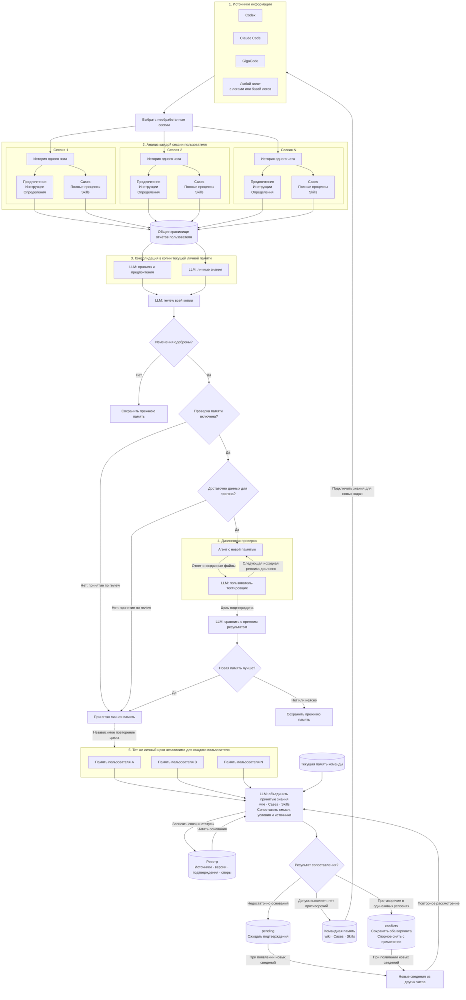
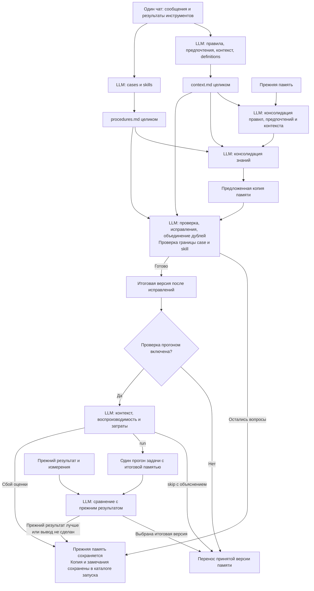

> Здесь сохранены исходные требования и заметки о развитии проекта. Актуальные имена модулей, команда запуска и схема работы находятся в [README](../README.md).

# Память пользователя и команды

## Целевая архитектура — утверждена 26 октября 2026 года

Пользователь утвердил конференционную схему «От диалогов агентов к памяти
команды» как целевую архитектуру проекта. Зафиксирована версия с упрощёнными
подписями и блоком «Агент с новой памятью».

Этот раздел имеет приоритет при определении целевого процесса над прежними
схемами и планами ниже, а также над предыдущими архитектурными предложениями.
Фиксация цели не означает, что все её механизмы уже реализованы, и сама по себе
не изменяет действующий код, CLI, навыки или опубликованную память.

- [Утверждённая оформленная схема](../../../docs/conference-memory-flow.html).
- [Mermaid-исходник](../../../docs/conference-memory-flow.mmd).
- [Пояснения к схеме](../../../docs/conference-memory-flow.md).
- [Состояние реализации на 26 октября](../../../docs/project-state-2026-10-26.md).

### 1. Источники информации

Целевые источники: Codex, Claude Code, GigaCode и любой другой агент,
предоставляющий логи или базу логов. История одной сессии одного пользователя
содержит сообщения пользователя, ответы агента, вызовы инструментов и результаты.

Система отбирает все ещё не обработанные сессии пользователя. Анализ каждой
сессии остаётся отдельным: истории разных чатов и пользователей не смешиваются
до формирования аналитических результатов.

### 2. Анализ сессий и общее хранилище отчётов пользователя

Для каждой сессии выполняются два независимых анализа одной истории:

- Контекст: предпочтения, инструкции и определения пользователя.
- Решения: Cases и полные процессы Skills.

Результаты всех обработанных сессий одного пользователя сохраняются в общее
хранилище его аналитических отчётов. Имена `context.md` и `procedures.md`
остаются техническим представлением двух видов отчётов; на конференционной
схеме они скрыты для читаемости. Тексты передаются консолидаторам целиком,
без разбора Markdown-разделов кодом.

### 3. Консолидация и review личной памяти

На основе накопленных отчётов и текущей личной памяти в рабочей копии
формируются два результата:

| Направление | Вход | Область изменения |
| --- | --- | --- |
| Правила и предпочтения | Отчёты контекста | `AGENTS.md`, `USER_PREFERENCES.md`, `user_llm_wiki/` |
| Личные знания | Оба вида отчётов | `knowledge/wiki/`, `knowledge/cases/`, `knowledge/skills/`, `knowledge/INDEX.md` |

Оба блока расположены на схеме на одном уровне. Это разделение ответственности,
а не требование параллельного исполнения. Оригинал памяти до принятия не меняется.

Вся предложенная копия передаётся LLM-review, который проверяет пересечения,
дубли и противоречия. Одобренная версия поступает на этап проверки памяти.
При отклонении сохраняется прежняя память; автоматический возврат к
консолидаторам этой схемой не вводится.

### 4. Проверка и принятие личной памяти

Порядок переходов:

1. Если проверка выключена, версия принимается по одобренному review.
2. Если проверка включена, проверяется наличие данных для прогона.
3. Если данных недостаточно, версия принимается по review; отсутствие прогона
   фиксируется явно и не обозначается успешной проверкой решением задачи.
4. Если данных достаточно, выполняется диалоговая проверка предложенной памяти.

В целевой схеме нет `force-replay` и выбора между одношаговым и диалоговым
режимами. Это описание целевого процесса, а не команда удалить существующие
параметры запуска.

В диалоговой проверке участвуют два отдельных агента на одном уровне:

- **Агент с новой памятью** получает запрос, исходные файлы и предложенную память.
- **LLM: пользователь-тестировщик** знает цель и эталон, получает ответы и
  созданные файлы, выбирает следующую исходную пользовательскую реплику
  либо подтверждает достижение цели.

Первая исходная реплика передаётся дословно. Последующие исходные реплики
выбираются по номеру и передаются кодом дословно; контекст решающего агента
сохраняется между ходами. Эталон не передаётся агенту с новой памятью.
Цикл успешной проверки заканчивается подтверждением цели тестировщиком;
ошибка или незавершённый диалог не считаются успешным результатом.

После подтверждения цели отдельная LLM сравнивает новый результат с прежним:
качество, завершённость, шаги, токены и время. Если предложенная память лучше,
она принимается и сохраняется. Если прежний результат лучше или вывод неясен,
сохраняется прежняя память. У принятой версии хранится статус проверки:
прогон выполнен либо принятие основано только на review.

### 5. Независимые личные циклы нескольких пользователей

Весь личный цикл повторяется независимо для каждого пользователя. Карточки
пользователей A…N на схеме обозначают несколько личных памятей, каждая из
которых прошла свой процесс анализа, консолидации и принятия. Они не означают
копирование личной памяти одного пользователя другим.

В командный контур поступают принятые wiki, Cases и Skills вместе с
происхождением и статусом проверки. Личные `AGENTS.md` и
`USER_PREFERENCES.md` остаются у владельца; вся личная wiki не становится
автоматически общей памятью.

### 6. Командная память, реестр и замкнутый цикл

Командная консолидация получает принятые личные знания пользователей и
сопоставляет их с текущей командной памятью. Входом целевого командного
процесса являются принятые знания, а не исходные аналитические отчёты.

Вместо отдельного блока командного review применяется механизм сопоставления
и работы с реестром. Реестр хранит источники, версии, подтверждения,
противоречия и решения: накопленные основания читаются перед сопоставлением,
новые связи и статусы записываются по его результату.

| Результат сопоставления | Действие |
| --- | --- |
| Оснований недостаточно | Сохранить кандидат в `pending` и ожидать новых сведений |
| Условия допуска выполнены, неразрешённых противоречий нет | Включить знание в действующую командную память |
| Несколько допустимых определений или способов решения | Сохранить варианты в действующей памяти с их постановками задач, условиями и кейсами |
| Несовместимые утверждения об одном определении или варианте в одинаковых условиях | Сохранить оба утверждения в `conflicts`, снять спорное с применения |

Уточнение пользователя от 30 октября 2026 года: разные команды и участники
могут использовать разные определения метрики, источники данных и способы
решения. Различие формул, таблиц или методов само по себе не является
противоречием, в том числе при общей цели задачи. Одно название метрики
не доказывает, что речь идёт об одном определении.

Для каждого варианта сохраняются исходная постановка, определение или
процедура, использованные данные, известные условия применения и ссылки
на кейсы с происхождением и статусом проверки. При выполненных условиях
допуска несколько вариантов могут одновременно находиться в действующей
памяти. Автор или команда указывают происхождение; их принадлежность сама
по себе не запрещает другому участнику использовать этот подход.

Рабочий агент сопоставляет запрос с условиями доступных вариантов. Если
постановка однозначно задаёт определение, использует соответствующий вариант
и указывает основание выбора. При неоднозначности показывает варианты,
различия и кейсы и уточняет существенные условия до расчёта. Не объединяет
разные определения в одну формулу и не объявляет один метод ошибочным
только из-за наличия другого. Неизвестные условия остаются неизвестными.

Вариант решения и статус знания — разные характеристики. Для этого
уточнения не вводится отдельный статус или обязательное хранилище вариантов;
сохраняются wiki, Cases, Skills и состояния принятия, `pending`, `conflicts`.

Повторная обработка одного чата и replay не создают независимого подтверждения.
Новые сведения из других чатов запускают повторное рассмотрение кандидата
или спора. Числовой порог допуска в этой схеме не устанавливается; новая
запись не разрешает противоречие автоматически по числу упоминаний.

Действующая командная память содержит wiki, Cases и Skills. `pending` и
`conflicts` не подключаются как действующая память агента. Принятые общие
знания возвращаются Codex, Claude Code, GigaCode и другим подключённым агентам
для новых задач. Их новые логи снова становятся источниками анализа:
этим замыкается общий цикл. Наличие обратной связи не утверждает, что уже
реализован фоновый автоматический запуск всех этапов.

### Утверждённая схема

Оформленный HTML задаёт визуальную компоновку: вертикальные слои, повторяющиеся
карточки сессий, два консолидатора и два участника проверочного диалога на
одном уровне, внешняя обратная связь к агентам. Mermaid ниже фиксирует узлы
и направления связей. Упрощение подписей не исключает требования этого раздела.



### Приведение к целевой схеме: согласованные рамки реализации

В следующем поручении пользователь разрешил пока не менять источники блока 1
и отложить весь постоянный учёт источников, подтверждений, `pending` и
`conflicts` блока 6. Временный командный режим объединяет принятые личные знания
без этого механизма. Политика полного реестра выше остаётся целевой.

Повторно используемый код разделён по этапам в `command_agent_memory`:
`analysis/` — новые сессии и отчёты, `memory/` — личный цикл и командное
объединение, `evaluation/` — диалог и сравнение, `pipeline.py` — независимые
циклы нескольких пользователей. Основная команда — `run_memory_pipeline.py`.
Прежние корневые команды анализа и консолидации служат точками входа.

В основном пути проверка данных выполняется локально; доступные материалы
запускают диалог. Нехватка данных записывается как `skipped` с принятием по
review. Параметров `force-replay` и выбора `replay-backend` в основном CLI нет.
Существующие отдельные экспериментальные команды не являются его этапами.

Командный вход — принятые личные запуски со статусом `published`/`unchanged`,
владельцем, основанием принятия и хешами снимка `after/`. Экспортируется только
`knowledge/`. Один LLM-консолидатор объединяет знания в копии и сообщает
оставшиеся проблемы; отдельного командного review нет. Неразрешённое
противоречие пока отклоняет всё предлагаемое командное обновление, сохраняя
прежнюю версию. Частичное снятие спорных утверждений требует будущего реестра.

После принятия общий снимок подключается к перечисленным рабочим областям
как `team_knowledge/`. Это подключение к существующему `agent_runtime`, а не
утверждение о реализованной доставке нативным Codex/Claude Code/GigaCode.
Технические хеши и состояния запусков не считаются реестром подтверждений.

Остаются целевыми: внешние адаптеры и доставка им знаний, полный реестр,
подтверждения, `pending`/`conflicts` и частичный отзыв спорных утверждений.
Критерии допуска, не заданные схемой, не заменяются дополнительным голосованием.

## Историческая фиксация реализации и передачи в другой чат

Дата фиксации: 25 октября 2026 года.

Этот раздел сохраняет состояние и решения на указанную дату. Он не отменяет
утверждённую выше целевую архитектуру. Более позднее состояние реализации
зафиксировано в документе от 26 октября, ссылка на который приведена выше.

### Цель проекта

Система читает логи работы пользователя с агентом и формирует память, которую
можно подключать к Codex, Claude Code и другим агентам. Текущий реализованный
цикл относится к одному пользователю:

```text
чат
  → два независимых анализа
  → предложение личной памяти и знаний
  → LLM-ревью с исправлением копии
  → один проверочный прогон задачи
  → LLM-сравнение нового и прежнего результата
  → публикация принятой памяти
```

Командная память с `pending`, подтверждениями и конфликтами ещё не реализована.

### Текущий путь запуска

Для прямой работы через OpenRouter без Codex CLI используются:

- `analyze_chats_openrouter.py` — анализ диалогов;
- `consolidate_reports_openrouter.py` — консолидация, ревью и replay;
- `run_openrouter_pipeline.py` — весь цикл одной командой;
- `openrouter_client.py` — вызовы OpenRouter;
- `codex_history.py` — чтение локальных историй Codex;
- `codex_replay_adapter.py` — автоматическая подготовка replay-сценария;
- `reviewed_consolidation.py` — копия памяти, ревью, replay и публикация;
- `replay_evaluation.py`, `replay_codex.py` — проверочный прогон и сравнение.

Команда полного цикла для двух текущих диалогов:

```powershell
python -X utf8 run_openrouter_pipeline.py --user-id slav4ik --workspace "data/openrouter-runs/slav4ik" --project jev_test --project offzone --limit-per-project 1 --model "deepseek/deepseek-v4.1-flash-1017"
```

Команду запускает пользователь в терминале. Не запускать её автоматически без
его прямой команды, поскольку полный цикл обращается к платной модели.

### Анализ одного диалога

Для каждого диалога запускаются два независимых анализа:

| Анализатор | Файл | Содержание |
| --- | --- | --- |
| `analyze-context` | `context.md` | предпочтения, инструкции и определения пользователя |
| `analyze-procedures` | `procedures.md` | переносимые Cases и при наличии полный бизнес-процесс как Skill-кандидат |

Формат отчёта не разбирается Python-кодом. Каждый анализ получает полную
сохранённую историю. Для OpenRouter анализ выполняется одним вызовом модели без
инструментов; Python записывает полученный текст в файл отчёта.

### Правила `analyze-context`

Актуальный skill:
`agents/analyze-context/skills/analyze-context/SKILL.md`.

Анализатор извлекает только:

1. предпочтения пользователя;
2. инструкции и ограничения для будущей работы;
3. определения и предметные правила, смысл которых объяснил сам пользователь.

Раздел `Личный и проектный контекст` удалён. Анализатор не должен сохранять
пути, версии, состав файлов, устройство проекта, состояние реализации,
результаты инструментов и пересказ выполненной задачи.

Предпочтения обобщаются до типа задач. Примеры:

- вместо списка `TYPESAFE_API_KEY`, SDK и идентификаторов модели —
  «Пользователь предпочитает использовать OpenRouter для подключения к моделям»;
- вместо правила для `example_2.py` — проверять, что аргументы инструмента
  получены от пользователя, а не придуманы агентом;
- вместо правила для `example_3.py` и DeepSeek — для структурированного ответа
  предпочитать JSON Schema, а не tool call.

Определение добавляется только когда пользователь сам объяснил значение термина,
поля, формулы, статуса или показателя. Объяснение агента, результат инструмента,
код, название поля и простое согласие с готовым результатом не создают
пользовательское определение.

Few-shot примеры из реальных сообщений находятся в
`agents/analyze-context/skills/analyze-context/references/worked-examples.md`.
Старые `classification.md`, `edge-cases.md` и `evals/scenarios.md` удалены,
поскольку учили модель сохранять проектный контекст.

### Размещение правил и предпочтений

`AGENTS.md` содержит только правила, применимые вне конкретного проекта:
например, требования к качеству кода, согласованию изменений и проверке
результата. В нём не должно быть сведений, ограниченных одним проектом,
задачей, артефактом или запуском.

`USER_PREFERENCES.md` содержит только предпочтения пользователя, применимые в
разных проектах. Условие одного поручения не становится предпочтением без
прямого распространения пользователем на другие задачи.

Контекст отдельного проекта допустим только в `user_llm_wiki/`, когда он нужен
для продолжения работы; разовые условия задания не сохраняются. Это правило
проверяется и консолидатором, и ревьюером.

### Правила Cases и Skills

Актуальный skill:
`agents/analyze-procedures/skills/analyze-procedures/SKILL.md`.

Case — переносимое решение отдельной проблемы. Для него нужны ситуация,
причина, решение, проверка и границы. Из диалогов `jev_test` и `offzone`
подходящими признаны пять Cases:

1. Пользовательский `config.py` — источник истины для секретов.
2. Проверка достаточности аргументов через Jev.
3. `ModuleNotFoundError` в PyCharm — неверный интерпретатор.
4. Laya на русских задачах: multilingual, латинские ключи и HF token.
5. Чтение русского UTF-8 файла в Windows PowerShell без потери формулировок.

Остальные Cases прошлого запуска признаны слишком частными для переноса между
проектами. Выполненный шаг сам по себе не является Case.

Skill — решение большого повторяемого бизнес-процесса, а не отдельной задачи.
Он требует бизнес-цели, входов и ролей, подготовки, нескольких содержательных
этапов, развилок и возвратов, контроля качества, конечного результата и критерия
завершения. Маленькая законченная подзадача остаётся Case.

Один диалог обычно даёт несколько Cases и ноль или один Skill. Нельзя создавать
Skill из настройки API, одной проверки tool call, одной ошибки окружения,
одного файла, SQL-запроса, модельного бенчмарка или искусственного объединения
нескольких независимых Cases.

Эти правила продублированы на границах публикации:

- `agents/consolidate-knowledge/skills/consolidate-knowledge/SKILL.md`;
- `agents/consolidate-knowledge/skills/consolidate-knowledge/references/skill-authoring.md`;
- `agents/review-memory/skills/review-memory/SKILL.md`.

Это нужно, чтобы микро-процедура не стала Skill даже при ошибке анализатора.

### Реальный запуск 24 октября 2026 года

Последний полный запуск анализа успешно обработал два диалога:

- `jev_test`: `01a0e6bb-fe18-7b11-91c3-6e390b6aba33`;
- `offzone`: `019f9a15-dce6-7152-adcc-e3c78dc48e2f`.

Оба manifest имеют состояние `completed`, для каждого созданы `context.md` и
`procedures.md`. Затем выполнены личная консолидация и консолидация знаний.

Каталог запуска:

```text
data/consolidation-runs/20261024T220602876403-2daed0536e92/personal/
```

Консолидаторы подготовили в копии:

- `AGENTS.md`;
- `USER_PREFERENCES.md`;
- три страницы `user_llm_wiki`;
- две статьи `knowledge/wiki`;
- 12 Cases;
- четыре микро-Skills.

Четыре Skills и семь лишних Cases получены до последнего уточнения критериев.
Они находятся только в снимке неудачного запуска и не должны считаться
актуальным ожидаемым результатом.

Ревьюер фактически исправил предложение и вернул решение:

```json
{
  "decision": "accepted",
  "findings": []
}
```

Он удалил дубль wiki, убрал выведенное из языка чата предпочтение русского
языка, убрал домыслы о мотивах пользователя, обобщил часть правил и исправил
ссылки. Исправленная копия осталась в:

```text
data/consolidation-runs/20261024T220602876403-2daed0536e92/personal/workspace/memory/
```

Память не опубликована. Действующая область
`data/openrouter-runs/slav4ik/` содержит только `raw/`.

### Ошибка, остановившая цикл

Ревьюер вернул перед JSON пояснение и Markdown-блок:

````text
Verification complete...

```json
{ "decision": "accepted", ... }
```
````

`review_memory` вызывает `json.loads(reply)` для всего ответа, поэтому получил:

```text
Expecting value: line 1 column 1 (char 0)
```

Из-за ошибки протокола:

- статус запуска — `failed`;
- replay не запускался;
- исправленная память не опубликована.

Следующее обязательное изменение — сделать ответ ревьюера структурированным на
границе вызова модели либо надёжно получать JSON-объект без зависимости от
Markdown-обрамления. Проверки содержания остаются ответственностью LLM; не
добавлять разбор содержимого отчётов по заголовкам или жёсткие проверки памяти.

### Replay-сценарий

`codex_replay_adapter.py` автоматически собрал сценарий из диалога `offzone`:

```text
data/openrouter-runs/slav4ik/raw/replay-scenario/scenario.json
```

Запрос: подготовить дизайн и текст стенгазеты для переноса на бумагу.
Вход: `CONTEXT_STENGAZETA_Z-134.md`.
Прежний результат: ответ и файлы `STENGAZETA_Z-134_LAYOUT.png`,
`STENGAZETA_Z-134_LAYOUT.svg`, `STENGAZETA_Z-134_READY_PLAN.md`.

Флаг `--force-replay` требует выполнить один реальный прогон и не разрешает
LLM пропустить его по оценке стоимости. Он уже подключён в полном pipeline,
но в последнем запуске выполнение не дошло до replay из-за ошибки ревью.

### Расход последнего запуска

Приблизительный суммарный расход составил 11 969 554 токена:

| Этап | Токены |
| --- | ---: |
| Анализ двух диалогов | 1 214 213 |
| Личная консолидация | 552 738 |
| Консолидация знаний | 2 957 071 |
| Ревью | 7 245 532 |

В `openrouter_client.py` нет ограничения в восемь модельных вызовов;
`recursion_limit` установлен в 1000 по последнему решению пользователя.
Трасса каждого шага записывается в JSONL по мере выполнения. Большой расход
вызван многократным перечитыванием накопленной истории DeepAgent, особенно
ревьюером. Оптимизация числа вызовов остаётся отдельной задачей после
восстановления корректного полного цикла.

### Что делать в следующем чате

1. Исправить протокол ответа ревьюера: принятое решение из
   `reviews/review-001.last.txt` должно разбираться без ошибки.
2. Не публиковать старый снимок: он создан прежними версиями skills и содержит
   лишние Cases и четыре микро-Skills.
3. Повторно запустить анализ двух диалогов с обновлёнными `analyze-context` и
   `analyze-procedures`.
4. Проверить ожидаемый результат: три категории контекста, пять переносимых
   Cases, вероятнее всего ни одного Skill.
5. Выполнить консолидацию, ревью, обязательный replay и публикацию.
6. После успешного личного цикла перейти к командной памяти: `pending`,
   подтверждения из разных диалогов, конфликты и действующий общий каталог.

Проверка структуры последних изменённых skills выполнена через
`skill-creator/scripts/quick_validate.py`; все skills признаны валидными.

---

Дата: 24 октября 2026 года. Шаги 1–2 реализованы: два анализа без разбора
Markdown и одно исправляющее ревью с итоговым снимком. Проверка шага 3 проведена
на копиях памяти Анны и Бориса; остались ошибки содержания и отдельные повторы.
[Результаты](../../../data/refactor-steps-1-3/20261024T060531Z/report.md).
Прогон задачи и отложенные задачи ещё не выполнялись.

## Ближайшие изменения

### Два анализа одного чата

Каждый анализатор получает полную историю одного чата: сообщения пользователя,
ответы агента, вызовы инструментов и их результаты. Содержимое прочитанных
файлов доступно в той мере, в какой оно сохранено в истории. Каждый проход
запускается в новом контексте со своим skill.

| Проход | Ответственность | Результат |
| --- | --- | --- |
| Анализ контекста | Правила работы, предпочтения пользователя, user_context и definitions с условиями применения | `context.md` |
| Анализ решений | Cases и skills: выполненные действия, ошибки, результаты и процедуры решения задач | `procedures.md` |

В первом проходе сохраняется различие между правилами работы и предпочтениями.
Во втором case может быть частью решения, а skill требует процедуры с условием
применения, входами, действиями, проверками и результатом. Отсутствующие действия
и результаты не достраиваются. Каждый анализатор описывает только свою задачу.

Названия разделов и оформление отчётов могут меняться. Python не извлекает
содержимое по заголовкам, не проверяет перечень разделов и не требует заданной
фразы при отсутствии сведений. Содержание, полноту, формат и смысл оценивает LLM.
Разделение ответственности может улучшить качество; это проверяется на чатах.

### Передача файлов без разбора Markdown

| Получатель | Вход |
| --- | --- |
| Консолидатор правил, предпочтений и контекста | Полный `context.md` и существующая память его области |
| Консолидатор знаний | Полные `context.md` и `procedures.md`, существующие знания |
| Ревьюер | Оба полных отчёта, прежняя память, предложенная копия, правила размещения и reference по составлению skills |

Наличие definitions в первом файле не требует делить его кодом. Каждый
консолидатор отбирает сведения по своей ответственности. Первый использует
правила, предпочтения и контекст; второй — определения, cases и skills.
Пересечения между отчётами объединяются по смыслу.

Сборщик получает пути файлов из параметров и служебных сведений этапов.
Тип отчёта не определяется по его тексту. Идентификаторы чата, модель, время
и пути результатов хранятся отдельно от содержания отчётов.

Из `memory_pipeline.py` удаляются `split_report` и `SECTIONS`, из анализатора
и консолидации — их вызовы. Выгрузка истории остаётся. Парсер не заменяется
регулярными выражениями или другой проверкой заголовков. Старые отчёты
сохраняются; при использовании их текст передаётся LLM целиком.

### Ревью с правом исправления

Ревьюер получает всю предложенную личную память и может изменять её копию.
Его ответственность:

- Сопоставить сведения с отчётами и прежней памятью, сохранить условия применения.
- Объединить смысловые дубли внутри файлов и между ними, обновить индексы и ссылки.
- Разделить правила работы и предпочтения пользователя, сохранить один смысл в одном месте.
- Проверить, что skill является процедурой, а не описанием отдельного запуска.
- Дополнить неполный skill только по материалам. Если процедуры нет, перенести
  полезное содержание в case и убрать лишний skill.
- Сохранить разные версии и условия. Неразрешённое противоречие не заменять
  произвольным выбором одного варианта.
- Применять каждый набор правил к его области. Пути пользователя допустимы
  в личной wiki; ограничения каталога знаний не распространяются на неё автоматически.

| Файл или каталог | Содержание |
| --- | --- |
| `AGENTS.md` | Правила выполнения и проверки работы |
| `USER_PREFERENCES.md` | Выбор пользователя в подаче результата и инструментах |
| `user_llm_wiki/` | Пользователь, проекты, окружение, файлы и пути |
| `knowledge/wiki/` | Определения и правила предметной области |
| `knowledge/cases/` | Случаи решения задач и их части |
| `knowledge/skills/` | Процедуры решения задач |
| `knowledge/INDEX.md` | Навигация по знаниям |

Если прежняя личная wiki содержит определения или процедуры, ревьюер сопоставляет
их с новым knowledge, переносит содержание без потери сведений и обновляет ссылки.
Общие термины и краткое пояснение при применении сами по себе не являются дублем.

После исправлений ревьюер перечитывает копию и сообщает: она готова либо остались
вопросы, требующие разрешения. Изменения и вопросы сохраняются. При недостатке
данных факты не выдумываются. Действующая память и исходные отчёты сохраняются.

Сейчас планируется один проход ревью с исправлениями: чтение, редактирование
и повторное чтение файлов внутри одного сеанса модели. Автоматический возврат
к консолидатору и цикл повторных ревью остаются будущим расширением.

### Итоговая версия и прогон

До ревью сохраняется предложение консолидаторов. После правок ревьюера снимается
итоговая версия; её использует проверочный прогон и перенос. Проверка неизменности
снимка не должна запрещать редактировать копию, которую ревьюер обязан исправлять.

Если копия готова и включён `--evaluate-by-replay`, LLM сначала оценивает наличие
контекста, воспроизводимость условий и стоимость по исходной истории и измерениям.
Оценка не выполняет задачу и дорогие запросы. При run агент один раз решает задачу
с исправленной памятью. Оценщик сравнивает результат с прежним выполнением.
Прежние ответы и итоговые файлы получает оценщик. При skip принятие основывается
на ревью; причина и отсутствие выполнения сохраняются отдельно.
Если копия не готова, прогон и перенос не выполняются.

При выборе предложенной версии переносится та версия, которая участвовала
в прогоне. Без флага перенос разрешает итог ревью. Изменения после проверки
не включаются в перенос без рассмотрения.

Python выполняет запуск, чтение и запись файлов, создание копий, блокировку
и перенос выбранной версии. Проверки содержания, классификации, дублей,
противоречий, ссылок и качества skills выполняют LLM. Формат Markdown-отчёта
не становится условием продолжения программы.

### Файлы результатов и обозначение R

Предлагаемая структура отчётов одного чата:

```text
W/raw/chat-reports-codex/session-ID/
  context.md
  procedures.md
  manifest.json
```

W — область пользователя. manifest хранит сведения запуска и пути результатов;
текст отчётов остаётся свободным от служебной шапки.

R — каталог результатов одного этапа консолидации, например:

```text
C:/Users/Slav4ik/PycharmProjects/comand_agent_memory/data/consolidation-runs/ID-запуска/personal/
```

«Предложение и замечания остаются в R» означает, что созданные файлы и выводы
ревью сохранены в этом каталоге. Их можно открыть после отказа. Наличие файлов
в R не означает их применение к памяти пользователя.

Для новой версии предусматриваются:

```text
R/before/                память до изменений
R/before-review/         предложение консолидаторов
R/workspace/memory/      копия, которую исправляет ревьюер
R/after/                 итог ревью; статус определяет готовность
R/review.md              изменения и оставшиеся вопросы
R/status.json            состояние этапа
R/replay/                результат одного прогона при его выполнении
R/replay-assessment/     решение LLM о возможности и стоимости прогона
R/report/               отчёты этапов, diff и summary.md, обновляемые по ходу работы
```

## Отложенные задачи

### Адаптеры Codex, Claude Code и Phoenix

Предусмотреть импорт историй Codex, Claude Code и базы логов Phoenix.
Адаптер источника преобразует сообщения, вызовы инструментов, результаты
и доступные измерения в историю одного чата. Формат исходной базы или файлов
не должен определять инструкции анализа.

Отделить вызов агента от чтения его логов: исполнитель запускает выбранную
модель и инструменты, адаптер источника читает историю. Phoenix в этом требовании
является источником логов. Его схему и способ подключения определить
при реализации на доступных данных.

Текущее чтение SQLite и вызов Codex переиспользовать. Новый источник не должен
требовать переписывать анализаторы и консолидаторы.

Обновление 28 октября 2026: базовые подключения реализованы в режиме `--config`.
Поддерживаются Claude Code, Codex, GigaAgent, Phoenix, JSONL и SQLite. Источник
истории отделён от настраиваемых файлов памяти внешнего агента. Модельные этапы
имеют отдельные provider/model; пожелания из UTF-8-файла добавляются ко всем
запросам. Проверка наличия данных для прогона остаётся локальной без LLM.
Настройки, ограничения и расширение: `docs/configuring_agents_and_databases.md`.

### Модели для каждого этапа

Предусмотреть независимый выбор исполнителя и модели для:

1. Анализа контекста и определений.
2. Анализа cases и skills.
3. Консолидации правил, предпочтений и контекста.
4. Консолидации знаний.
5. Ревью с исправлениями.
6. Оценки возможности и затрат прогона.
7. Агента проверочного прогона.
8. Оценщика результатов прогона.

Настройки этапа указывают модель, исполнителя и путь к skill. Уровень размышлений
задаётся, если его поддерживает исполнитель. Фактические настройки и измерения
сохраняются в сведениях запуска. Изменение модели не требует изменения skill.
Конкретные модели и механизм конфигурации здесь не назначаются.

### Изоляция skills

У каждого этапа свой каталог с SKILL.md и нужными references. Этап получает свой
skill и явно переданные материалы. Другие установленные skills и пользовательские
настройки исполнителя не должны подключаться неявно. Это требование к будущему
исполнению, а не утверждение о достаточности текущего флага CLI.

В skill описываются входы, ответственность и результат его агента. Устройство
всего проекта, другие агенты и сведения о публикации туда не включаются.
Инструкции не копируются в Python; путь к skill задаётся для этапа.
Правка skill или reference не должна требовать изменения кода запуска.

## Порядок реализации

Решение от 24 октября: два консолидатора сохраняются. Один обновляет правила,
предпочтения и контекст; второй — определения, cases и skills. Объединение
консолидаторов не входит в ближайшие изменения. Состояние шагов указано в начале документа.

### 1. Перевести анализ и консолидацию на два отчёта

- Разделить существующие инструкции анализа на два skills: анализ контекста
  и анализ решений. Переиспользовать reference по составлению skills.
- В `analyze_chats_codex.py` запускать два независимых анализа одной истории,
  сохранять `context.md`, `procedures.md` и служебные сведения запуска.
- В `consolidate_reports_codex.py` передавать файлы целиком: первый — обоим
  консолидаторам, второй — консолидатору знаний.
- Удалить `split_report`, `SECTIONS` и вызовы проверки структуры отчёта.
  В `memory_pipeline.py` сохранить выгрузку истории.
- Удалить заменённый skill анализа после переноса используемых инструкций
  и references. Старые отчёты и исходные диалоги сохранить.

Результат: один чат даёт два отчёта; изменение их заголовков не ломает передачу
сведений консолидаторам. У каждого анализатора собственный контекст и skill.
Проверить передачу текста без разбора Markdown и обновить затронутые тесты запуска.

### 2. Дать ревьюеру исправлять предложенную память

- Уточнить `agents/review-memory/skills/review-memory/SKILL.md`: проверка
  содержания, устранение дублей, различение cases и skills, исправление копии.
- В `reviewed_consolidation.py` предоставить ревьюеру всю предложенную копию
  и разрешить её редактирование в одном сеансе.
- Сохранять версию консолидаторов до ревью, итоговый снимок — после правок.
  Подключить прогон и перенос именно к итоговому снимку.
- Включить перенос определений из прежней личной wiki в knowledge с сохранением
  сведений и ссылок. Личные данные и пути оставлять в личной wiki.
- Сохранять условия вроде «при необходимости». При неразрешённом вопросе
  оставлять действующую память и записывать причину.

Результат: ревьюер может исправить предложение, а прогон получает его исправленную
версию. Механика переноса проверяется тестами: правки в копии разрешены, оригинал
до решения сохраняется, прогон и перенос используют одну итоговую версию.
Автоматического цикла возврата к консолидатору пока нет.

### 3. Проверить содержание на чатах Анны и Бориса

- Использовать существующие диалоги и копии памяти пользователей.
- Получить два анализа каждого выбранного чата и выполнить консолидацию с ревью.
- Поручить LLM проверить сохранность прежних сведений, объединение дублей,
  распределение правил и предпочтений, границы cases и skills.
- Проверить повторную обработку тех же сведений: без новых смыслов не должны
  появляться новые материалы и переписывания ради оформления.

Результат: сохранены отчёты, изменения памяти и выводы LLM о содержании.
На этом шаге проверочный прогон задачи не выполняется.

### 4. Выполнить один сквозной прогон Анны

- На копии области Анны пройти путь от одного исходного чата через два анализа,
  два консолидатора и исправляющее ревью.
- После готового ревью включить существующий `--evaluate-by-replay` со сценарием
  `docs/examples/reconciliation_replay/scenario.json`.
- Выполнить один новый сеанс агента, сохранить ответ, файлы, трассу, время,
  обращения к модели и инструментам и доступные токены.
- Оценщик выбирает предложенную либо прежнюю версию по результатам задачи.
  Перенос в этом тесте выполняется только в экспериментальную копию.

Результат: видны входной чат, два анализа, изменения после консолидации и ревью,
результат задачи и причина выбора памяти. Если до прогона остаётся неразрешённый
вопрос, зафиксировать остановку; не обозначать её как выполненный прогон.

### 5. Закрепить результат в документации и убрать остатки старого пути

- Обновить README, команды для PyCharm, схему файлов и описание личного цикла
  по фактически реализованному поведению.
- Удалить оставшиеся неиспользуемые импорты, инструкции и тесты прежнего парсера;
  не добавлять второй парсер для совместимости.
- Зафиксировать выполненные шаги, результаты проверок и оставшиеся ограничения.

Старые диалоги, память и результаты сравнений не удаляются как неиспользуемый код.

После каждого выполненного шага показать в чате изменённые файлы, добавленные
или изменённые функции с объяснением и схему фактического поведения. Для изменения
только инструкций показать изменённый фрагмент skill. Проверки содержания выполнять
LLM; Python не использовать для жёсткой проверки оформления отчётов.

Адаптеры Codex, Claude Code и Phoenix, выбор моделей по этапам и изоляция исполнения
skills остаются следующим этапом после проверки личного цикла. Технические решения
по этим задачам в ближайшие пять шагов не добавляются.

## Сценарии проверки

| Ситуация | Ожидаемое поведение |
| --- | --- |
| Заголовки отчёта изменились | Полный текст получает LLM; ошибки Python из-за структуры отчёта нет |
| В чате есть сведения всех типов | Получены два анализа, сведения сохранены по назначению |
| В skill нет полной процедуры | Подтверждённое содержание сохранено как case, этапы не выдуманы |
| Есть полная процедура | Сохранён skill с условиями, входами, действиями, проверками и результатом |
| Правило повторяется в AGENTS.md и предпочтениях | Выбрано место по смыслу, записи объединены |
| Определения есть в прежней wiki и новом knowledge | Содержание и ссылки сохранены, самостоятельные дубли объединены |
| В личной wiki есть путь пользователя | Он сохранён как контекст окружения |
| Есть условие «при необходимости» | Оно не превращено в требование для всех задач |
| Есть неразрешённое противоречие | Модель описала вопрос, прежняя память сохранена |
| Ревьюер исправил копию | Прогон и перенос используют исправленную итоговую версию |

Первые сравнения выполняются на существующих чатах Анны и Бориса. Содержание
оценивает LLM: сохранность сведений, смысловые дубли, границы cases и skills,
применимость итоговой памяти.

## Схема ближайшей версии


